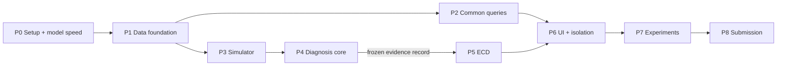

# DriveTrace Build Plan: Requirements, Setup and Execution

**Project:** Tata Elxsi Teliport S4, Case Study 5 - Natural Language Vehicle Information using On-Device SLM/LLM (VehicleGPT)
**Design reference:** `solution_journey (1).md` (sections referenced as §x.y)
**Prepared:** 28 October 2026
**Planning assumption:** about 6 weeks of build time for one to two people. If the deadline is shorter, apply the MVP cut line in Part 3, §3.5.

This document has three parts:

1. **Requirement plan:** what must be built and how each requirement is accepted.
2. **Setup plan:** hardware, toolchain, models, datasets and repository layout.
3. **Execution plan:** phases, tasks, exit criteria, risks and the demo.

---

# Part 1 - Requirement Plan

## 1.1 Scope

**In scope for the prototype**

- Offline, read-only, natural-language assistant over vehicle telemetry, events and logs.
- Real EV battery data (Mendeley), CAN data (Zenodo and/or HCRL), and a labelled synthetic thermal-fault simulator.
- Tier 0 deterministic and Tier 1 grammar-constrained query paths (§8.8).
- Δ-Signature, evidence gate, hypothesis ranking (§8.5-8.7).
- Evidence-Compiled Decoding (ECD), the headline novelty (§8.11).
- Local web UI with evidence references.
- Benchmarks on a 2-core / 2 GB ARM target or a documented proxy.

**Documented, partially implemented (adapter stub plus design)**

- SOME/IP, Android VHAL, QNX logs, camera feeds: one mock adapter each that emits canonical records, plus a written integration design.
- CARLA: driving-context and ADAS-adjacent events only, and only if a GPU machine is available (stretch goal).

**Out of scope**

- Any write or actuation path to the vehicle.
- Cloud services, model fine-tuning on vehicle data, and real-vehicle validation of synthetic fault models.

## 1.2 Stakeholders and personas

| Persona | Typical question | What they must get |
|---|---|---|
| Driver | "Why has my range dropped over the last two weeks?" | A short plain-language answer, no raw codes, no location history |
| Service engineer | "What happened before the battery overheating warning?" | A timeline, Δ-Signature, hypotheses, evidence IDs |
| Fleet operator | "Compare energy consumption city vs highway across trips." | Aggregates, trends, no driver identity |
| Validation team | "Show all ADAS disengagement events from yesterday." | An exact event list, reproducible queries |

## 1.3 Declared common-query set (the "under 2 seconds" set)

The brief requires under 2 seconds for *common* queries. We declare this set explicitly and benchmark it as a class (NFR-01).

| ID | Example query | Intent | Path |
|---|---|---|---|
| Q1 | "Show all ADAS disengagement events from yesterday." | `list_events` | Tier 0 |
| Q2 | "When did fuel/energy efficiency show the largest drop?" | `max_drop` | Tier 0 |
| Q3 | "Why has my driving range reduced over the last two weeks?" (trend part) | `trend` + `compare_periods` | Tier 0/1 |
| Q4 | "Compare energy consumption between city and highway driving." | `compare_groups` | Tier 0 |
| Q5 | "What was the battery temperature at the last warning?" | `point_lookup` | Tier 0 |
| Q6 | "How many overheating warnings this month?" | `count_events` | Tier 0 |
| Q7 | Paraphrases of Q1-Q6 not matched by rules | any of the above | Tier 1 (SLM plan) |
| D1 | "What happened before the battery overheating warning?" | `diagnose_event` | Diagnostic (reported separately) |
| D2 | "Why is the battery running hotter than usual?" | `diagnose_trend` | Diagnostic (reported separately) |

## 1.4 Functional requirements

Priority: **M** = must, **S** = should, **C** = could.

### Ingestion and normalization (FR-ING)

| ID | Requirement | Pri | Acceptance |
|---|---|---|---|
| FR-ING-01 | Ingest Mendeley EV `.mat` drive/charge files into canonical records (§8.3 schema) | M | All files in the chosen subset load; row counts reconcile with the source |
| FR-ING-02 | Ingest CAN logs (candump/CSV) and decode the signals that have a definition (DBC via `cantools`) | M | Decoded values match reference decoding on a sample |
| FR-ING-03 | Replay any source as a live stream at 1x / Nx speed through the same ingestion path | M | Replay of 1 h of data at 10x without dropped records |
| FR-ING-04 | Map every signal to a pinned VSS release path or a documented vendor extension, with unit conversion | M | Mapping file under version control; unmapped signals rejected with a log entry |
| FR-ING-05 | Attach `source_id`, `scenario_id`, `source_type` (recorded/simulated) and `quality` to every record | M | No record without provenance; datasets never share a timeline |
| FR-ING-06 | Mock adapters for SOME/IP, VHAL, QNX log, camera metadata emitting canonical records | S | Each adapter has a unit test and appears in the architecture diagram |
| FR-ING-07 | CARLA event adapter (collision, lane invasion, IMU, ADAS-like events) | C | Events from one recorded CARLA run are queryable |

### Temporal memory (FR-MEM)

| ID | Requirement | Pri | Acceptance |
|---|---|---|---|
| FR-MEM-01 | Bounded in-process hot ring buffer for recent samples | M | Memory stays within its configured bound under 1 h of replay |
| FR-MEM-02 | Time-partitioned Parquet history queried through DuckDB with an explicit `memory_limit` | M | Six weeks of simulated history queryable |
| FR-MEM-03 | Periodic aggregates (min/max/mean/count/quantiles) per signal per window | M | Aggregates match recomputation from raw data |
| FR-MEM-04 | Event capsules: detailed windows before and after warnings or anomalies | M | Capsule exists for every injected fault with configured pre/post duration |
| FR-MEM-05 | Event index (time, subsystem, type, signals, provenance) | M | Q1/Q6 answered from the index without scanning raw data |
| FR-MEM-06 | Retention policy metadata recorded with every partition | S | Each answer can state the resolution of the data it used |
| FR-MEM-07 | Grammar-derived sufficient-statistic retention (§8.11.5) | C | Storage and error-bound report produced in Experiment D |

### Query understanding (FR-QRY)

| ID | Requirement | Pri | Acceptance |
|---|---|---|---|
| FR-QRY-01 | Tier 0 rule/pattern router for Q1-Q6 | M | ≥95% correct routing on the declared phrasings |
| FR-QRY-02 | Tier 1 SLM query planner emitting JSON under a GBNF plan grammar | M | 100% syntactically valid plans; intent accuracy reported |
| FR-QRY-03 | Plan validator: enums, signal allowlist, date bounds, no arbitrary SQL, no actuation intents | M | Negative test suite of malformed and malicious plans: all rejected |
| FR-QRY-04 | Relative-time resolution ("yesterday", "last two weeks") against the vehicle clock | M | Unit tests on date boundaries and time zones |
| FR-QRY-05 | Graceful fallback: unsupported query → say what is supported | M | No crash and no fabricated answer on out-of-scope queries |

### Analytics and diagnosis (FR-ANA / FR-DX)

| ID | Requirement | Pri | Acceptance |
|---|---|---|---|
| FR-ANA-01 | Deterministic trend, max-drop, period/group comparison, counts | M | Results equal reference pandas computation |
| FR-ANA-02 | Matched healthy baseline selection on SoC, current, ambient temperature and mode, with a recorded reason | M | Baseline record lists matching features and tolerances |
| FR-ANA-03 | Δ-Signature with robust z-score, coverage and quality flags, evidence IDs (§8.5) | M | All fields of §8.5 present |
| FR-DX-01 | Evidence gate returning `SUFFICIENT` / `AMBIGUOUS` / `INSUFFICIENT` with reasons (§8.6) | M | S4 and S5 do not produce a fault diagnosis |
| FR-DX-02 | Hypothesis library and compatibility score S(h\|E) (§8.7) | M | Top-1/top-3 reported on S1-S7 |
| FR-DX-03 | Counterfactual check using the thermal model for supported hypotheses | S | `ATTRIBUTED` only issued when the counterfactual test passes |

### Evidence-Compiled Decoding (FR-ECD)

| ID | Requirement | Pri | Acceptance |
|---|---|---|---|
| FR-ECD-01 | Evidence record → per-query GBNF compiler | M | Grammar compiles in llama.cpp for every scenario |
| FR-ECD-02 | C1: no digits in model output; quantities only via slots | M | 0 untraceable numbers across the test set |
| FR-ECD-03 | C2: entity names restricted to the evidence capsule | M | 0 out-of-capsule entity references |
| FR-ECD-04 | C3: phrase licensing by epistemic level | M | 0 causal claims above the assigned level |
| FR-ECD-05 | Deterministic slot renderer (value, unit, uncertainty, timestamp, evidence ID) | M | Rendered numbers equal analytics output |
| FR-ECD-06 | Role-scoped grammars (driver / service / fleet) | S | Leakage tests pass (Experiment F4) |

### User interface (FR-UI)

| ID | Requirement | Pri | Acceptance |
|---|---|---|---|
| FR-UI-01 | Local web UI: question box, answer, evidence panel, timeline chart | M | Works with networking disabled |
| FR-UI-02 | Role selector (driver / service / fleet) | S | Changes the grammar and the visible evidence |
| FR-UI-03 | Show the latency breakdown (route, SQL, analytics, prompt, decode, render) per answer | S | Visible in the demo |
| FR-UI-04 | Voice input | C | Only if a small offline ASR fits the memory budget |

### Simulation (FR-SIM)

| ID | Requirement | Pri | Acceptance |
|---|---|---|---|
| FR-SIM-01 | Lumped thermal battery model (heat from I²R, heat capacity, cooling term, ambient) | M | Healthy run stays inside its declared envelope |
| FR-SIM-02 | Fault injection for scenarios S0-S7 (§9.2) with seeds and labels kept separate | M | Each scenario reproducible from its seed |
| FR-SIM-03 | Multi-week synthetic history generator (trips, charges, faults) | M | Six-week history generated in minutes |

## 1.5 Non-functional requirements

| ID | Requirement | Target | How measured |
|---|---|---|---|
| NFR-01 | Common-query latency (Q1-Q7) | p95 < 2.0 s end-to-end, warm | Experiment C on the target or proxy |
| NFR-02 | Diagnostic latency (D1-D2) | Reported; goal p95 < 6 s | Experiment C, separate class |
| NFR-03 | Peak memory of the whole stack | ≤ 2 GB including OS, with headroom (goal ≤ 1.6 GB for the app) | cgroup `memory.peak`, `/usr/bin/time -v` |
| NFR-04 | CPU | Runs on 2 cores; ingestion continues during queries | `taskset`/`--cpus=2`; tail latency under ingest |
| NFR-05 | Offline | No network calls in any path | Run with `--network none`; packet capture empty |
| NFR-06 | History | ≥ 6 weeks searchable | Generated six-week dataset; storage size reported |
| NFR-07 | Safety isolation | Assistant has no CAN socket, device node or write API | Negative tests (§3.2, Phase 6) |
| NFR-08 | Privacy | Location and identity redacted by role; local-only logs; deletion command | Leakage tests; retention test |
| NFR-09 | Reproducibility | Seeds, model hash, build flags, VSS version recorded | `bench/` report header |
| NFR-10 | Scalability story | Same code runs on Pi, Graviton, and an x86 dev box | Config-only change between targets |

## 1.6 Traceability to the evaluation criteria

| Evaluation criterion (case study p.3) | Requirements | Evidence shown to judges |
|---|---|---|
| System architecture, simulation and user interface | FR-ING, FR-MEM, FR-SIM, FR-UI | Architecture diagram, live demo |
| AI capability: understanding queries | FR-QRY-01/02 | Routing and intent accuracy |
| AI capability: accuracy of responses | FR-ANA, FR-ECD-02..05 | Experiment F hallucination metrics |
| Data integration | FR-ING-01..07 | Adapter list, VSS mapping file |
| Search and analytics: events, trends, anomalies | FR-MEM-05, FR-ANA-01..03 | Q1-Q6 demo |
| Search and analytics: explaining causes | FR-DX, FR-ECD-04 | D1 demo on S3/S6 |
| Edge performance: memory, latency, scalability | NFR-01..04, NFR-10 | Benchmark table |
| Privacy and security | NFR-05, 07, 08, FR-ECD-06 | Negative tests, role demo |
| Innovation and practicality | FR-ECD | ECD vs free-generation comparison |

---

# Part 2 - Setup Plan

## 2.1 Hardware and environments

| Role | Recommended | Why | Caveat |
|---|---|---|---|
| Development | Windows 11 + WSL2 Ubuntu 24.04 (this machine) | Linux toolchain, Docker, fast iteration | x86 timings are not ARM timings |
| Constraint emulation in dev | Docker with `--cpus=2 --memory=2g --network none` | Catches memory and offline violations early | Same caveat as above |
| **Benchmark target, option A** | AWS Graviton `t4g.small` (2 vCPU, 2 GiB, ARM64) | Matches the 2-core / 2 GB budget exactly; the brief allows Graviton | Neoverse-N1 cores are faster than Cortex-A5x; state this when reporting |
| **Benchmark target, option B** | Raspberry Pi 5 (or 4), limited to 2 cores (`taskset -c 0,1`) and a 2 GB cgroup | Physical automotive-like board; good for the demo | Pi 5 uses A76 cores, Pi 4 uses A72; also faster than A5x |
| Avoid for timing | QEMU aarch64 full emulation on x86 | Works functionally | Emulated timings are not meaningful; only use for ARM build checks |
| CARLA (stretch) | Windows or Linux machine with a discrete GPU | CARLA needs a GPU | Run offline; export logs; ingest them into DriveTrace |

**Decision:** develop in WSL2 + Docker; benchmark on `t4g.small` (cheapest exact match), and use a Pi for the physical demo if one is available. Report results as "2-core / 2 GB ARM proxy", never as A5x results.

## 2.2 Development machine setup (WSL2)

Install WSL2 with Ubuntu 24.04 (from an administrator PowerShell):

```powershell
wsl --install -d Ubuntu-24.04
```

Inside Ubuntu, install the system packages:

```bash
sudo apt update && sudo apt install -y build-essential cmake git git-lfs python3-dev python3-venv can-utils jq htop sysstat linux-tools-common
```

Install `uv` for Python environment management:

```bash
curl -LsSf https://astral.sh/uv/install.sh | sh
```

Install Docker Desktop on Windows with the WSL2 backend enabled, or Docker Engine inside WSL.

**Note on virtual CAN:** the default WSL2 kernel usually lacks the `vcan` module. In development, use python-can's `virtual` interface. On the Pi or Graviton (a real Linux kernel), use `vcan0`:

```bash
sudo modprobe vcan && sudo ip link add dev vcan0 type vcan && sudo ip link set up vcan0
```

## 2.3 Python project and dependencies

Create the project with Python 3.12 and pin every version through `uv.lock` (commit the lock file; do not hand-write versions in this document).

```bash
uv init drivetrace --python 3.12
```

| Area | Packages | Purpose |
|---|---|---|
| Storage and analytics | `duckdb`, `pyarrow`, `numpy`, `pandas` (dev/reference only) | Parquet history, SQL, reference checks |
| Data loading | `scipy` (`.mat` files), `h5py` (if files are v7.3) | Mendeley EV dataset |
| CAN | `python-can`, `cantools` | CAN replay and DBC decoding |
| Model runtime | `llama-cpp-python` **or** call `llama-server` over a local socket | SLM inference with GBNF |
| API and UI | `fastapi`, `uvicorn`, `jinja2`; htmx + a small chart library served locally | Lightweight UI (Streamlit was rejected: too much RAM for the budget) |
| Schema | `pydantic` | Canonical record and query-plan validation |
| Testing | `pytest`, `hypothesis` | Unit, property and negative tests |
| Benchmarking | `psutil` | RSS sampling |

Rule: no package may open a network connection at runtime. Check this by running the test suite inside `--network none`.

## 2.4 Inference runtime (llama.cpp)

Build natively on each target (do not cross-compile for benchmarks):

```bash
git clone https://github.com/ggml-org/llama.cpp && cd llama.cpp
```

```bash
cmake -B build -DCMAKE_BUILD_TYPE=Release && cmake --build build -j 2
```

Record the git commit hash and build flags in every benchmark report (NFR-09). Tools used:

- `llama-bench`: raw prompt-processing and token-generation speed per model.
- `llama-server`: local inference server with `--grammar` / per-request grammar for the planner and ECD.
- `llama-cli --grammar-file`: quick grammar experiments.

## 2.5 Models

Download both candidates (verify exact file names on the repository pages first):

```bash
uvx --from huggingface_hub hf download Qwen/Qwen2.5-0.5B-Instruct-GGUF qwen2.5-0.5b-instruct-q4_k_m.gguf --local-dir models
```

```bash
uvx --from huggingface_hub hf download unsloth/SmolLM2-360M-Instruct-GGUF SmolLM2-360M-Instruct-Q4_K_M.gguf --local-dir models
```

- Record the SHA-256 of each `.gguf` file in `models/MODELS.md`.
- Before freezing the choice, check for newer sub-1B instruct models released in 2026; add at most one more candidate to keep the benchmark small.
- The model is downloaded once during setup; the running system never fetches anything.

## 2.6 Datasets

| Dataset | How to obtain | Licence note | Store at |
|---|---|---|---|
| Mendeley "Real-world EV data: driving and charging" v2 | Manual download from data.mendeley.com (DOI 10.17632/7vdkzpnjgj.2) | CC BY-NC 3.0: fine for a competition, do not redistribute commercially | `data/raw/mendeley_ev/` |
| Zenodo "Vehicle CAN bus data (with GPS)" | Download record 2661316 | CC BY 4.0 | `data/raw/zenodo_can/` |
| HCRL CAN Signal Extraction and Translation | Request through the HCRL page / IEEE DataPort (may require a questionnaire) | Academic use | `data/raw/hcrl_can/` (optional) |
| Synthetic thermal scenarios | Generated by `sim/` | Ours; label as simulated | `data/sim/` |
| CARLA runs (stretch) | Recorded on a GPU machine | CARLA licence | `data/raw/carla/` |

Keep `data/` out of git. Commit a `data/MANIFEST.md` listing source, version, download date, licence and checksums.

## 2.7 Repository layout

```
drivetrace/
  adapters/        # mendeley_ev.py, can_log.py, someip_mock.py, vhal_mock.py, qnx_log_mock.py, carla_events.py
  schema/          # canonical record (pydantic), vss_mapping.yaml (pinned VSS version)
  ingest/          # separate process: replay, normalizer, ring buffer writer, Parquet writer
  memory/          # ring buffer, partitioning, aggregates, event capsules, event index
  analytics/       # trends, comparisons, baseline matching, delta_signature.py
  diagnosis/       # evidence_gate.py, hypotheses.yaml, scoring.py, counterfactual.py
  query/           # tier0_rules.py, plan_grammar.gbnf, planner.py, validator.py, executor.py
  ecd/             # grammar_compiler.py, epistemic_levels.yaml, phrase_lexicon.yaml, renderer.py, roles/
  llm/             # llama.cpp client, prompt templates
  ui/              # FastAPI app, templates, static (htmx, charts) - all served locally
  sim/             # thermal_model.py, scenarios.yaml (S0-S7), history_generator.py
  bench/           # latency.py, memory.py, experiments A-F, report generator
  tests/           # unit, property, negative/security tests
  deploy/          # Dockerfiles, compose file, cgroup/systemd units, target configs (dev / t4g / pi)
  docs/            # architecture diagrams, VSS mapping notes, results
  data/            # git-ignored, plus MANIFEST.md
  models/          # git-ignored, plus MODELS.md
```

## 2.8 Isolation setup (safety and offline)

Run two processes (containers) with different privileges:

| Process | Can access | Cannot access |
|---|---|---|
| `ingest` | CAN socket (`vcan0`) or replay files; writes Parquet and the event index | Network, model, UI |
| `assistant` (query, analytics, ECD, LLM, UI) | Read-only mount of Parquet and the event index; local UI port on `127.0.0.1` | CAN sockets, `/dev`, write access to data, outbound network |

Implementation notes:

- `assistant` container: `--read-only`, data volume mounted `:ro`, `--network none` plus a Unix socket or a `127.0.0.1`-only port mapping for the UI, `--cap-drop ALL`, a non-root user, no `/dev` devices.
- The assistant talks to data only through the allowlisted executor in `query/executor.py`.
- Negative tests (Phase 6) prove each "cannot".

## 2.9 Benchmark harness setup

- Apply the budget with cgroups: `docker run --cpus=2 --memory=2g --memory-swap=2g ...`, or a systemd slice with `MemoryMax=2G` and `AllowedCPUs=0-1` on the Pi.
- Record peak memory from cgroup `memory.peak` (whole stack) plus per-process RSS from `psutil`.
- Record per-stage timestamps (route, plan, validate, SQL, analytics, gate, grammar compile, prompt eval, decode, render).
- Every report header includes: device, kernel, CPU model, llama.cpp commit, model file hash, quantization, context size, threads, VSS version, scenario seeds.

---

# Part 3 - Execution Plan

## 3.1 Phase overview

| Phase | Weeks | Goal | Exit criterion |
|---|---|---|---|
| P0 Setup and feasibility spike | 1 | Toolchain works; model speed on the target is known | `llama-bench` numbers for both models on `t4g.small`/Pi |
| P1 Data foundation | 1-2 | Real data ingested, normalized, stored, replayable | Q5/Q6 answerable by SQL on Mendeley data |
| P2 Common-query path | 2-3 | Q1-Q7 answered end-to-end | NFR-01 measured; p95 < 2 s or a documented gap |
| P3 Simulator and scenarios | 3 | Labelled six-week history with S0-S7 | Scenarios reproducible from seeds |
| P4 Diagnosis core | 3-4 | Δ-Signature, gate, hypotheses | S4/S5 not misdiagnosed; top-1 reported |
| P5 ECD (novelty) | 4-5 | Evidence-compiled grammar + renderer | Contracts C1-C3 hold on the test set |
| P6 UI, isolation, roles | 5 | Demo-ready product | Negative security tests pass |
| P7 Experiments and benchmarks | 5-6 | Evidence for every claim | Results tables for Experiments B, C, D, E, F (A if time) |
| P8 Submission | 6 | Docs, video, slides | Submission package complete |

P2 and P3 can run in parallel if two people are working. P5 depends on P4's evidence record format, so freeze that format at the end of week 3.

## 3.2 Progress tracker (updated 2026-10-29)

| Phase | Status | Evidence |
|---|---|---|
| P0 Setup | **Done on an x86 proxy.** llama.cpp b11606 (prebuilt CPU build), both models benchmarked at 2 threads, plan grammar timed, **G0 decided: Tier 0 rules must cover Q1-Q6; the SLM planner is a fallback.** Still open: re-run on the ARM target. | `drivetrace/docs/g0_decision.md`, `bench/results/` |
| P1 Data foundation | **Done (with substitutions).** Mendeley replaced by synthetic history + VED/Zenodo adapters; DBC decoding not needed (Zenodo is pre-decoded). Exit met: 1 week replayed (290 k rows, 6 s), Q5/Q6 answered with SQL, provenance on every row. | `tests/test_memory.py`, `docs/dataset_report.md` |
| P2 Common-query path | **Done on an x86 proxy.** Tier 0 rules 71/71 on dev and test (same author - independent set still needed); SLM fallback 17-42% fully correct; common-query p95 13-15 ms. Not yet measured on ARM. | `drivetrace/docs/p2_results.md` |
| P3 Simulator | **Done** (ahead of plan). Exit met: seeded history and episodes; a capsule for every warning. | `tests/test_sim.py`, `sim/scenarios.yaml` |
| P4 Diagnosis core | **Done (synthetic data only).** Exact hypothesis set on train 21/21, dev 7/7, test 17/17 (incl. held-out S7), history 8/8; 0 confidently wrong; S4/S5 never claim a fault. Counterfactual model = simulator (mechanics check only). Evidence record v1.0 frozen. | `drivetrace/docs/p4_results.md` |
| P5 ECD | **Done (dry run, synthetic records).** Contracts C1-C3 hold by construction (property-tested) and in Experiment F: 0 violations with ECD vs free text (Qwen: 3/15 untraceable numbers, 2/15 out-of-record, 1/15 overclaim) and a static grammar (Qwen: 7/15 out-of-record). SLM choice costs 1.5-2.3 s; deterministic choice is the default. | `drivetrace/docs/p5_results.md` |
| P6 UI, isolation, roles | **Partly done.** Local UI (roles, evidence, charts, latency), egress guard, read-only API, privacy (no location/identity), deletion command, 14 negative tests pass. Containers built and run on Docker Desktop: 7/7 isolation checks pass after fixing egress (internal network + gateway). Target (ARM) run still open. | `drivetrace/docs/p6_results.md` |
| P7 Experiments | **Done on the x86 proxy (synthetic faults).** B, C, D, E, F run with report header; diagnosis exact on all splits incl. 16 never-seen blind episodes; E found 3 weaknesses (fixed as rules v1.1, re-tested blind); whole stack peaks ~850 MB. A not run. ARM re-run open. | `drivetrace/docs/p7_results.md` |
| P8 Submission | **Done.** Architecture doc with results and limits, demo script, reproducibility appendix, 14-slide deck in evaluation-criteria order. Demo video `DriveTrace_demo.mp4` generated from real app screens; no commit IDs (not a git repository). | `drivetrace/docs/architecture.md`, `demo_script.md`, `REPRODUCE.md` |

## 3.3 Phase details

### P0 - Setup and feasibility spike (week 1)

Tasks:

- [x] Complete Part 2 setup on the dev machine (§2.2-2.5). *Windows + Python 3.14 venv instead of WSL; WSL Ubuntu not installed.*
- [ ] Launch a `t4g.small` (or prepare the Pi); build llama.cpp natively. *Not done; using the prebuilt Windows x64 CPU build b11606 as a proxy.*
- [x] Run `llama-bench` for both models with 2 threads: Qwen 115 / 27 tok/s, SmolLM2 120 / 35 tok/s (prompt / generation, x86 proxy).
- [x] Quick grammar test: a 5-field plan grammar via `llama-server`; one warm-cache plan takes 1.6-1.7 s (JSON) or 0.44-0.55 s (compact format).
- [x] Download and checksum datasets (§2.6). *VED + Zenodo done; Mendeley/TUM need manual download.*
- [x] Scaffold the repository (§2.7), tests with `pytest`. *Pinned `requirements.txt` instead of `uv.lock`; no git repo or CI yet.*

**Decision gate G0:** compute the latency budget from the measured speeds. If one Tier 1 plan plus overhead cannot fit in 2 s, Tier 1 becomes a fallback and Tier 0 rules must cover the whole declared common set. Record this decision. **Decided 2026-10-29 (x86 proxy): Tier 1 is a fallback; Tier 0 covers Q1-Q6. See `drivetrace/docs/g0_decision.md`.**

### P1 - Data foundation (weeks 1-2)

Tasks:

- [x] Canonical record model as §8.3 (`schema/canonical.py`, pyarrow schemas rather than pydantic).
- [x] Write `vss_mapping.yaml` for every used signal; document vendor extensions. *VSS release not yet pinned; paths still to verify.*
- [x] ~~Mendeley `.mat` adapter~~ VED adapter (FR-ING-01) and Zenodo CAN adapter (FR-ING-02). *Mendeley adapter pending download.*
- [x] Replay engine at 1x/Nx (FR-ING-03): `ingest/replay.py`.
- [x] Ring buffer, Parquet partition writer (by day and source), aggregates, event index, capsules (FR-MEM-01..05): `memory/`.
- [x] DuckDB connection with an explicit `memory_limit` and temp directory (`memory/store.py`, `config/drivetrace.yaml`).
- [x] Reference tests: aggregates and counts match a pandas recomputation.

Exit: replay one week of ~~Mendeley~~ synthetic-history data, then answer Q5 and Q6 with SQL; provenance is present on every record. **Met 2026-10-29.**

### P2 - Common-query path (weeks 2-3)

Tasks:

- [x] Tier 0 rule router and intent templates for Q1-Q6 (FR-QRY-01), with relative-time resolution (FR-QRY-04).
- [x] Plan JSON schema and `plan_grammar.gbnf` (FR-QRY-02), generated from `query/vocabulary.py`; few-shot prompt truncates questions to 300 characters.
- [x] Plan validator and allowlisted executor (FR-QRY-03); negative test suite (malformed plans, SQL injection strings, actuation intents, injection in questions). *Prompt injection inside log text: log text never enters a prompt in P2; re-test once ECD (P5) puts evidence into prompts.*
- [x] Deterministic answer templates for common intents.
- [x] Latency instrumentation per stage (§2.9); first Experiment C run *on the x86 proxy* (ARM run still open).
- [x] A test set of 142 paraphrases for Q1-Q7, written before tuning and split into dev and test halves.

Exit: Q1-Q7 work end-to-end; NFR-01 measured on the target. **Met on the x86 proxy 2026-10-29; target measurement outstanding.**

### P3 - Simulator and scenarios (week 3)

Tasks:

- [x] Lumped thermal model (FR-SIM-01): `C·dT/dt = I²R − k_cool·(T − T_coolant) − k_amb·(T − T_amb)`, with pump command and pump speed signals.
- [x] Declare parameter ranges in `scenarios.yaml`; healthy envelope check.
- [x] Fault injection for S0-S7 (§9.2): load increase, cooling degradation, sensor bias, pump commanded off, stale/missing signal, compound fault, held-out combination.
- [x] Six-week history generator with trips (city/highway), charges, and faults at labelled times (FR-SIM-03). Labels are written to a separate file the assistant never reads.
- [x] Generate ADAS-like disengagement events (synthetic, or from CARLA if available) for Q1.

Exit: `sim generate --seed N` reproduces a six-week history; event capsules exist for every fault.

### P4 - Diagnosis core (weeks 3-4)

Tasks:

- [x] Baseline matcher with declared features and tolerances, and a fallback when no match exists (FR-ANA-02).
- [x] Δ-Signature generator with every field in §8.5 (FR-ANA-03).
- [x] Evidence gate rules: coverage, range, freshness/stuck values, alignment, command state, baseline comparability, corroboration, contradiction (FR-DX-01).
- [x] `diagnosis/rules.yaml`: load, cooling, sensor fault, pump not commanded, stale data, none; compatibility score S(h|E) (FR-DX-02).
- [x] Counterfactual check: re-simulate with the candidate fault removed and the observed load/ambient held fixed; compare against the observed trajectory (FR-DX-03).
- [x] Assign an epistemic level to every claim.
- [x] **Freeze the evidence record format** (input to P5): `diagnosis/record.py`, v1.0.

Exit: on S0-S7, S4/S5 give no fault diagnosis; top-1/top-3 and abstention rates reported on dev scenarios. **Met 2026-10-29.**

### P5 - Evidence-Compiled Decoding (weeks 4-5)

Tasks:

- [x] `ecd/lexicon.yaml`: epistemic levels and licensed phrases per level and role (§8.11.3).
- [x] `ecd/compiler.py`: evidence record → GBNF over choice words (claims, phrases, evidence); no digits (FR-ECD-01..04). *Revised after G0: the model chooses, the renderer writes.*
- [x] `ecd/renderer.py`: fills slots with value and unit; required caveats always appended (FR-ECD-05).
- [x] Property tests (`hypothesis`): random evidence records → every generated output parses, contains no digits outside slots, and uses no phrase above the assigned level.
- [x] Forced-token cost measured in G0 (forced tokens are not free); choice format generates 15-23 tokens vs 116 for free text. *Target (ARM) measurement still open.*
- [x] Role grammars for driver / service / fleet (FR-ECD-06).
- [x] Baselines for Experiment F: free generation (F1) and a static grammar (F2), using the same prompts.

Exit: C1-C3 hold on all dev scenarios; Experiment F dry run complete. **Met 2026-10-29 (x86 proxy).**

### P6 - UI, isolation and roles (week 5)

Tasks:

- [x] FastAPI + vanilla-JS UI (no htmx, so nothing to download): question box, answer with highlighted numbers, evidence panel, timeline chart, role selector, latency breakdown (FR-UI-01..03).
- [x] Two-container deployment (§2.8): `deploy/compose.yaml` + `Dockerfile`, run on Docker Desktop (ingest, assistant on an internal network, gateway). *Linux/ARM target run still open.*
- [x] Negative security tests (process level): writes, network, actuation, injection in log text, unsafe HTML. *OS-level checks in `deploy/check_isolation.sh`: 7/7 blocked on Docker Desktop.*
- [x] Privacy: no role can obtain location or identity; `ingest.delete_personal` removes driver-related records from every layer.

Exit: full demo runs on the target with `--network none`; every negative test passes.

### P7 - Experiments and benchmarks (weeks 5-6)

Run on the held-out test split, on the benchmark target, with the report header from §2.9.

| Experiment (§9.3) | Priority | Output | Status |
|---|---|---|---|
| C - common-query latency | Must | p50/p95/max, cold and warm, per stage | **Done (x86)** |
| D - resources and storage | Must | Peak memory of the stack, CPU, six-week storage size, latency under ingest | **Done (x86)** |
| F - ECD | Must | Untraceable numbers, out-of-capsule entities, overclaims, accuracy, forced-token share, latency, both models | **Done (dev + test)** |
| B - diagnostic ablation | Must | Top-1/top-3, confidently wrong rate, abstention, per scenario | **Done** |
| E - evidence quality and abstention | Should | Risk-coverage curve | **Done (+ blind split)** |
| A - representation ablation | Could | Tokens, accuracy, unsupported statements per format | Not run |

Rules: publish negative results; never tune on the test split; keep the scenario labels hidden from the assistant.

### P8 - Submission (week 6)

- [x] Architecture document covering every "Expected Output" item on page 3 of the brief (architecture, data collection, SLM rationale, retrieval workflow, storage, edge deployment, user interaction).
- [x] Results section with the benchmark and experiment tables.
- [x] 3-5 minute demo video: `DriveTrace_demo.mp4` (4:31, narrated walkthrough of real app screens; synthetic voice).
- [x] Slide deck following the evaluation-criteria order (§1.6).
- [x] Reproducibility appendix: setup commands, seeds, model hashes (`models/MODELS.md`); no commit IDs because the project is not a git repository.

## 3.4 Critical path and dependencies



The critical path is P0 → P1 → P3 → P4 → P5 → P7 → P8. ECD (P5) is the novelty, so protect its time: if anything slips, cut from the list below rather than from P5.

## 3.5 MVP cut line (if time runs short)

Drop in this order:

1. CARLA adapter (FR-ING-07) → use synthetic ADAS events.
2. Experiment A (representation ablation).
3. Grammar-derived retention (FR-MEM-07) → keep it as a design section only.
4. Mock SOME/IP / VHAL / QNX adapters → keep the written design.
5. Counterfactual check (FR-DX-03) → ECD then never issues `ATTRIBUTED`, which is still honest.
6. Role grammars (FR-ECD-06) → keep a single service-engineer role.

Never drop: offline operation, isolation, the declared common-query benchmark, ECD contracts C1-C3, Experiment F.

## 3.6 Risks and mitigations

| Risk | Likelihood | Impact | Mitigation |
|---|---|---|---|
| SLM too slow on 2 ARM cores for Tier 1 within 2 s | Medium | High | Gate G0; Tier 0 covers all declared common queries; Tier 1 only for paraphrases |
| Peak memory exceeds 2 GB | Medium | High | Measure from P0; small context size; DuckDB `memory_limit`; one model loaded; no Streamlit/Redis/vector DB |
| ECD grammars too restrictive, answers stilted | Medium | Medium | Several sentence structures per level; readability rating in Experiment F |
| llama.cpp grammar slow for large per-query grammars | Low-Medium | Medium | Keep grammars small (entities from one capsule only); measure compile and sampling cost |
| Mendeley `.mat` format or signals differ from expectations | Medium | Medium | Inspect in P0; adapter written against the real files |
| Synthetic faults seen as unrealistic | Medium | Medium | Declare parameters and assumptions; label as simulated; use real data for trends |
| Prior-art search finds near-identical ECD work | Low-Medium | High | Search in week 1; if found, reposition the contribution as the vehicle-domain evaluation and role-scoped privacy |
| Scope creep from too many protocols | High | Medium | Mock adapters plus written design; cut line §3.5 |

## 3.7 Demo script (about 4 minutes)

1. **Offline proof (20 s):** show the container running with `--network none` on the 2-core / 2 GB target, and the memory meter.
2. **Common queries (60 s):** Q1, Q4, Q2 with the latency breakdown visible; each under 2 s.
3. **Diagnosis (60 s):** D1 on scenario S6 (compound fault): timeline, Δ-Signature, "consistent with ... not distinguishable" answer with evidence IDs.
4. **ECD contrast (60 s):** the same S3 (sensor bias) case with free generation, which confidently says "cooling failure", vs ECD, which says the evidence does not support a cooling fault and flags the disagreeing sensor. Show the compiled grammar briefly.
5. **Roles and privacy (30 s):** switch to the driver role: the same question gets a simpler answer with no codes or location.
6. **Safety (10 s):** run the negative test showing the assistant cannot open the CAN socket.

## 3.8 Weekly checkpoints

| End of week | Checkpoint |
|---|---|
| 1 | Model speeds on the target known; G0 decision recorded; datasets in place; prior-art search done |
| 2 | Real data queryable; Q5/Q6 working |
| 3 | Q1-Q7 end-to-end with latency measured; six-week synthetic history; evidence record frozen |
| 4 | Gate and hypotheses working on S0-S7; ECD compiler producing valid grammars |
| 5 | ECD contracts verified; UI and isolation done; experiments running |
| 6 | All results in; video, slides and documents submitted |
