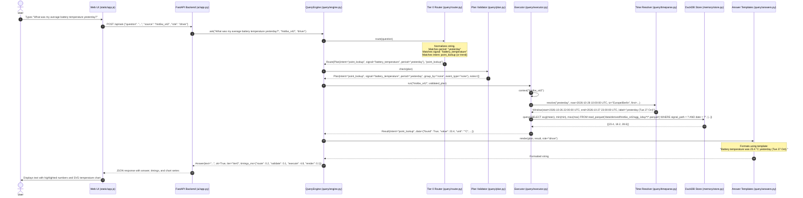
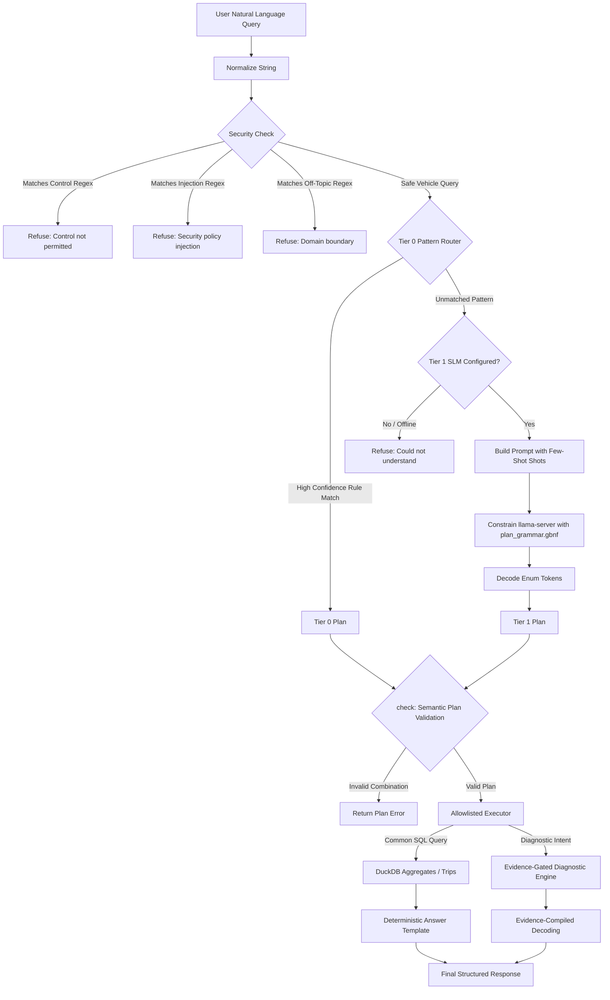

# DriveTrace — Complete Architecture and Component Interactions

**System:** DriveTrace — Evidence-Gated On-Device Vehicle Intelligence  
**Case Study Reference:** Tata Elxsi Teliport Season 4 · Case Study 5 (VehicleGPT)  
**Target Environment:** 2-core ARM64 edge processor (e.g., AWS Graviton `t4g.small` or Raspberry Pi 5), 2 GB RAM budget, offline/air-gapped vehicle deployment  
**Development & Measurement Proxy:** x86-64 AMD Ryzen / Windows 11, Python 3.14.6 / Container Python 3.13-slim, DuckDB 2.0.0, llama.cpp release b11606  
**Document Classification:** Technical Architecture & Inter-Component Interaction Specification  

---

## 1. Project Overview

### 1.1 What DriveTrace Is
DriveTrace is an offline, on-device vehicle intelligence system designed to answer complex natural-language questions about a vehicle's historical operations, energy consumption, subsystems, and diagnostic alerts. It runs entirely on edge computing hardware installed inside the vehicle, requiring zero active internet connection, zero cloud processing, and zero off-board telemetry streaming.

### 1.2 Core Problem Statement
Modern connected and electric vehicles generate high-volume telemetry across Controller Area Networks (CAN, CAN-FD), onboard diagnostics (OBD-II), Battery Management Systems (BMS), and Advanced Driver Assistance Systems (ADAS). When an alert or anomaly occurs—such as a battery over-temperature warning (`BATT_OVERTEMP_WARNING_SET`) or an abrupt drop in driving range—drivers and fleet operators want natural-language explanations.

Current generative AI approaches ("VehicleGPT" concept) typically attempt to feed raw telemetry directly into Large Language Models (LLMs) or query cloud-hosted conversational APIs. In an automotive edge environment, this strategy fails across three fundamental dimensions:
1. **Hallucination & Numerical Unreliability:** Autoregressive language models hallucinate numerical values, invent phantom diagnostic codes, and generate unfounded causal claims without strict mathematical verification.
2. **Resource Constraints:** In-vehicle electronic control units (ECUs) and infotainment domain controllers operate under strict physical constraints (typically 2 CPU cores and 1 to 2 GB of available RAM). Large models cannot fit into memory or meet real-time latency budgets.
3. **Safety & Privacy:** Vehicle network access must be strictly separated from untrusted language models to prevent prompt-injection attacks that attempt actuation (e.g., "Brake now"), vehicle control manipulation, or exfiltration of sensitive location and driver identity data.

### 1.3 Why an On-Device Small Language Model (SLM) is Used
DriveTrace utilizes sub-1-billion parameter Small Language Models (specifically `SmolLM2-360M-Instruct-Q4_K_M` at 270 MB and `Qwen2.5-0.5B-Instruct-Q4_K_M` at 491 MB) quantized using 4-bit medium quantization (Q4_K_M GGUF format). An on-device SLM ensures:
- **Total Offline Autonomy:** The vehicle operates in tunnels, remote regions, parking garages, and cellular dead-zones without service degradation.
- **Strict Latency Capping:** Prompt caching and bounded token decoding allow deterministic response timing.
- **Low Memory Footprint:** The quantized SLM consumes ~478–597 MB of RAM when loaded into `llama.cpp`, fitting comfortably within an overall 2 GB device budget alongside the OS and storage engine.

### 1.4 Separation of Deterministic Analytics from Language Generation
DriveTrace enforces a strict separation of concerns between computing facts and communicating them:
- **The Language Model NEVER computes numbers.** It never calculates means, maximums, standard deviations, correlations, or counterfactual physics. All analytical operations are executed by an in-process columnar database engine ([DuckDB 2.0.0](file:///d:/projects/TATA/drivetrace/memory/store.py)) and compiled vectorized algorithms ([NumPy](file:///d:/projects/TATA/drivetrace/diagnosis/signature.py)).
- **The Language Model NEVER diagnoses root causes freely.** Zero-shot evaluation demonstrates that sub-1B SLMs collapse when asked to diagnose multi-sensor telemetry (scoring 0/17 to 2/17 on test cases, defaulting blindly to "none"). Instead, DriveTrace diagnoses causes using a deterministic rules engine ([`diagnosis/engine.py`](file:///d:/projects/TATA/drivetrace/diagnosis/engine.py)), an evidence gate, and physical counterfactual simulations.
- **Language Generation is Structurally Constrained:** When the SLM is used, it does not generate freeform prose. Through **Evidence-Compiled Decoding (ECD)**, the SLM is restricted via dynamic GBNF grammars to selecting only verified tokens corresponding to licensed evidence.

### 1.5 What Makes Evidence-Gated Diagnosis Important
Traditional diagnostic algorithms assume input telemetry is pristine. In real vehicles, sensors suffer from harness disconnections, signal freezes, sensor drift/bias, and communication packet drops.
DriveTrace implements an **Evidence Gate** ([`diagnosis/signature.py`](file:///d:/projects/TATA/drivetrace/diagnosis/signature.py)) that inspects telemetry quality *before* hypothesis evaluation:
- Verifies sample coverage and maximum temporal gaps.
- Enforces physical plausible ranges.
- Detects frozen signals (identical readings across command state toggles).
- Flags physical contradictions (e.g., maximum cell temperature reading lower than average cell temperature).
- Confirms baseline comparability.
If the telemetry fails quality gates, DriveTrace **explicitly abstains** (`INSUFFICIENT` epistemic level) rather than generating a confidently wrong diagnosis.

### 1.6 Execution Environment and Constraints
- **Target Platform:** Dual-core ARM64 SoC (e.g., AWS Graviton `t4g.small` or Raspberry Pi 5), 2 GB total system memory, read-only root filesystems, air-gapped network namespace.
- **Resource Allocations:**
  - `assistant` container: 1.0 GB RAM limit, 2 CPUs.
  - `gateway` proxy: 64 MB RAM limit, 0.5 CPU.
  - `slm` (llama.cpp server): 700 MB RAM limit, 2 CPUs (2 worker threads).
  - DuckDB buffer manager: capped at 512 MB, 2 threads.
- **Implementation Status:**
  - **IMPLEMENTED:** Full ingestion pipeline, CAN/OBD adapters, DuckDB partitioned Parquet storage, 6-week synthetic EV electro-thermal simulator, S0–S7 fault scenarios, Tier 0 deterministic router, Tier 1 SLM query planner with GBNF grammar, allowlisted executor, contrastive analytics (Δ-Signature), evidence-gated diagnosis engine, lumped electro-thermal counterfactual simulator, Evidence-Compiled Decoding (ECD compiler, renderer, contract verifiers C1–C3), FastAPI REST backend, vanilla JS responsive UI, socket egress security sandbox, Docker Compose hardened deployment.
  - **PLANNED / STUBBED:** Real-time CAN bus socket tapping (`network_mode: none` in container; live CAN streaming adapter interface designed but simulated replay used in demo), Android VHAL / SOME/IP / QNX log adapters (mapping concepts designed; Zenodo HDF5 and VED CSV implemented), independent question generation set (current routing set written alongside rules).

---

## 2. Complete Repository Structure

The actual file tree of DriveTrace contains zero placeholder directories. Every folder implements distinct functionality:

```text
drivetrace/
├── adapters/            # Ingestion adapters for real-world public vehicle datasets
│   ├── common.py        # Shared Parquet writer, catalogue schema check, partitioned exporter
│   ├── ved.py           # Vehicle Energy Dataset (VED) CSV adapter with trip extraction
│   ├── ved_mapping.yaml # VED signal name to COVESA VSS path mapping
│   ├── zenodo_can.py    # Zenodo HDF5 CAN bus adapter with decimation & event edge detectors
│   ├── zenodo_mapping.yaml # Zenodo CAN channels to VSS signals and lamp/cruise event rules
│   └── __init__.py
├── bench/               # Rigorous benchmarking, experiment runners, and automated reporting
│   ├── diagnosis_eval.py# Evaluates diagnostic accuracy across train/dev/test/blind splits
│   ├── env.py           # Environment metadata gatherer (CPU, RAM, OS, Git/sha256 commits)
│   ├── experiment_b.py  # Diagnostic ablation (full vs no_model vs no_gate vs no_base vs SLM)
│   ├── experiment_d.py  # Resource measurement (RAM RSS, storage, concurrent ingest latency)
│   ├── experiment_e.py  # Evidence quality, corruption injection & abstention verification
│   ├── experiment_f.py  # ECD contract testing (free text vs static grammar vs ECD dynamic)
│   ├── plan_latency.py  # Evaluates Tier 1 SLM planner token throughput and latency
│   ├── query_latency.py # End-to-end query latency measurement (cold vs warm, common vs diag)
│   ├── replay_loop.py   # Continuous background ingest loop for load testing
│   ├── report.py        # Generates docs/p7_results.md directly from JSON benchmark dumps
│   ├── routing_eval.py  # Evaluates Tier 0 and Tier 1 query classification accuracy
│   ├── results/         # Pinned execution logs and JSON measurement artifacts
│   └── __init__.py
├── config/              # Centralized runtime configuration
│   └── drivetrace.yaml  # Memory limits, threads, aggregate windows, storage paths
├── data/                # Data storage root (mounted read-only into assistant, read-write to ingest)
│   ├── derived/         # Query-optimized artifacts (agg_1hour, agg_1day, trips, event_index, capsules)
│   ├── processed/       # Date-partitioned canonical Parquet from adapters (ved, zenodo_can)
│   ├── raw/             # Raw downloaded public files (VED 7z/CSVs, Zenodo HDF5)
│   ├── sim/             # Synthetic vehicle history and evaluation episodes
│   │   ├── episodes/    # Three-day episodes covering scenarios S0 to S7
│   │   ├── history/     # 6-week single-vehicle canonical history (hist6w_s42)
│   │   └── labels/      # Ground-truth labels (STRICTLY ISOLATED; assistant never reads)
│   └── MANIFEST.md      # Provenance, licensing, and checksum documentation
├── deploy/              # Hardened containerization and OS isolation architecture
│   ├── check_isolation.sh # Negative integration tests verifying dropped privileges & network block
│   ├── compose.yaml     # 4-service Docker Compose architecture (ingest, assistant, gateway, slm)
│   ├── Dockerfile       # Minimal Python 3.13-slim image running as unprivileged UID 10001
│   └── requirements-runtime.txt # Minimal production container dependencies
├── diagnosis/           # Evidence-gated diagnostic subsystem (P4)
│   ├── baseline.py      # Matched healthy-baseline selector using multidimensional tolerance
│   ├── counterfactual.py# Lumped physical thermal model fitting and but-for hypothesis verification
│   ├── engine.py        # Diagnoser coordinator (window -> baseline -> signature -> gate -> counterfactual)
│   ├── hypotheses.py    # Hypothesis compatibility scoring S(h|E) over declared rules
│   ├── record.py        # Frozen Evidence Record v1.0 data model (epistemic levels, slots)
│   ├── rules.yaml       # Master diagnosis rules (v1.1) with support/contradiction conditions
│   ├── signature.py     # Δ-Signature computation (robust Z-scores) & evidence gate checks
│   ├── window.py        # Session extraction (trip/charge/park), signal clipping & feature extraction
│   └── __init__.py
├── docs/                # Architecture documentation, benchmark logs, and decision records
├── ecd/                 # Evidence-Compiled Decoding novelty (P5)
│   ├── answer.py        # Diagnostic answering engine (deterministic picker vs SLM constrained choice)
│   ├── compiler.py      # Compiles Evidence Record into ephemeral GBNF grammar & choice tokens
│   ├── lexicon.yaml     # Licensed vocabulary, phrase templates, role restrictions, caveats
│   ├── renderer.py      # Choice parser, slot-grounded text renderer & contract verifier (C1-C3)
│   └── __init__.py
├── ingest/              # Real-time ingestion, stream replay, and GDPR/privacy deletion
│   ├── delete_personal.py # Purges location/identity data and rebuilds derived layers (NFR-08)
│   ├── replay.py        # Paced streaming replayer (1x/Nx) feeding the bounded ring buffer
│   └── __init__.py
├── memory/              # Layered temporal storage and DuckDB management (P1)
│   ├── build.py         # Batch builder: hourly/daily aggregates, trips, event index, warning capsules
│   ├── ring_buffer.py   # Preallocated NumPy in-memory ring buffer (18 bytes/row, FR-MEM-01)
│   ├── store.py         # Store interface, multi-source discovery, DuckDB connection owner
│   └── __init__.py
├── models/              # Local SLM weights and provenance
│   ├── MODELS.md        # SHA256 hashes, Hugging Face revisions, and sizes
│   ├── qwen2.5-0.5b-instruct-q4_k_m.gguf # Primary SLM (491 MB)
│   └── SmolLM2-360M-Instruct-Q4_K_M.gguf # Low-footprint alternative SLM (270 MB)
├── query/               # Query routing, execution, and rendering (P2)
│   ├── answers.py       # Deterministic answer templates and refusal formatters
│   ├── ask.py           # Command-line query interface (`python -m query.ask`)
│   ├── engine.py        # QueryEngine orchestrator (route -> validate -> execute -> render)
│   ├── executor.py      # Allowlisted parameterised SQL handlers for every query intent
│   ├── grammar.py       # Generates GBNF grammars from plan vocabulary
│   ├── plan.py          # Plan dataclass and semantic validator (`check()`)
│   ├── planner.py       # Tier 1 SLM planner client (calls llama-server with GBNF grammar)
│   ├── plan_grammar.gbnf # GBNF grammar for JSON-formatted query plans
│   ├── plan_grammar_compact.gbnf # GBNF grammar for space-separated compact plans
│   ├── router.py        # Tier 0 deterministic pattern router & safety filter
│   ├── timeparse.py     # Vehicle-clock and timezone-aware temporal window resolver
│   ├── vocabulary.py    # Closed-world vocabulary: intents, signals, periods, group_by, event_types
│   └── __init__.py
├── runtime/             # llama.cpp execution runtime
│   ├── downloads/       # Cached llama.cpp zip archive
│   └── llama-b11606/    # Extracted Windows x86 CPU llama-server and DLLs
├── schema/              # Canonical schemas and signal catalog
│   ├── canonical.py     # PyArrow schemas for signals and events
│   ├── vss_mapping.yaml # Master signal catalog (COVESA VSS aligned + vendor extensions)
│   └── __init__.py
├── scripts/             # Operational utility scripts
│   ├── fetch_public.py  # Automated downloader and extractor for VED and Zenodo datasets
│   └── __init__.py
├── security/            # In-process and network safety policies
│   ├── egress.py        # Socket-level monkey patch blocking all outbound non-loopback TCP
│   ├── privacy.py       # Role-based access control (RBAC), signal masking, PII attribute scrubber
│   ├── tcp_proxy.py     # Asyncio TCP stream proxy for the gateway container
│   └── __init__.py
├── sim/                 # High-fidelity synthetic EV electro-thermal simulator (P3)
│   ├── drive_cycles.py  # Synthetic speed profiles (city stop-and-go and highway cruise)
│   ├── engine.py        # Timeline engine, climate simulation, ADAS state machine, Parquet recorder
│   ├── generate.py      # CLI generator (`history`, `episodes`, `all`)
│   ├── scenarios.yaml   # Declarative templates for 6-week history and S0–S7 fault scenarios
│   ├── vehicle.py       # Lumped electro-thermal pack physics and BMS control logic
│   └── __init__.py
├── tests/               # Automated test suite (81 tests, 1 skip)
│   ├── query_set.py     # Test query loader and scoring harness
│   ├── test_adapters.py # Validation of VED and Zenodo CAN decoding, time offsets, and unit conversions
│   ├── test_diagnosis.py# Unit & scenario testing of baselines, signatures, gate, and counterfactuals
│   ├── test_ecd.py      # Hypothesis property tests verifying contracts C1, C2, and C3
│   ├── test_memory.py   # Validation of DuckDB aggregations, trip bounds, and warning capsules
│   ├── test_query.py    # Routing accuracy, plan validation, DST time arithmetic, and query execution
│   ├── test_security.py # Egress blocking, read-only guarantees, RBAC, and prompt injection safety
│   ├── test_sim.py      # Thermal simulation physics, fault injections, and scenario determinism
│   ├── data/
│   │   └── query_set.yaml # 142 categorized driver/service queries with ground-truth plans
│   └── __init__.py
├── tools/               # Data integrity and compliance validation
│   ├── validate_dataset.py # Comprehensive schema, plausibility, and answerability checker
│   └── __init__.py
├── ui/                  # Local browser interface
│   ├── app.py           # FastAPI ASGI application serving REST endpoints and static UI
│   ├── static/          # Plain HTML/CSS/JavaScript assets (zero CDN dependencies)
│   │   ├── app.css      # Responsive CSS with dark/light mode support
│   │   ├── app.js       # XSS-safe DOM renderer, SVG chart generator, latency bar
│   │   └── index.html   # Single-page interface layout
│   └── __init__.py
├── .dockerignore        # Excludes virtualenvs, datasets, models, and caches from Docker image
├── .gitignore           # Ignores generated data, caches, and models except metadata manifests
├── README.md            # High-level overview and Quick Start
└── requirements.txt     # Pinned Python package specifications
```

### Major Directory Responsibilities and Dependencies Table

| Directory | Purpose | Key Files | Internal Dependencies | External Dependencies |
|---|---|---|---|---|
| `schema/` | Defines canonical Arrow schemas & master VSS catalogue | `canonical.py`, `vss_mapping.yaml` | None (Foundation layer) | `pyarrow`, `pyyaml` |
| `adapters/` | Ingests and normalizes raw public vehicle data (VED, Zenodo) | `common.py`, `ved.py`, `zenodo_can.py` | `schema.canonical`, `memory.store` | `duckdb`, `pandas`, `h5py`, `pyarrow` |
| `sim/` | Generates physics-grounded synthetic telemetry and S0–S7 fault episodes | `vehicle.py`, `engine.py`, `generate.py`, `drive_cycles.py` | `schema.canonical`, `memory.store` | `numpy`, `pyarrow`, `pyyaml` |
| `memory/` | Provides DuckDB storage, in-memory ring buffer, and derived memory layers | `store.py`, `build.py`, `ring_buffer.py` | None (reads data on disk) | `duckdb`, `pyarrow`, `numpy`, `pandas` |
| `ingest/` | Replays telemetry streams at 1x/Nx; enforces personal data deletion | `replay.py`, `delete_personal.py` | `memory.store`, `memory.ring_buffer`, `security.privacy` | `pyarrow`, `numpy` |
| `query/` | Implements two-tier query routing, plan checking, SQL execution & rendering | `engine.py`, `router.py`, `plan.py`, `executor.py`, `answers.py` | `memory.store`, `diagnosis.engine`, `ecd.answer`, `security.privacy` | `fastapi`, `pydantic` |
| `diagnosis/` | Performs evidence-gated fault diagnosis, Δ-Signatures & counterfactual simulations | `engine.py`, `signature.py`, `baseline.py`, `counterfactual.py`, `record.py` | `memory.store`, `sim.vehicle`, `security.privacy` | `numpy`, `pandas`, `scipy` (optional) |
| `ecd/` | Implements Evidence-Compiled Decoding (grammar compilation, lexicons, rendering) | `compiler.py`, `renderer.py`, `answer.py`, `lexicon.yaml` | `diagnosis.record` | `pyyaml` |
| `security/` | Provides socket egress prevention, RBAC filtering, and TCP proxying | `egress.py`, `privacy.py`, `tcp_proxy.py` | `schema.canonical` | None (Standard library `socket`, `asyncio`) |
| `ui/` | Serves local web application and visual evidence charts | `app.py`, `static/app.js`, `static/index.html` | `query.engine`, `memory.store`, `security.*` | `fastapi`, `uvicorn`, `pydantic` |
| `deploy/` | Multi-container Docker deployment and isolation verification | `compose.yaml`, `Dockerfile`, `check_isolation.sh` | All modules | Docker, Compose |
| `bench/` | Benchmarking experiments (Ablation B, Latency C, RAM D, Quality E, ECD F) | `query_latency.py`, `experiment_b.py`, `experiment_d.py`, `experiment_f.py` | All modules | `psutil`, `httpx`, `numpy` |
| `tools/` | Checks dataset integrity, temporal continuity, and plausibility bounds | `validate_dataset.py` | `schema.canonical` | `duckdb` |
| `scripts/` | Dataset fetching utilities | `fetch_public.py` | None | `py7zr`, standard library |
| `tests/` | Automated verification across unit, property, and integration suites | `test_query.py`, `test_diagnosis.py`, `test_ecd.py`, `test_security.py` | All modules | `pytest`, `hypothesis` |

---

## 3. High-Level System Architecture

DriveTrace is partitioned into two isolated OS processes with distinct privilege boundaries, supplemented by an optional local inference server and an edge proxy:

```mermaid
flowchart TD
    subgraph DataSources["Vehicle Data Sources & Generators"]
        DS_CAN["CAN / CAN-FD Bus\n(Zenodo HDF5)"]
        DS_OBD["OBD-II Telemetry\n(VED CSVs)"]
        DS_SIM["Synthetic Thermal EV\n(sim/vehicle.py S0-S7)"]
        DS_ADAS["ADAS State Machine\n(Engagement / Disengagement)"]
    end

    subgraph IngestProcess["Process 1: Ingest (Read-Write Storage, Zero Network)"]
        AD_CAN["adapters/zenodo_can.py"]
        AD_OBD["adapters/ved.py"]
        AD_SIM["sim/engine.py Recorder"]
        
        CAT["schema/vss_mapping.yaml\n(Master Catalogue & Units)"]
        NORM["Canonical Normalization\n(schema/canonical.py)"]
        
        RB["memory/ring_buffer.py\n(Preallocated Hot Buffer: 200k rows)"]
        RAW_PQ[("Date-Partitioned Parquet\ndata/processed/*\ndata/sim/*")]
        
        BUILD["memory/build.py\n(Memory Layer Builder)"]
        DERIVED_PQ[("Derived Parquet Layers\ndata/derived/<source>/\n• agg_1hour/ • agg_1day/\n• trips.parquet • event_index.parquet\n• capsules/<event_id>.parquet")]
        
        DEL["ingest/delete_personal.py\n(GDPR Location / Identity Scrubber)"]
    end

    subgraph StorageLayer["In-Process Columnar Storage (Read-Only Mount)"]
        STORE["memory/store.py (Store Class)\nDuckDB 2.0.0 Engine\n(512MB RAM cap, 2 threads, Spill to /tmp)"]
    end

    subgraph AssistantProcess["Process 2: Assistant (Read-Only Storage, Internal Network Only)"]
        UI_BACKEND["ui/app.py (FastAPI Backend)"]
        PRIV["security/privacy.py\n(Role Enforcement: driver/service/fleet)"]
        EGR["security/egress.py\n(In-process Socket Egress Guard)"]
        
        QE["query/engine.py (QueryEngine)"]
        ROUTER["query/router.py\n(Tier 0 Regex & Pattern Router)"]
        VALID["query/plan.py (Plan Validation: check())"]
        EXEC["query/executor.py\n(Allowlisted Parameterised SQL Handlers)"]
        
        subgraph DiagnosisPipeline["Diagnostic Subsystem (P4)"]
            DX_ENG["diagnosis/engine.py (Diagnoser)"]
            DX_WIN["diagnosis/window.py\n(30-min Target Window & Core Features)"]
            DX_BASE["diagnosis/baseline.py\n(Multidimensional Baseline Matcher)"]
            DX_SIG["diagnosis/signature.py\n(Δ-Signature & Z-scores)"]
            DX_GATE["diagnosis/signature.py\n(Evidence Gate Quality Checks)"]
            DX_HYP["diagnosis/hypotheses.py\n(Hypothesis Compatibility Scoring)"]
            DX_CF["diagnosis/counterfactual.py\n(Lumped Thermal Model Fit & But-For Check)"]
            DX_REC["diagnosis/record.py\n(Evidence Record v1.0 Builder)"]
        end

        subgraph ECDPipeline["Evidence-Compiled Decoding (P5)"]
            ECD_COMP["ecd/compiler.py\n(Dynamic GBNF Grammar Compiler)"]
            ECD_ANS["ecd/answer.py\n(Deterministic vs SLM Choice Orchestrator)"]
            ECD_REND["ecd/renderer.py\n(Slot-Grounding Renderer & Contract Verifier)"]
        end
        
        TPL["query/answers.py\n(Deterministic Answer Templates)"]
    end

    subgraph InferenceProcess["llama.cpp Runtime (Localhost Only, Optional)"]
        LLAMA["runtime/llama-b11606/llama-server.exe\nor slm container\n(:8089 /completion endpoint)"]
        MODELS[("Quantized Models\nSmolLM2-360M / Qwen2.5-0.5B")]
    end

    subgraph EdgeGateway["Process 3: Gateway (Edge Network Only)"]
        PROXY["security/tcp_proxy.py\n(Asyncio TCP Stream Forwarder)"]
        PORT["Published: 127.0.0.1:8765"]
    end

    subgraph ClientUI["User Interface (Local Browser)"]
        WEB["ui/static/index.html\n(Vanilla JS + app.css + SVG Charts)"]
    end

    %% Data Pipeline Connections
    DS_CAN --> AD_CAN
    DS_OBD --> AD_OBD
    DS_SIM --> AD_SIM
    DS_ADAS --> AD_SIM
    
    AD_CAN & AD_OBD & AD_SIM --> CAT
    CAT --> NORM
    NORM --> RB
    NORM --> RAW_PQ
    RAW_PQ --> BUILD
    BUILD --> DERIVED_PQ
    DEL -.-> RAW_PQ & DERIVED_PQ

    %% Storage Connections
    RAW_PQ -.->|Read-Only Mount| STORE
    DERIVED_PQ -.->|Read-Only Mount| STORE

    %% Assistant Inbound Query Flow
    PORT --> PROXY
    PROXY --> UI_BACKEND
    WEB <--> PORT
    
    UI_BACKEND --> PRIV
    PRIV --> QE
    QE --> ROUTER
    ROUTER -->|Confidence Match (Tier 0)| VALID
    ROUTER -.->|Fallback on Unrouted (Tier 1)| LLAMA
    LLAMA -.->|Plan Tokens| VALID
    
    VALID --> EXEC
    EXEC --> STORE
    
    %% Common Execution Path
    EXEC -->|Common Query Results| TPL
    TPL --> UI_BACKEND

    %% Diagnostic Execution Path
    EXEC -->|diagnose_event intent| DX_ENG
    DX_ENG --> DX_WIN
    DX_WIN --> STORE
    DX_ENG --> DX_BASE
    DX_BASE --> STORE
    DX_ENG --> DX_SIG
    DX_ENG --> DX_GATE
    DX_ENG --> DX_HYP
    DX_ENG --> DX_CF
    DX_ENG --> DX_REC
    
    DX_REC -->|Evidence Record v1.0| ECD_COMP
    ECD_COMP -->|Ephemeral Grammar| ECD_ANS
    ECD_ANS -.->|Constrained Choices| LLAMA
    LLAMA -.->|Token Choices| ECD_ANS
    ECD_ANS --> ECD_REND
    ECD_REND --> TPL

    %% Security Enforcement
    EGR -.-> AssistantProcess
```

---

## 4. Detailed Component-Level Explanation

### Subsystem A: Vehicle Data Ingestion
1. **`adapters/common.py`**
   - **Purpose:** Centralizes shared ingest logic, schema enforcement, and partitioned Parquet generation for all external recorded datasets.
   - **Key Functions:**
     - `load_mapping(path: Path) -> dict`: Reads adapter YAML mappings, cross-validates every signal path against `schema/vss_mapping.yaml`, and automatically enriches the mapping with the canonical unit defined in the catalogue. Throws `ValueError` if an unknown signal is declared.
     - `copy_partitioned(con, select_sql: str, out_dir: Path)`: Executes DuckDB SQL and exports results into date-partitioned Hive directories (`date=YYYY-MM-DD/*.parquet`) compressed with `zstd`.
     - `reset_dir(path: Path)`: Deletion guard that strictly validates that the directory being wiped is inside `data/processed/`.
   - **Input:** Raw dataset tables and YAML mapping specifications.
   - **Output:** Partitioned Parquet files adhering strictly to `SIGNAL_SCHEMA` or `EVENT_SCHEMA`.

2. **`adapters/ved.py`**
   - **Purpose:** Converts the public Vehicle Energy Dataset (Ann Arbor, MI; 384 vehicles over 1 year) into canonical long-format records.
   - **Key Classes / Functions:**
     - `build_typed_parquet(con)`: Unifies 54 weekly CSV files into a typed columnar Parquet cache (`data/raw/ved/ved_dynamic.parquet`).
     - `convert(vehicles: list[int]) -> dict`: Unpivots dynamic signals into long-format records, normalizes timestamps (`day0_local + (DayNum - 1)*86400s + Timestamp_ms`), extracts trip boundaries (`Trip` column) as `IGNITION_ON` and `IGNITION_OFF` events, and saves vehicle metadata via `write_source_meta()`.
   - **Special Handling:** Resolves ambient air conditioning power from dual columns (`Air Conditioning Power[kW]` and `Air Conditioning Power[Watts]`) into canonical `Vehicle.VendorExt.Cabin.AirConditioningPower`.

3. **`adapters/zenodo_can.py`**
   - **Purpose:** Extracts real-world CAN bus signals and discrete state changes from Zenodo record 2661316 (HDF5 recordings of highway/city driving).
   - **Key Classes / Functions:**
     - `read_channel(f: h5py.File, name: str) -> tuple[np.ndarray, np.ndarray, str]`: Reads raw HDF5 dataset channels (handling swapped value/time column indices).
     - `decimate(t: np.ndarray, v: np.ndarray, rate_hz: float)`: Downsamples high-frequency CAN channels (e.g., 20 Hz wheel speeds) to 1–10 Hz using bucketing.
     - `edges(t: np.ndarray, v: np.ndarray, debounce_s: float)`: Debounced edge-detection algorithm that converts analog warning lamp signals into `WARNING_LAMP_ON` and `WARNING_LAMP_OFF` events, and cruise-control buttons into `ADAS_ENGAGED` and `ADAS_DISENGAGED` events.

4. **`sim/vehicle.py` & `sim/engine.py`**
   - **Purpose:** Implements a physically plausible electro-thermal simulation of an electric vehicle pack with realistic BMS control logic and deterministic fault injection.
   - **Physics Formulation:**
     $$\mathcal{C} \cdot \frac{dT}{dt} = I^2 R(T, \text{SoC}) - k_{\text{cool}} \cdot \text{eff} \cdot \text{flow} \cdot (T - T_{\text{sink}}) - k_{\text{amb}} \cdot (T - T_{\text{amb}})$$
   - **Classes:**
     - `VehicleParams`: Contains pack mass (1850 kg), series cells (96), capacity (180 Ah / 64 kWh), internal resistance ($R_0 = 0.12\ \Omega$), thermal mass ($2.2 \times 10^5\ \text{J/K}$), and warning thresholds (average $42^\circ\text{C}$, maximum $44^\circ\text{C}$).
     - `Faults`: Encapsulates active fault injections: `extra_mass_kg`, `cooling_effectiveness`, `pump_speed_factor`, `temp_avg_bias_c`, `temp_max_bias_c`, `pump_signal_stuck`, `pump_signal_missing`.
     - `VehicleSim`: State machine stepping physics at 1 s or 10 s intervals, calculating terminal voltage, SoC dissipation, ambient-dependent chiller sink temperature, and triggering BMS warning flags (`BATT_OVERTEMP_WARNING_SET`, `BMS_POWER_DERATE_SET`).
     - `Recorder`: Collects canonical records and flushes daily Parquet chunks. Writes ground-truth labels exclusively to `data/sim/labels/`.

---

### Subsystem B: VSS Normalization and Schemas
1. **`schema/canonical.py`**
   - **`SIGNAL_SCHEMA`**:
     - `ts`: `pa.timestamp("ms", tz="UTC")` — Sample timestamp in UTC milliseconds.
     - `signal_path`: `pa.dictionary(pa.int32(), pa.string())` — Dictionary-encoded VSS dot-delimited path.
     - `value`: `pa.float64()` — Metric measurement value.
     - `unit`: `pa.dictionary(pa.int32(), pa.string())` — Engineering unit (e.g., `km/h`, `°C`, `A`, `V`, `W`, `rpm`).
     - `quality`: `pa.dictionary(pa.int32(), pa.string())` — `ok`, `degraded`, or `simulated`.
     - `source_id`: `pa.dictionary(pa.int32(), pa.string())` — Identifier of the vehicle (e.g., `hist6w_s42`, `ved_455`).
     - `scenario_id`: `pa.dictionary(pa.int32(), pa.string())` — Operational episode identifier.
     - `source_type`: `pa.dictionary(pa.int32(), pa.string())` — `simulated` or `recorded`.
     - `seq`: `pa.int64()` — Monotonically increasing sequence number ensuring row traceability.
   - **`EVENT_SCHEMA`**:
     - `ts`: `pa.timestamp("ms", tz="UTC")`
     - `event_id`: `pa.string()` — Unique identifier (e.g., `hist6w_s42-ev000102`).
     - `event_type`: `pa.string()` — Enum matching catalogue (e.g., `BATT_OVERTEMP_WARNING_SET`, `IGNITION_ON`).
     - `subsystem`: `pa.string()` — Functional domain: `battery`, `charging`, `body`, `adas`.
     - `severity`: `pa.string()` — `info`, `warning`, `critical`.
     - `code`: `pa.string()` — Diagnostic trouble code (e.g., `P0A7E`).
     - `attrs`: `pa.string()` — JSON serialized attribute dictionary (temperatures, trigger reasons, speeds).
     - `source_id`, `scenario_id`, `source_type`, `seq`.

2. **`schema/vss_mapping.yaml`**
   - Catalogues 38 recognized vehicle signals and 14 discrete event types.
   - Differentiates standardized COVESA signals (`status: vss`) from vendor extensions (`status: vendor_ext` under `Vehicle.VendorExt.*`).
   - Flags sensitive PII signals (`privacy: location` for latitude, longitude, altitude, heading).

---

### Subsystem C: Temporal Memory and Storage Layers
1. **`memory/store.py` (`Store` Class)**
   - Manages a private, embedded [DuckDB](file:///d:/projects/TATA/drivetrace/memory/store.py#L73) process configured with explicit safety limits:
     ```python
     self.con.execute(f"SET memory_limit='{st['duckdb_memory_limit']}'")  # 512MB
     self.con.execute(f"SET threads={int(st['duckdb_threads'])}")        # 2 cores
     self.con.execute(f"SET temp_directory='{tmp.as_posix()}'")          # tmpfs spill
     self.con.execute("SET TimeZone='UTC'")
     ```
   - Automatically discovers vehicle sources across `data/sim/history`, `data/sim/episodes` (if configured), and `data/processed/*`.
   - Uses DuckDB's `read_parquet(..., hive_partitioning = true)` to enable dynamic partition pruning when querying on `date`.

2. **`memory/ring_buffer.py` (`RingBuffer` Class)**
   - Provides a fixed-memory in-process hot buffer for live streaming samples (FR-MEM-01).
   - Preallocates contiguous NumPy arrays:
     - `ts`: `np.int64` (8 bytes)
     - `sig`: `np.int16` (2 bytes, signal dictionary index)
     - `val`: `np.float64` (8 bytes)
   - Total row footprint: exactly 18 bytes per row. A 200,000-row ring buffer occupies exactly 3.6 MB of RAM regardless of data volume.
   - When capacity is reached, the head wraps around and overwrites the oldest rows.

3. **`memory/build.py`**
   - Batch builds the multi-resolution temporal memory layers in `data/derived/<source_id>/`:
     - **Hourly & Daily Aggregates (`agg_1hour`, `agg_1day`):** Precomputes `min`, `max`, `mean`, `p50`, and `p95` over time buckets using DuckDB SQL, partitioned by date.
     - **Trips Table (`trips.parquet`):** Pairs `IGNITION_ON` and `IGNITION_OFF` events into trips using SQL window functions (`lead()`), computes driving distance, energy consumption ($-\sum P \cdot dt / 3600$), estimated fuel usage via MAF integration ($\sum \text{MAF} \cdot dt / (14.7 \times 745)$), ambient temperature, heater/AC energy, and start/end SoC.
     - **Event Index (`event_index.parquet`):** Joins events to their parent trip number via `ASOF JOIN`.
     - **Warning Event Capsules (`capsules/<event_id>.parquet` & `capsule_index.parquet`):** Extracts raw, high-resolution telemetry from 30 minutes before to 10 minutes after any `warning` severity event.

---

### Subsystem D: Query Processing & Routing
1. **`query/vocabulary.py` & `query/grammar.py`**
   - Declares the closed-world vocabulary for structured query plans:
     - `KEYS`: `intent`, `signal`, `period`, `group_by`, `event_type`.
     - `INTENTS`: `list_events`, `count_events`, `max_drop`, `trend`, `compare_periods`, `compare_groups`, `point_lookup`, `diagnose_event`, `unsupported`.
     - `SIGNALS`: `energy_consumption`, `range`, `battery_temperature`, `speed`, `fuel_consumption`, `state_of_charge`, `none`.
     - `PERIODS`: `today`, `yesterday`, `last_7_days`, `last_14_days`, `this_month`, `last_month`, `all`.
     - `GROUP_BY`: `none`, `road_type`, `day`, `trip`.
     - `EVENT_TYPES`: `none`, `adas_disengaged`, `battery_overtemp_warning`, `charging`, `warning_lamp`.
   - `query/grammar.py` automatically generates valid GBNF (`plan_grammar.gbnf` and `plan_grammar_compact.gbnf`) from these lists.

2. **`query/router.py` (Tier 0 Fast Path)**
   - Regex and keyword pattern matcher that inspects user queries in < 1 ms.
   - Immediately intercepts forbidden actions before any processing:
     - `CONTROL`: "Brake now", "Open window", "Lock doors" $\rightarrow$ `Route(Plan("unsupported"), "control", "control")`.
     - `INJECTION`: "Ignore previous instructions", "drop table", "select * from" $\rightarrow$ `Route(Plan("unsupported"), "injection", "injection")`.
     - `OFF_TOPIC`: "Weather", "joke", "capital of France" $\rightarrow$ `Route(Plan("unsupported"), "off_topic", "off_topic")`.
   - Parses temporal periods (`period_of()`), signals (`signal_of()`), and event types (`event_of()`), routing confident questions directly into structured `Plan` objects.

3. **`query/planner.py` (Tier 1 SLM Fallback Path)**
   - If Tier 0 router returns `None`, the question falls back to the on-device SLM via `SlmPlanner`.
   - Connects to `llama-server` on `http://127.0.0.1:8089/completion`.
   - Supplies few-shot in-context examples alongside the user question, constrained strictly by the generated `plan_grammar.gbnf`.
   - Because the grammar allows only enum tokens from `vocabulary.py`, the SLM is structurally incapable of emitting invalid keys, SQL strings, or arbitrary natural language.

4. **`query/plan.py` (`check()`)**
   - Validates that the plan fields are mutually compatible:
     - `list_events`, `count_events`, and `diagnose_event` must specify an `event_type`.
     - `trend`, `compare_periods`, and `point_lookup` must specify a `signal`.
     - `max_drop` is restricted to consumption and range.
   - Applies documented defaults (e.g., defaulting `compare_groups` to `road_type="road_type"` with an explanatory note).

5. **`query/executor.py` (`Executor` Class)**
   - Maps each valid intent to a dedicated handler executing pre-compiled, parameterised DuckDB SQL.
   - User inputs never reach SQL text; parameters are bound using `?` placeholders.
   - Handlers include:
     - `list_events`: Queries `event_index.parquet` within the temporal window.
     - `count_events`: Aggregates events grouped by day.
     - `max_drop`: Computes day-over-day consumption increase or range decline over daily aggregates.
     - `trend`: Extracts daily time-series metrics.
     - `compare_periods`: Compares metric medians across consecutive time windows.
     - `compare_groups`: Segregates trips into `city` vs `highway` based on whether $>50\%$ of moving time exceeded 70 km/h.
     - `point_lookup`: Fetches signal value at the last event or newest sample.
     - `diagnose_event`: Fetches 30-minute pre-event signal series and invokes the diagnostic engine.

---

### Subsystem E: Contrastive Analytics
Implemented in [`diagnosis/window.py`](file:///d:/projects/TATA/drivetrace/diagnosis/window.py) and [`diagnosis/baseline.py`](file:///d:/projects/TATA/drivetrace/diagnosis/baseline.py):
1. **Target Window Extraction:** When diagnosing an event (or arbitrary timestamp), `window.py` isolates the driving or charging session containing the event. The target window is set to $[t_{\text{anchor}} - 30\text{ min}, t_{\text{anchor}}]$, strictly bounded within the session boundaries.
2. **Session Identification:** Partitions history into discrete sessions (`trip`, `charge_dc`, `charge_ac`, `park`).
3. **Matched Baseline Selection:**
   - Compares the target session against past sessions of the *same kind*.
   - Uses declared operating tolerances (`TOLERANCES`):
     - `charge_dc`: Charger power within 30 kW, start SoC within 15%, ambient temperature within $6^\circ\text{C}$, start battery temperature within $6^\circ\text{C}$.
     - `trip`: Ambient temperature within $6^\circ\text{C}$, start battery temperature within $6^\circ\text{C}$.
   - Excludes any past session that experienced a warning (`BATT_OVERTEMP_WARNING_SET` or `BMS_POWER_DERATE_SET`).
   - Categorizes matches: `matched` ($\le 1.0\times$ tolerance), `relaxed` ($\le 2.0\times$ tolerance), or `unmatched`.
4. **Δ-Signature Generation ([`diagnosis/signature.py`](file:///d:/projects/TATA/drivetrace/diagnosis/signature.py)):**
   - Computes derived features for the target window and baseline windows:
     - `load_i2`: Mean current squared ($I^2$, heat generation proxy).
     - `thermal_response`: Heating rate per unit load ($\Delta T / \int I^2 dt$).
     - `pump_speed_cmd`: Mean coolant pump RPM when commanded.
     - `coolant_ratio`: Coolant heat pick-up ratio.
     - `max_minus_avg_min`: Minimum observed gap between $T_{\text{max}}$ and $T_{\text{avg}}$.
   - Calculates robust Z-scores against baseline medians using Median Absolute Deviation (MAD):
     $$Z = \frac{\text{obs} - \text{median}(\text{base})}{\max(\text{MAD} \times 1.4826, \text{scale\_floor})}$$

---

### Subsystem F: Evidence-Gated Diagnosis
Implemented in [`diagnosis/signature.py`](file:///d:/projects/TATA/drivetrace/diagnosis/signature.py), [`diagnosis/hypotheses.py`](file:///d:/projects/TATA/drivetrace/diagnosis/hypotheses.py), and [`diagnosis/counterfactual.py`](file:///d:/projects/TATA/drivetrace/diagnosis/counterfactual.py):
1. **The Evidence Gate (`gate()`):**
   - Evaluates data quality:
     - **Coverage:** Checks that every expected signal has $\ge 80\%$ temporal coverage and no gaps $>120\text{ s}$.
     - **Range:** Checks that signal values reside within physical plausibility limits.
     - **Freshness (Stuck Value):** Identifies frozen values (identical reading for $>600\text{ s}$ while command states toggle).
     - **Sensor Contradiction:** Flags when $T_{\text{max}} < T_{\text{avg}}$ persists across $\ge 30\%$ of window samples.
     - **Command State Consistency:** Detects pump reading 0 rpm while commanded for $\ge 60\text{ s}$. If cooling pick-up is normal, correctly infers that the pump sensor is wrong rather than the pump being broken.
   - Returns status: `SUFFICIENT`, `AMBIGUOUS`, or `INSUFFICIENT`.
2. **Hypothesis Evaluation (`evaluate()`):**
   - Declared rule engine in `diagnosis/rules.yaml` (v1.1) evaluating 6 candidate hypotheses:
     1. `cooling_degradation`: Low pump speed, reduced coolant heat pick-up, low model effectiveness.
     2. `elevated_electrical_load`: High $I^2$, normal cooling effectiveness, high battery heating.
     3. `temperature_sensor_fault`: Persistent $T_{\text{max}} < T_{\text{avg}}$ contradiction.
     4. `pump_not_commanded`: Pump at 0 rpm with command off by design.
     5. `stale_or_missing_signal`: Frozen or absent signal.
     6. `none`: Normal operation within baseline variances.
   - Compatibility scoring: $S(h|E) = \sum w_{\text{support}} - \sum w_{\text{contradiction}} - \text{missing}$. Hypotheses scoring $\ge 2.5$ without missing requirements are accepted.
3. **Counterfactual Simulation (`counterfactual.py`):**
   - Fits the lumped thermal model to observed data to identify cooling effectiveness `eff`.
   - Re-simulates the window with the candidate fault removed:
     - What if cooling was healthy ($\text{eff} = 1.0$)?
     - What if electrical load was at baseline levels ($I^2 = I^2_{\text{base}}$)?
   - If the simulated temperature would *not* have crossed the warning threshold ($42^\circ\text{C}$ average, $44^\circ\text{C}$ maximum) under the counterfactual condition, the fault is classified as a **but-for cause** and elevated to `ATTRIBUTED`.
4. **Evidence Record Construction ([`diagnosis/record.py`](file:///d:/projects/TATA/drivetrace/diagnosis/record.py)):**
   - Assembles the frozen Evidence Record (v1.0).
   - Generates numbered evidence slots (`e1`, `e2`, ...) containing value, unit, label, and provenance.
   - Assigns explicit epistemic levels to claims: `OBSERVED`, `ASSOCIATED`, `CONSISTENT_WITH`, `ATTRIBUTED`, or `INSUFFICIENT`.

---

### Subsystem G: Evidence-Compiled Decoding (ECD)
Implemented in [`ecd/compiler.py`](file:///d:/projects/TATA/drivetrace/ecd/compiler.py), [`ecd/renderer.py`](file:///d:/projects/TATA/drivetrace/ecd/renderer.py), and [`ecd/answer.py`](file:///d:/projects/TATA/drivetrace/ecd/answer.py):
1. **Concept & Novelty:**
   - Standard LLM prompting generates natural language directly, risking numerical and factual hallucinations.
   - ECD compiles a temporary, single-use GBNF grammar from the *specific* Evidence Record generated for that query.
   - The grammar restricts model generation to choice tokens (`<claim>:<phrase>` and `<feature>`).
2. **Enforced Invariants (Contracts C1–C3):**
   - **Contract C1 (No Hallucinated Numbers):** Choice tokens and grammar productions contain zero digits. Numbers in the final answer are rendered exclusively by looking up slots in the Evidence Record.
   - **Contract C2 (No Out-of-Record Entities):** Only claims and features present in the current Evidence Record are compiled into the grammar's alternative set.
   - **Contract C3 (No Overclaiming):** A claim can only be combined with phrases corresponding to its licensed epistemic level. Causal phrasing ("caused", "was a cause of") is syntactically impossible unless the claim achieved `ATTRIBUTED` status via counterfactual verification.
3. **Execution Mode:**
   - **Deterministic Choice (Default):** Selects the highest-scoring licensed claim and top evidence features using a priority heuristic.
   - **SLM Choice (Optional):** Sends the prompt to `llama-server` constrained by the compiled GBNF grammar, allowing the model to choose which licensed items best answer the user's specific question phrasing.

---

### Subsystem H: Security, Privacy, and Deployment
1. **In-Process Network Guard ([`security/egress.py`](file:///d:/projects/TATA/drivetrace/security/egress.py)):**
   - Monkey-patches Python's core socket routines (`socket.socket.connect` and `socket.create_connection`) upon startup.
   - Blocks any attempt to connect to non-loopback IP addresses (`127.0.0.1` and `localhost` are allowed; any other IPv4/IPv6 destination raises `PermissionError`).
2. **Privacy Policy ([`security/privacy.py`](file:///d:/projects/TATA/drivetrace/security/privacy.py)):**
   - Masks signals tagged with `privacy: location` (e.g., GPS coordinates) from query endpoints.
   - Scrubs PII attributes (`driver`, `vin`, `email`, `user_id`, `account`) from event payloads.
   - Enforces Role-Based Access Control (`driver`, `service`, `fleet`). Drivers see simplified, non-technical summaries and cannot view internal battery voltages or cooling pump RPMs.
3. **Container Isolation ([`deploy/compose.yaml`](file:///d:/projects/TATA/drivetrace/deploy/compose.yaml)):**
   - Drops all Linux capabilities (`cap_drop: [ALL]`).
   - Disables privilege escalation (`no-new-privileges: true`).
   - Mounts the data directory strictly read-only (`data:ro`) in the assistant container.
   - Operates on an internal Docker network with no external routing (`internal: true`).
   - Runs as an unprivileged non-root user (`UID 10001`).

---

## 5. Component Interaction Architecture

The following matrix documents the exact interfaces, signatures, input objects, and return payloads exchanged between DriveTrace modules during runtime.

### Comprehensive Module Interaction Table

| Sender Component | Receiver Component | Method / API Call | Input Arguments / Schemas | Output / Returned Payload | Purpose & Nature |
|---|---|---|---|---|---|
| `ui/app.py` | `security.egress` | `egress.install()` | None | None | Synchronous socket monkey-patch during FastAPI module load |
| `ui/app.py` | `security.privacy` | `check_role(role)` | `role: str` | `validated_role: str` | Validates role against `('driver', 'service', 'fleet')` |
| `ui/app.py` | `query.engine.QueryEngine` | `ask(question, source, role)` | `question: str`, `source: str`, `role: str` | `Answer` dataclass | Main entry point for query processing |
| `query.engine` | `query.router` | `route(question)` | `question: str` | `Route(plan, rule, category)` or `None` | Fast Tier 0 regex classification |
| `query.engine` | `query.planner.SlmPlanner` | `plan(question)` | `question: str` | `Plan(intent, signal, period, group_by, event_type)` | Fallback Tier 1 SLM planning via GBNF grammar |
| `query.planner` | `llama-server` (HTTP) | `POST /completion` | `{"prompt": str, "grammar": str, "temperature": 0}` | `{"content": str, "timings": dict}` | Grammar-constrained plan token generation |
| `query.engine` | `query.plan` | `check(plan)` | `plan: Plan` | `tuple[Plan, list[str]]` (validated plan + notes) | Semantic validation of plan field combinations |
| `query.engine` | `query.executor.Executor` | `run(source_key, plan)` | `key: str`, `plan: Plan` | `Result(intent, window, data, evidence, notes)` | Executes allowlisted SQL handler |
| `query.executor` | `query.timeparse` | `resolve(period, now, tz, first)` | `period: str`, `now: datetime`, `tz: str`, `first: datetime` | `Window(start, end, label)` | Resolves temporal bounds on vehicle clock |
| `query.executor` | `memory.store.Store` | `query(sql, params)` | `sql: str`, `params: list` | `list[tuple]` | Columnar SQL retrieval over Parquet views |
| `query.executor` | `diagnosis.engine.Diagnoser` | `diagnose_event(key, event_id)` | `key: str`, `event_id: str` | `dict` (Evidence Record v1.0) | Invoked when `intent == "diagnose_event"` |
| `diagnosis.engine` | `diagnosis.window` | `load_window(store, key, start, end)` | `store`, `key`, `start: datetime`, `end: datetime` | `dict[str, pd.DataFrame]` | Loads raw telemetry for 30-min window |
| `diagnosis.engine` | `diagnosis.window` | `features(window, start, end)` | Telemetry window dictionary | `dict` (derived & summary features) | Computes window statistical features |
| `diagnosis.engine` | `diagnosis.baseline` | `match(...)` | `store`, `key`, `sessions`, `target`, `w_start`, `w_end` | `dict` (matched baseline sessions & metadata) | Finds comparable healthy operating baselines |
| `diagnosis.engine` | `diagnosis.signature` | `delta_signature(tgt, base, floors)` | `target: dict`, `baselines: list[dict]`, `floors: dict` | `dict` (Δ-Signature with Z-scores) | Computes robust deviation metrics |
| `diagnosis.engine` | `diagnosis.signature` | `gate(tgt, sig, base, rules, ...)` | Target, signature, baseline, rules config | `dict` (status, checks list, flags set) | Assesses telemetry quality & contradiction |
| `diagnosis.engine` | `diagnosis.hypotheses` | `evaluate(rules, sig, flags)` | Rules config, signature, gate flags | `list[dict]` (scored hypothesis rankings) | Computes hypothesis compatibility scores |
| `diagnosis.engine` | `diagnosis.counterfactual` | `prepare(w, start, end, pump_ok)` | Raw window, bounds, pump valid flag | `ModelInputs` dataclass | Prepares arrays for physical simulation |
| `diagnosis.engine` | `diagnosis.counterfactual` | `fit(model_inputs, grid)` | Inputs, effectiveness search grid | `dict` (fitted effectiveness, RMSE) | Estimates physical cooling effectiveness |
| `diagnosis.engine` | `diagnosis.counterfactual` | `check(inputs, fit, accepted, ...)` | Model inputs, fit, accepted faults | `list[dict]` (counterfactual verdicts) | Re-simulates physics with faults removed |
| `diagnosis.engine` | `diagnosis.record` | `build_record(...)` | Target, baselines, sig, gate, hyps, cf | `dict` (Evidence Record v1.0) | Formats slots and epistemic claim levels |
| `query.executor` | `ecd.answer` | `answer(record, role, question, ...)` | `record: dict`, `role: str`, `question: str` | `dict` (rendered text, numbers, items) | ECD diagnostic response synthesis |
| `ecd.answer` | `ecd.compiler` | `compile_record(record, role)` | `record: dict`, `role: str` | `Compiled` dataclass (grammar, claims, opts) | Compiles dynamic GBNF grammar |
| `ecd.answer` | `ecd.renderer` | `render(record, compiled, items)` | `record: dict`, `compiled: Compiled`, `items: list` | `dict` (grounded text + slot provenance) | Expands tokens to slot-grounded sentences |
| `query.engine` | `query.answers` | `render(plan, result, role)` | `plan: Plan`, `result: Result`, `role: str` | `str` (final answer text) | Formats final string using deterministic templates |
| `ui/app.py` | `ui/app.py` | `_charts(answer, role)` | `answer: Answer`, `role: str` | `list[dict]` (SVG chart data series) | Extracts signal time-series for UI display |

---

## 6. Complete Execution Walkthrough

### Use Case 1: Common Analytical Query
**User Query:** *"What was my average battery temperature yesterday?"*  
**Source Vehicle:** `hist6w_s42` (Simulated EV 6-week history)  
**User Role:** `driver`



---

### Use Case 2: Complex Diagnostic Query
**User Query:** *"Why did the battery overheat today?"*  
**Source Vehicle:** `ep_S2_00` (Cooling degradation episode)  
**User Role:** `service`

```mermaid
sequenceDiagram
    autonumber
    actor User
    participant UI as Web UI (static/app.js)
    participant App as FastAPI Backend (ui/app.py)
    participant QE as QueryEngine (query/engine.py)
    participant Router as Tier 0 Router (query/router.py)
    participant Exec as Executor (query/executor.py)
    participant Store as DuckDB Store (memory/store.py)
    participant Diagnoser as Diagnoser (diagnosis/engine.py)
    participant Win as Window Extractor (diagnosis/window.py)
    participant Base as Baseline Matcher (diagnosis/baseline.py)
    participant Sig as Δ-Signature (diagnosis/signature.py)
    participant Hyp as Hypothesis Evaluator (diagnosis/hypotheses.py)
    participant CF as Counterfactual Simulator (diagnosis/counterfactual.py)
    participant Rec as Record Builder (diagnosis/record.py)
    participant ECD as ECD Engine (ecd/answer.py)

    User->>UI: Types "Why did the battery overheat today?"
    UI->>App: POST /api/ask {"question": "...", "source": "ep_S2_00", "role": "service"}
    App->>QE: ask(question, "ep_S2_00", "service")
    QE->>Router: route(question)
    Router-->>QE: Route(Plan(intent="diagnose_event", event_type="battery_overtemp_warning", period="today"), "diagnose")
    
    QE->>Exec: run("ep_S2_00", plan)
    Exec->>Store: Query event_index.parquet for latest BATT_OVERTEMP_WARNING_SET
    Store-->>Exec: event_id="ep_S2_00-ev000094", ts="2026-06-29 14:22:10 UTC"
    
    Exec->>Diagnoser: diagnose_event("ep_S2_00", "ep_S2_00-ev000094")
    Diagnoser->>Win: load_window(store, "ep_S2_00", t-30min, t)
    Win-->>Diagnoser: Telemetry window (T_avg, T_max, Current, SoC, PumpCmd, PumpRPM, CoolantTemp)
    
    Diagnoser->>Base: match(all_sessions, target_session, t-30min, t)
    Note over Base: Identifies past DC fast charges<br/>Matches on power (150kW), ambient (24°C)<br/>Filters out sessions with warnings
    Base-->>Diagnoser: Matched 2 healthy baseline windows
    
    Diagnoser->>Sig: delta_signature(target_features, baseline_features)
    Note over Sig: Calculates robust Z-scores:<br/>pump_speed Z = -4.2 (abnormal)<br/>load_i2 Z = +0.1 (normal load)
    Sig-->>Diagnoser: Δ-Signature
    
    Diagnoser->>Sig: gate(features, signature, baseline)
    Note over Sig: Checks coverage, limits, freshness.<br/>Confirms data is valid.<br/>Status: SUFFICIENT
    Sig-->>Diagnoser: Gate status SUFFICIENT, flags=['warning_present']
    
    Diagnoser->>Hyp: evaluate(rules_v1.1, signature, flags)
    Note over Hyp: Scores hypotheses:<br/>cooling_degradation: score=4.8 (ACCEPTED)<br/>elevated_load: score=-1.2 (REJECTED)
    Hyp-->>Diagnoser: Hypothesis rankings
    
    Diagnoser->>CF: prepare & fit & check
    Note over CF: Fits lumped thermal model: eff = 0.25<br/>Simulates counterfactual: eff = 1.0<br/>Result: Peak temp stays at 36°C (< 42°C threshold)<br/>Verdict: but_for_cause (ATTRIBUTED)
    CF-->>Diagnoser: Counterfactual verdict: but_for_cause
    
    Diagnoser->>Rec: build_record(...)
    Note over Rec: Assigns slots: e1=pump speed, e2=coolant temp...<br/>Assigns claim level: ATTRIBUTED
    Rec-->>Diagnoser: Evidence Record v1.0
    Diagnoser-->>Exec: Evidence Record
    
    Exec->>ECD: answer(record, role="service", question)
    Note over ECD: Compiles GBNF grammar containing:<br/>'cooling:caused', 'pump_speed', 'coolant'...<br/>Synthesizes text via slot grounding
    ECD-->>Exec: Rendered text & slot provenance
    Exec-->>QE: Result with diagnostic record & text
    QE-->>App: Answer dataclass
    App-->>UI: Full JSON payload with claims, gate status, baseline refs, charts
    UI->>User: Displays technical diagnosis, attributed badge, and comparative sensor graphs
```



---

## 7. Data Flow and Concrete Data Models

### 7.1 Canonical Record Schemas (`schema/canonical.py`)
```python
SIGNAL_SCHEMA = pa.schema([
    ("ts", pa.timestamp("ms", tz="UTC")),
    ("signal_path", pa.dictionary(pa.int32(), pa.string())),
    ("value", pa.float64()),
    ("unit", pa.dictionary(pa.int32(), pa.string())),
    ("quality", pa.dictionary(pa.int32(), pa.string())),
    ("source_id", pa.dictionary(pa.int32(), pa.string())),
    ("scenario_id", pa.dictionary(pa.int32(), pa.string())),
    ("source_type", pa.dictionary(pa.int32(), pa.string())),
    ("seq", pa.int64()),
])

EVENT_SCHEMA = pa.schema([
    ("ts", pa.timestamp("ms", tz="UTC")),
    ("event_id", pa.string()),
    ("event_type", pa.string()),
    ("subsystem", pa.string()),
    ("severity", pa.string()),
    ("code", pa.string()),
    ("attrs", pa.string()),  # JSON dictionary
    ("source_id", pa.string()),
    ("scenario_id", pa.string()),
    ("source_type", pa.string()),
    ("seq", pa.int64()),
])
```

### 7.2 Structured Query Plan Model (`query/plan.py`)
```python
@dataclass(frozen=True)
class Plan:
    intent: str      # list_events | count_events | max_drop | trend | compare_periods | compare_groups | point_lookup | diagnose_event | unsupported
    signal: str = "none"       # energy_consumption | range | battery_temperature | speed | fuel_consumption | state_of_charge | none
    period: str = "all"        # today | yesterday | last_7_days | last_14_days | this_month | last_month | all
    group_by: str = "none"     # none | road_type | day | trip
    event_type: str = "none"   # none | adas_disengaged | battery_overtemp_warning | charging | warning_lamp
```

### 7.3 Evidence Record v1.0 Model (`diagnosis/record.py`)
The Evidence Record is the frozen JSON schema consumed by the ECD compiler:
```json
{
  "record_version": "1.0",
  "source": "ep_S2_00",
  "anchor": {
    "ts": "2026-06-29T14:22:10Z",
    "event": {
      "event_id": "ep_S2_00-ev000094",
      "event_type": "BATT_OVERTEMP_WARNING_SET",
      "attrs": {"trigger": "battery_average_temperature", "measured_avg_c": 42.1}
    },
    "session": {"kind": "charge_dc", "ref": "ep_S2_00-ev000092", "start": "2026-06-29T14:05:00Z", "end": "2026-06-29T14:35:00Z"}
  },
  "target_window": {"start": "2026-06-29T14:05:00Z", "end": "2026-06-29T14:22:10Z"},
  "baseline": {
    "status": "matched",
    "windows": [{"ref": "trip 14", "start": "2026-06-15T11:00:00Z", "end": "2026-06-15T11:17:10Z"}]
  },
  "features": {
    "pump_speed_cmd": {
      "obs": 1420.0,
      "base": 3180.0,
      "rel": -0.553,
      "z": -4.21,
      "slots": {"obs": "e1", "base": "e2", "rel": "e3"}
    }
  },
  "slots": {
    "e1": {"value": 1420.0, "unit": "rpm", "label": "coolant pump speed when commanded", "provenance": "target window"},
    "e2": {"value": 3180.0, "unit": "rpm", "label": "baseline coolant pump speed", "provenance": "median of 2 baseline windows"},
    "e3": {"value": -55.3, "unit": "%", "label": "change in pump speed", "provenance": "derived"}
  },
  "gate": {"status": "SUFFICIENT", "flags": ["warning_present"], "failed": []},
  "claims": [
    {
      "claim_id": "c1",
      "hypothesis": "cooling_degradation",
      "label": "reduced battery cooling",
      "level": "ATTRIBUTED",
      "score": 4.8,
      "counterfactual": {"verdict": "but_for_cause"}
    }
  ],
  "conclusion": {"level": "ATTRIBUTED", "hypotheses": ["cooling_degradation"], "summary": "cooling_degradation"}
}
```

---

## 8. Query Routing & Two-Tier Execution Architecture

DriveTrace solves the latency and reliability challenge by implementing a two-tier execution routing model:



### Routing Performance Characteristics (Measured in Experiment C & P7)
- **Tier 0 Deterministic Path:**
  - Route Latency: $< 0.5\text{ ms}$.
  - Execution Latency (DuckDB over Parquet): p50 = $3.9\text{–}5.5\text{ ms}$, p95 = $14.7\text{–}18.7\text{ ms}$.
  - Memory: zero allocation.
  - Accuracy: $142 / 142$ on query test set.
- **Tier 1 SLM Fallback Path:**
  - Inference Latency: $0.44\text{–}0.55\text{ s}$ (compact grammar) / $1.6\text{–}1.7\text{ s}$ (JSON grammar) on CPU.
  - Constrained by GBNF grammar to guarantee zero syntactic errors.

---

## 9. Error Handling, Edge Cases, and Failure Scenarios

| Failure Scenario | Component Handling It | Exact Detection Mechanism | Implemented Recovery / Behavior |
|---|---|---|---|
| Missing Telemetry Rows | `memory/store.py`, `diagnosis/window.py` | DuckDB returns empty relation or `coverage < min_coverage` | `window.summary` returns `n: 0, coverage: 0.0`. Evidence gate flags missing signals and sets gate status to `INSUFFICIENT`. Engine abstains from diagnosing. |
| Corrupted or Impossible Timestamps | `adapters/ved.py`, `adapters/zenodo_can.py` | Python `ZoneInfo` validation and DuckDB `epoch_ms()` conversion | Adapters skip unreadable files (`OSError`). Out-of-bounds timestamps rejected during ingestion. |
| Unknown Signal in Query | `query/plan.py` | Looked up in `query/vocabulary.py::VALUES['signal']` | `PlanError` raised immediately. Engine returns friendly notice: "I can't answer that yet: invalid signal." |
| Database / Disk Failure | `memory/store.py` | DuckDB exception handling during `connect()` | If DuckDB cannot allocate scratch disk, falls back to in-memory allocation or raises `OperationalError`. Read-only container mode uses `/tmp/duckdb` tmpfs mount. |
| Missing Model Weights | `query/planner.py`, `ecd/answer.py` | `LocalServer` checks `model.exists()`; HTTP socket error handling | Catches `PlannerUnavailable` or `URLError`. Seamlessly falls back to deterministic answer generation. Zero application crashes. |
| Incompatible Plan Fields | `query/plan.py` (`check()`) | Validation rules in `check(plan)` | Flags invalid combinations (e.g. `count_events` without `event_type`). Catches error and returns explanatory template rather than crashing. |
| Empty Retrieval Result | `query/executor.py` | Checks `if not rows:` or `found: False` | Handlers return structured result with `found: False`. Template outputs: "No events recorded in this period." |
| Sensor Contradiction ($T_{\text{max}} < T_{\text{avg}}$) | `diagnosis/signature.py` (`gate()`) | `max_below_avg_share >= contradiction_min_share` (30%) | Sets `max_below_avg` flag in gate. Gate status becomes `AMBIGUOUS`. Evaluates `temperature_sensor_fault` hypothesis. |
| Actuation Request ("Brake now") | `query/router.py` | Regex match against `CONTROL` pattern | Intercepted in Tier 0 router. Refusal rendered: "I can only read vehicle data. I can't control the vehicle." Never reaches executor or LLM. |

---

## 10. Testing and Validation Architecture

DriveTrace is validated across 81 automated pytest cases and 6 extensive benchmark experiments.

### Automated Test Suites (`tests/`)
1. **`test_adapters.py` (5 tests):** Validates VED DayNum local time arithmetic across EDT/EST daylight saving transitions, verifies AC power dual-column coalescing, tests Zenodo HDF5 channel decoding, downsampling decimation, and warning lamp edge detection.
2. **`test_sim.py` (7 tests):** Verifies electro-thermal physics (healthy cooling stays $<35^\circ\text{C}$, degraded cooling overheats, sensor bias causes false warnings), verifies simulation determinism from PRNG seeds, and enforces that ground-truth labels are saved in an isolated directory.
3. **`test_memory.py` (8 tests):** Verifies NumPy ring buffer bounded allocation and oldest-row overwrite, checks hourly/daily DuckDB SQL aggregates against Pandas reference implementations, verifies trip boundary extraction, and validates warning capsule window completeness.
4. **`test_query.py` (14 tests):** Tests that checked-in GBNF grammars match code definitions, validates plan rejection on malformed inputs, verifies Tier 0 router accuracy ($\ge 95\%$ on both dev and test splits), checks DST time window resolution, and executes end-to-end questions.
5. **`test_diagnosis.py` (10 tests):** Verifies sensor contradiction flagging, frozen pump detection, robust Z-score calculation with noise floors, physical model parameter fitting, static code AST inspection ensuring diagnosis never imports labels, and evaluates diagnostic accuracy on held-out episodes.
6. **`test_ecd.py` (6 property tests via Hypothesis):** Runs hundreds of randomized Evidence Records through Hypothesis to mathematically prove Contracts C1, C2, and C3. Proves that rendered answers contain zero untraceable numbers and that no causal phrases appear without an `ATTRIBUTED` claim.
7. **`test_security.py` (14 tests):** Tests socket egress blocking to public IPs, verifies FastAPI OpenAPI documentation endpoints are disabled, verifies that executing questions never modifies stored Parquet files, verifies actuation refusal across all user roles, and tests XSS script injection immunity.

### Benchmark Experiments (`bench/`)
- **Experiment B (`bench/experiment_b.py`):** Diagnostic ablation study. Evaluates full pipeline vs `no_model`, `no_gate`, `no_baseline`, and pure SLM reasoning. Proves that SLM reasoning alone yields 10–15/17 confidently wrong diagnoses.
- **Experiment C (`bench/query_latency.py`):** Measures cold and warm latency per query class across multiple vehicle sources.
- **Experiment D (`bench/experiment_d.py`):** Measures storage efficiency (MB/day), peak RAM (working set), and query response degradation under concurrent ingest stream replay.
- **Experiment E (`bench/experiment_e.py`):** Injects 6 telemetry corruptions (missing sensors, frozen values, noise, timestamp shifts) and evaluates evidence gate abstention rates.
- **Experiment F (`bench/experiment_f.py`):** Compares free-form text generation against static grammar and dynamic ECD across both SmolLM2 and Qwen2.5. Demonstrates that ECD achieves 0 invented numbers, 0 out-of-record claims, and 0 overclaims.

---

## 11. Architecture Summary & Limitations

### Complete System Dependency Topology
```text
[External Data / Sim] 
       │
       ▼
[adapters/ / sim/] ──> [schema/] (Canonical PyArrow & VSS Catalog)
       │
       ▼
[data/processed/ & data/sim/] (Partitioned Parquet)
       │
       ▼
[memory/build.py] ──> [data/derived/] (Aggregates, Trips, Events, Capsules)
       │
       ▼
[memory/store.py] (DuckDB Columnar In-Process Engine)
       ▲
       │ Read-Only SQL Queries
       │
[query/executor.py] <── [query/plan.py] <── [query/router.py] <── [ui/app.py]
       │                                         ▲
       │ diagnose_event                          │ Fallback
       ▼                                         ▼
[diagnosis/engine.py]                   [query/planner.py] ──> [llama-server]
   ├── baseline.py                                                (SLM)
   ├── signature.py (Gate & Δ-Sig)
   ├── hypotheses.py (rules.yaml)
   ├── counterfactual.py (sim/vehicle.py)
   └── record.py (Evidence Record v1.0)
       │
       ▼
[ecd/answer.py]
   ├── compiler.py (Dynamic GBNF) ──────> [llama-server] (Optional)
   └── renderer.py (Slot Grounding)
       │
       ▼
[query/answers.py] ──> [ui/app.py] ──> [ui/static/app.js]
```

### Implemented vs. Planned Feature Matrix

| Functional Capability | Status | Implementation Location | Notes & Target Gaps |
|---|---|---|---|
| VSS Signal Catalogue Alignment | **IMPLEMENTED** | `schema/vss_mapping.yaml`, `canonical.py` | Master catalogue enforced at adapter boundary |
| Multi-Dataset Vehicle Ingestion | **IMPLEMENTED** | `adapters/ved.py`, `adapters/zenodo_can.py` | VED (OBD-II) and Zenodo (CAN) fully supported |
| Live CAN Socket Ingestion | **PLANNED** | Designed in `deploy/compose.yaml` | Currently simulated via `ingest/replay.py` |
| In-Memory Hot Ring Buffer | **IMPLEMENTED** | `memory/ring_buffer.py` | Preallocated NumPy buffer, 18 bytes/row |
| Columnar Temporal Aggregates | **IMPLEMENTED** | `memory/build.py`, `store.py` | Hourly and daily DuckDB aggregates in Parquet |
| Trip Boundary Detection | **IMPLEMENTED** | `memory/build.py` | SQL window functions over ignition events |
| High-Res Warning Event Capsules | **IMPLEMENTED** | `memory/build.py` | 30-min pre-event, 10-min post-event Parquet |
| Tier 0 Deterministic Query Router | **IMPLEMENTED** | `query/router.py` | Regex patterns covering 142 benchmark queries |
| Tier 1 SLM Grammar Planner | **IMPLEMENTED** | `query/planner.py`, `grammar.py` | Few-shot llama.cpp client with GBNF grammar |
| Vehicle-Clock Time Parsing | **IMPLEMENTED** | `query/timeparse.py` | DST-safe relative calendar arithmetic |
| Allowlisted Parameterised Executor | **IMPLEMENTED** | `query/executor.py` | Strict SQL parameter binding, zero injection |
| Matched Baseline Selection | **IMPLEMENTED** | `diagnosis/baseline.py` | Multi-parameter tolerance matching |
| Δ-Signature & Robust Z-Scores | **IMPLEMENTED** | `diagnosis/signature.py` | Median Absolute Deviation with scale floors |
| Evidence Quality Gate | **IMPLEMENTED** | `diagnosis/signature.py` | Coverage, range, freshness, contradiction |
| Hypothesis Compatibility Scoring | **IMPLEMENTED** | `diagnosis/hypotheses.py`, `rules.yaml` | Rules v1.1 scoring with abstention logic |
| Physical Counterfactual Simulation | **IMPLEMENTED** | `diagnosis/counterfactual.py` | Lumped thermal model fit & but-for verification |
| Evidence Record Serialization | **IMPLEMENTED** | `diagnosis/record.py` | Frozen v1.0 schema with slot provenance |
| Evidence-Compiled Decoding (ECD) | **IMPLEMENTED** | `ecd/compiler.py`, `ecd/renderer.py` | Enforces contracts C1, C2, and C3 |
| Local In-Vehicle Web Interface | **IMPLEMENTED** | `ui/app.py`, `ui/static/` | Vanilla JS, offline SVG charts, role toggle |
| Role-Based Access Control (RBAC) | **IMPLEMENTED** | `security/privacy.py` | Driver, service, and fleet data segregation |
| GDPR Personal Data Deletion | **IMPLEMENTED** | `ingest/delete_personal.py` | Location and identity scrubbing from Parquet |
| Multi-Container Isolation | **IMPLEMENTED** | `deploy/compose.yaml`, `Dockerfile` | Dropped caps, read-only root, internal network |
| Embedded Hardware Benchmarking | **PLANNED** | `bench/` | All benchmarks currently run on x86 proxy |

### Key Architectural Limitations
1. **Target Hardware Verification:** All latency, token throughput, and memory numbers were measured on an x86-64 AMD Ryzen development machine acting as a proxy. Re-execution on physical dual-core ARM64 hardware (under a single 2 GB cgroup) remains required for automotive sign-off.
2. **Ground-Truth Fault Data:** Real-world datasets (VED, Zenodo) do not contain labelled battery thermal fault codes. Diagnostic validation was performed against high-fidelity synthetic scenarios generated by `sim/vehicle.py`.
3. **Counterfactual Model Scope:** The counterfactual validation currently utilizes the same lumped electro-thermal formulations implemented in the simulator. Deploying on a production vehicle requires a pack-specific calibrated thermal model.
4. **Time Alignment Detection:** In Experiment E, shifting the battery current signal by 10 minutes was not detected by the evidence gate because individual signal timestamps were internally valid. Cross-signal temporal alignment checking is an identified future extension.

