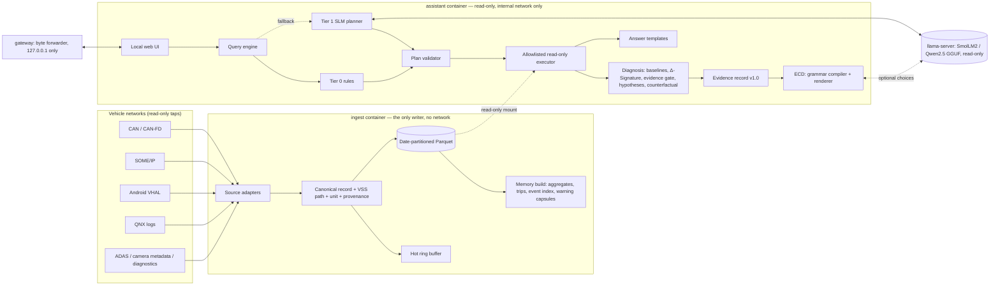

# DriveTrace — Architecture and Results

**Tata Elxsi Teliport S4 · Case Study 5: Natural Language Vehicle Information using On-Device SLM/LLM (VehicleGPT)**
**Date:** 30 October 2026

DriveTrace answers natural-language questions about a vehicle entirely on the vehicle:
- deterministic analytics over a local store answer common questions in about 15 ms (p95);
- an evidence-gated diagnosis explains warnings, with every claim labelled by how strongly the evidence supports it;
- a small language model is used only where it adds value, and only through a grammar compiled from the evidence (Evidence-Compiled Decoding, the novelty).

> **Measurement scope.** All timings and memory figures come from an x86-64 laptop standing in for the 2-core ARM target. All fault-diagnosis results come from synthetic scenarios: none of the recorded vehicles has a labelled fault. Both gaps are listed in §11.

---

## 1. High-level system architecture

The system is two processes with different privileges plus an optional model server. Only the ingest process touches vehicle interfaces and writes the store. The assistant reads, answers and serves the UI.

| Component | Technology | Why |
|---|---|---|
| Store | DuckDB 2.0 over zstd Parquet, partitioned by day and vehicle | Columnar SQL in-process; capped at 2 threads and 512 MB; no server to run |
| Analytics and diagnosis | Python, numpy; declared rules in YAML | Numbers must be reproducible; the model never computes them |
| Language model | llama.cpp (b11606) with Q4_K_M GGUF models | CPU-only, grammar-constrained decoding, runs in about 0.5 GB |
| UI | FastAPI + plain JavaScript and inline SVG | No CDN or third-party scripts; works offline |
| Deployment | Docker Compose: ingest, assistant, gateway, optional SLM | Isolation that can be tested |

## 2. Vehicle data collection strategy

**Data flow:** every source passes through an adapter that writes one canonical record shape:
- timestamp, VSS signal path, value, unit, quality;
- source id, scenario or run id, `simulated`/`recorded` flag;
- a sequence number that makes the record traceable back to its source.

The signal catalogue (`schema/vss_mapping.yaml`) is the gate: a signal or unit not in it is rejected. Signals outside VSS are declared as vendor extensions (`Vehicle.VendorExt.*`).

| Source in the brief | How it is handled | Status |
|---|---|---|
| CAN / CAN-FD | Zenodo record 2661316: 5 real trips, 115 decoded signals at 20 Hz; 28 mapped and decimated to 1-10 Hz; warning lamps and cruise buttons become events | Built and tested |
| OBD-II / powertrain | VED (Ann Arbor fleet): 22.4 M rows, 384 vehicles, including 2 EVs with a year of data | Built and tested |
| Battery, BMS, thermal | Synthetic EV: lumped electro-thermal model with BMS logic (pump, derate, warning) | Built and tested |
| ADAS | Synthetic engagement/disengagement events; real cruise-control events from Zenodo | Built |
| SOME/IP, Android VHAL, QNX logs, camera | Adapter interface defined; mapped to the same canonical record; not implemented | Design only |
| Diagnostics (DTC) | Over-temperature warning (P0A7E) from the simulated BMS; lamp events from CAN | Built |

**Recreating driving scenarios and error sequences:** `sim/` generates labelled data:
- a six-week history for one EV (102 trips, 3,600 km);
- 61 three-day episodes covering eight scenarios: healthy, high load, cooling degradation, sensor bias, pump not commanded, frozen or missing signal, compound faults, and a held-out combination.

Labels are written to a separate directory that no assistant code reads, and a test enforces this. CARLA was not needed for the battery and thermal scenarios; it remains the route for camera-based ADAS scenarios.

## 3. SLM/LLM selection rationale

The model was chosen by measuring, not assuming. Decision gate G0 (`docs/g0_decision.md`):

| Model (Q4_K_M) | File | Prompt / generation speed, 2 threads | One query plan, prompt cached | Server peak memory |
|---|---|---|---|---|
| Qwen2.5-0.5B-Instruct | 485 MB | 115 / 27 tok/s | 1.7 s (JSON) · 0.55 s (compact) | 597 MB |
| SmolLM2-360M-Instruct | 269 MB | 120 / 35 tok/s | 1.6 s (JSON) · 0.44 s (compact) | 478 MB |

What followed from the measurements:
1. **Rules answer the common questions.** A model-written plan would use most of the 2 s budget on ARM, so deterministic rules (Tier 0) answer all common questions. The model (Tier 1) is a fallback for rephrasings only.
2. **Tokens forced by a grammar still cost time.** Each still takes a full decode step, so the model should emit choices, not fixed text. That shaped ECD (§7).
3. **These models cannot diagnose.** Asked to pick the cause themselves, both chose "none" almost every time: 0-2 of 17 test cases right (Experiment B). Analysis stays deterministic.
4. **Recommendation:** SmolLM2-360M for its footprint; Qwen2.5-0.5B where accuracy matters more, since it gets more plans fully right (42% vs 17-35%).

## 4. Search and retrieval workflow

1. **Route.** Keyword and pattern rules map the question to a plan: intent, signal, period, grouping, event type. Control requests ("Brake hard now"), prompt injection and off-topic questions are refused here, before any model runs.
2. **Fallback (optional).** If configured, the SLM can fill the same plan under a grammar from the plan vocabulary. It cannot express SQL or a command. The default web UI deployment keeps Tier 0 only.
3. **Validate.** The plan is checked against allowed values and combinations; documented defaults are applied and reported.
4. **Resolve time.** "Yesterday" and "this month" are resolved on the vehicle's own clock and time zone, DST-safe.
5. **Execute.** One handler per intent runs fixed, parameterised SQL over the memory layers. Plan values never reach SQL text.
6. **Render.** Templates write the answer. Numbers come only from the result; notes state any substitution, for example "no fuel data, using energy".
7. **Explain.** Diagnostic questions go to §6, and their answer is written through ECD (§7).

| Measure | Result |
|---|---|
| Tier 0 routing on 142 same-author questions | 71/71 dev, 71/71 test |
| Tier 0 routing on regression set (reviewer probes) | 37/40 fully correct (in-sample regression set; external independent set pending) |
| SLM fallback, fully correct plans | 17-42% |
| Common-question latency, in-process | p95 15-19 ms |
| Common-question latency, over HTTP | p95 38-46 ms |

## 5. Historical data storage approach

| Layer | Contents | Requirement |
|---|---|---|
| Hot ring buffer | Recent samples in fixed numpy arrays; 200k rows = 3.6 MB, oldest overwritten | FR-MEM-01 |
| Raw history | Canonical Parquet per day and vehicle (zstd) | FR-MEM-02 |
| Aggregates | Hourly and daily min / max / mean / p50 / p95 per signal | FR-MEM-03 |
| Trips | Distance, battery energy, estimated fuel, highway share, temperatures, heater, state of charge | - |
| Event index | Every event with its trip | FR-MEM-05 |
| Capsules | Raw signals 30 min before to 10 min after every warning | FR-MEM-04 |

**Measured storage (Parquet, raw + derived):**

| Source | MB per day | Six weeks |
|---|---|---|
| Synthetic EV | 0.62 | 26 MB |
| VED Leaf | 0.06 | 2.6 MB |
| Zenodo CAN at 1-10 Hz | 3.5 | about 150 MB |

The "several weeks searchable" requirement therefore fits comfortably in flash storage. Replay delivers a week of data in 6-8 s at full speed, or paced at any multiple, with no dropped rows.

## 6. Explaining causes: evidence-gated diagnosis

Question: "What happened before the battery overheating warning?"

1. **Window.** Up to 30 minutes before the event, inside one trip or charge.
2. **Matched baselines.** Earlier sessions of the same kind within declared tolerances (charger power, start SoC, ambient, start temperature). Sessions that raised warnings are excluded. If nothing matches, the fallback is declared as such.
3. **Δ-Signature.** Load, heating per unit load, pump speed when commanded, coolant heat pick-up and sensor agreement, each against the baseline, with robust z-scores and declared noise floors.
4. **Evidence gate.** Coverage, gaps, range, frozen values, persistent sensor contradiction, pump command state, baseline comparability. Outcome: SUFFICIENT, AMBIGUOUS or INSUFFICIENT.
5. **Hypotheses.** Declared rules score six explanations: load, cooling, sensor fault, pump not commanded, stale data, none. Scores are compatibility scores, not probabilities.
6. **Physical model and counterfactual.** A lumped thermal model is fitted to the observed temperatures, then re-run with each fault removed. A fault is ATTRIBUTED only if removing it would have prevented the warning and the fit is good.
7. **Evidence record v1.0.** Every number is a slot with provenance; every claim carries an epistemic level: OBSERVED, ASSOCIATED, CONSISTENT_WITH, ATTRIBUTED or INSUFFICIENT.

**Results (rules v1.1)** - exact means the predicted set of causes equals the labelled set:

| Split | Exact | Confidently wrong |
|---|---|---|
| train | 21/21 | 0 |
| dev | 7/7 | 0 |
| test | 17/17 | 0 |
| history | 8/8 | 0 |
| blind (16 episodes generated after the last rule change) | 16/16 | 0 |

Healthy, pump-off and bad-data scenarios never produced a fault claim.

**What each part contributes (Experiment B):** removing the evidence gate drops test accuracy to 6/17, and removing baselines to 13/17. The physical model matters only when baselines are unrepresentative.

**Under corrupted data (Experiment E, blind split):** 1 confidently wrong answer in 96 corrupted diagnoses.

> **Caveat.** The counterfactual model is the simulator's own model, so ATTRIBUTED results show the method works, not that it would be right on a real pack. A real vehicle needs a calibrated model first.

## 7. Novelty: Evidence-Compiled Decoding (ECD)

The language model never writes the answer. For each diagnosis, a grammar is compiled from the evidence record, and the model can only choose items from it. The renderer then writes every word from a fixed lexicon and every number from a record slot.

| Contract | Enforced by |
|---|---|
| **C1** no number outside the evidence | Choice words contain no digits; fixed wording contains no digits (tested) |
| **C2** no cause or entity outside the record | Only the record's claims and features are choices |
| **C3** wording never stronger than the evidence | "was a cause" exists only for ATTRIBUTED claims |
| Roles | The driver grammar has no technical evidence; no role gets location or identity |

**Experiment F, 17 held-out test diagnoses, Qwen2.5-0.5B:**

| Condition | Invented numbers | Causes not in evidence | Overclaims | p50 latency |
|---|---|---|---|---|
| Free text | 3/17 | 2/17 | 1/17 | 8.5 s |
| One fixed grammar | 0/17 | 6/17 | 0/17 | 4.7 s |
| **ECD** | **0/17** | **0/17** | **0/17** | **1.0 s** |

SmolLM2 showed the same pattern. Property tests over about 1,000 random records found one real violation in our own wording: a label containing a digit. It was fixed, and a test now guards against it.

**What ECD does not show yet:** that the model chooses better than the deterministic default. The product therefore uses the deterministic choice by default, with SLM choice as an option.

## 8. Edge deployment architecture

| Container | Privileges | Network |
|---|---|---|
| ingest | Read-write data; the only one that may receive CAN access | none |
| assistant | Read-only root filesystem and data, all capabilities dropped, user 10001, no-new-privileges, 1 GB / 2 CPU | internal network only, no route out |
| gateway | Byte forwarder, no application logic, 64 MB | internal + edge; publishes 127.0.0.1:8765 only |
| slm (optional) | Read-only models | internal only |

**Negative tests from inside the assistant container (Docker Desktop):** 7 of 7 forbidden actions blocked: writing the data, writing the image, opening a CAN socket, outbound TCP with a raw socket, external DNS, setuid, seeing devices. The first network design (a no-masquerade bridge) leaked outbound traffic; the test caught it, and the design moved to an internal network. An in-process egress guard is a second layer.

**Measured footprint (Experiment D):**

| Process | Peak memory |
|---|---|
| Assistant under full load | 200 MB |
| Concurrent ingest replay | 88 MB |
| llama-server (SmolLM2) | 567 MB |
| **Whole stack** | **about 850 MB** |

Common-question p95 rises from 38 ms to 42 ms with ingest running at the same time.

**Scaling** from a Raspberry Pi to a vehicle HPC uses the same image and code. Only the thread count, DuckDB memory limit and model choice in `config/drivetrace.yaml` and the compose limits change.

## 9. User interaction design

- **Local web page.** One question box with the case-study questions as one-click examples.
- **Answers.** Every number is highlighted, because each comes from data.
- **Evidence panel.** Claims with level badges, the gate status, baseline sessions and event IDs.
- **Charts.** Signals around the event, with the event marked and axes in the vehicle's time zone.
- **Latency.** A breakdown per stage.
- **Roles.**
  - Driver: plain conclusions and temperatures only.
  - Service: full technical evidence.
  - Fleet: aggregates, without location or identity.
- **Privacy.** Location and driver identity are never served to any role. A deletion command in the ingest process removes them from every layer and logs counts only.
- **Safety.** Control requests are refused for every role. Text inside vehicle logs is shown as data and never executed (tested).

## 10. Results against the evaluation criteria

| Criterion (brief, p.3) | Evidence | Key numbers |
|---|---|---|
| System architecture | §1, compose deployment, UI | 4 containers; 119 automated tests |
| AI capability: understanding queries | Tier 0 rules in UI; optional SLM fallback | 142/142 on same-author set; 37/40 on in-sample regression set; SLM 17-42% |
| AI capability: accuracy | Deterministic answers; ECD | 0 invented numbers with ECD vs 3/17 free text |
| Data integration | Adapters with catalogue and unit checks | CAN (Zenodo), OBD (VED), simulated BMS/ADAS; SOME/IP, VHAL, QNX designed only |
| Search and analytics: events, trends, anomalies | Memory layers + executor | p95 15-19 ms |
| Explaining causes | Evidence-gated diagnosis | 16/16 blind exact; 0 confidently wrong |
| Edge performance: memory, latency, scalability | Experiments C, D | about 850 MB stack; common p95 42 ms under ingest (x86 proxy) |
| Privacy and security | Isolation, egress guard, privacy policy, deletion | 7/7 isolation checks; 14 security tests |
| Innovation and practicality | ECD; container deployment | Contracts C1-C3 hold by construction |

## 11. Limits and next steps

1. **ARM target.** Re-run the benchmarks on a 2-core ARM board under one 2 GB limit, and rebuild the image there (`docs/REPRODUCE.md` §6).
2. **Real faults & circular diagnosis.** Diagnostic accuracy is from synthetic scenarios, where the counterfactual model is the declared physical model (`models/vehicle_model.py`) that generated the synthetic traces. A calibrated thermal model and physical fault data are required for production automotive sign-off.
3. **Independent questions.** The original routing questions were written by the same author as the rules. The 40 reviewer probes were compiled into an in-sample regression set (`tests/data/regression_set.yaml`) rather than representing an independent evaluation. True independent validation requires a prospective external set (100+ questions from external participants without rule access) to measure unbiased generalisation.
4. **Protocols.** SOME/IP, VHAL, QNX and camera adapters are designed, not built. VSS release 6.1 paths still need verification.
5. **Detection gaps.** Signals misaligned in time are not detected yet (Experiment E).
6. **Image size.** The image is 763 MB and can be trimmed.

## 12. Sources and documents

**Datasets:**
- Vehicle Energy Dataset (G. S. Oh, D. J. LeBlanc, H. Peng), [github.com/gsoh/VED](https://github.com/gsoh/VED), Apache 2.0.
- Vehicle CAN bus data with GPS (C. Kaiser, A. Stocker, A. Festl), [zenodo.org/records/2661316](https://zenodo.org/records/2661316), CC BY 4.0.

**Models and runtime:**
- [Qwen2.5-0.5B-Instruct-GGUF](https://huggingface.co/Qwen/Qwen2.5-0.5B-Instruct-GGUF)
- [SmolLM2-360M-Instruct-GGUF](https://huggingface.co/unsloth/SmolLM2-360M-Instruct-GGUF)
- [llama.cpp b11606](https://github.com/ggml-org/llama.cpp/releases/tag/b11606)

**Standards:** [COVESA Vehicle Signal Specification](https://covesa.github.io/vehicle_signal_specification/).

**Design history and references:** `solution_journey (1).md` (research, defects, references R1-R12).

**Repository documents:**
- results: `docs/p2_results.md`, `p4_results.md`, `p5_results.md`, `p6_results.md`, `p7_results.md`, `g0_decision.md`;
- reproduction: `docs/REPRODUCE.md`;
- demo: `docs/demo_script.md`.
