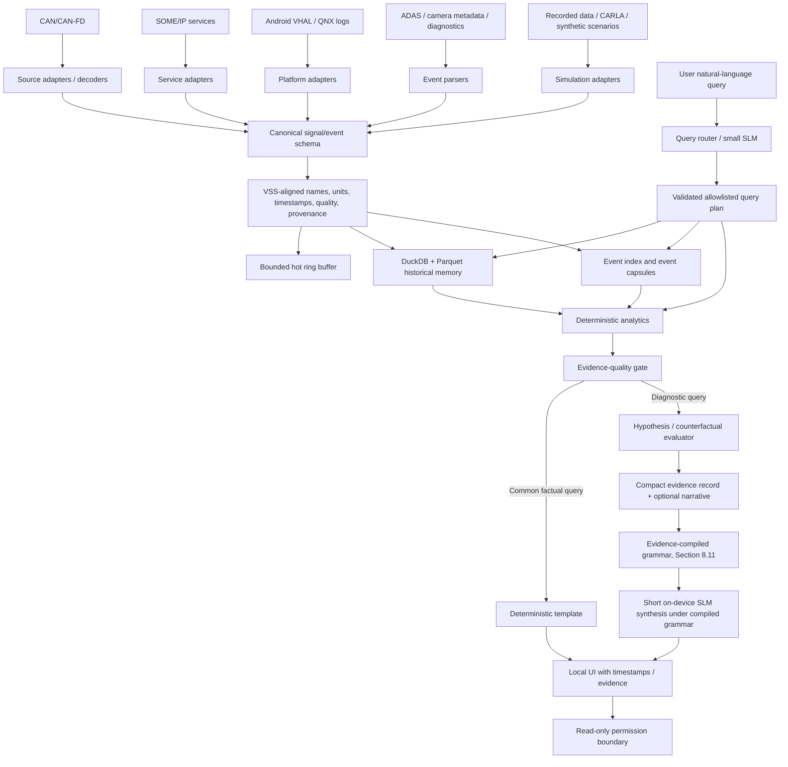
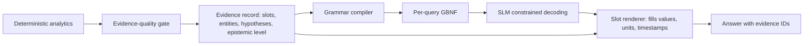

# Solution Journey: DriveTrace / VehicleGPT

**Document type:** Technical retrospective, research review, architecture proposal, and decision record  
**Prepared:** 27 October 2026  
**Project context:** Tata Elxsi Teliport S4, Case Study 5 - Natural Language Vehicle Information using On-Device SLM/LLM (VehicleGPT)  
**Status:** Proposed design and validation plan. No implementation benchmarks or experiments are claimed as completed in this document.

---

## Executive Summary

The objective is to design an intelligent vehicle assistant that answers natural-language questions about vehicle telemetry, diagnostic events, driving history, and system logs while running locally on constrained embedded hardware. The Case Study 5 brief requires offline operation, approximately 2 GB RAM, around two ARM A5X-class cores, sub-two-second response time for common queries, searchable history spanning several weeks, integration with heterogeneous automotive data sources, and isolation from safety-critical functions.

The solution evolved from a generic on-device vehicle chatbot into **DriveTrace**, an evidence-grounded temporal-memory and analytics system. Its central engineering principle is to keep data retrieval, numerical analysis, signal-quality checks, and diagnostic validation in deterministic software. A small language model (SLM) is used for natural-language intent interpretation and concise explanation, not as the component responsible for calculating telemetry statistics or independently proving a physical root cause.

Several ideas were considered and refined:

1. **Generic local RAG** was attractive because it is familiar and easy to describe, but feeding raw high-frequency telemetry or long log histories directly to a tiny SLM is unlikely to be efficient or numerically reliable.
2. **Contrastive analytics** became the first major improvement: retrieve an event window, compare it with matched healthy windows, calculate a compact difference representation (the **Delta-Signature**, written Δ-Signature), and preserve links to source evidence.
3. **VSS-aligned semantic narratives** were proposed after reviewing research on structured driving-state narratives for GNSS spoofing detection. The idea remains an input-representation candidate, but it is not claimed to be universally superior, a new standard, or a latency guarantee. COVESA VSS is a vehicle signal data model, not a universal raw-protocol decoder or a prescribed natural-language format.
4. **Two-tier query routing and grammar-constrained output** address the difference between common factual queries and deeper diagnostic questions. Grammar-constrained decoding can constrain output syntax, but it does not guarantee semantic correctness or a particular response time.
5. The most promising next research direction is **evidence-gated counterfactual diagnosis**: compare candidate explanations against observed data and, where a defensible physical/causal model exists, evaluate what would differ if a candidate fault were absent. If evidence is incomplete or hypotheses remain indistinguishable, DriveTrace should say so instead of presenting a confident diagnosis.
6. The proposed headline novelty is **Evidence-Compiled Decoding (ECD)** (Section 8.11): for each answer, the deterministic engine compiles a grammar from the evidence record, so the SLM cannot emit numbers outside evidence slots, cannot name entities that were not retrieved, and can only use causal language licensed by the evidence gate's epistemic level. The same mechanism supports role-scoped (privacy-preserving) vocabularies and a query-language-derived retention design. Its individual building blocks exist; the coupling is the claimed contribution, pending a targeted prior-art search and Experiment F.

The current recommended design is therefore:

> **DriveTrace: query-aware temporal memory + VSS-aligned signal normalization + deterministic contrastive analytics + signal-quality/evidence gating + lightweight hypothesis testing + compact on-device SLM interaction under evidence-compiled decoding.**

The research contribution must be demonstrated experimentally. A credible proposal should compare raw/structured/narrative representations, basic RAG, Δ-Signature, evidence gating, and hypothesis testing under controlled fault-injection scenarios. It should report answer quality, unsupported claims, evidence coverage, retrieval recall, p50/p95 latency, peak RAM, and storage cost. Until these experiments are run on the target hardware, performance claims remain hypotheses.

---

## 1. Initial Problem and Objectives

### 1.1 Original problem statement

The Case Study 5 PDF describes Software-Defined Vehicles as generating large volumes of real-time data from sensors, ECUs, ADAS, infotainment, powertrain, body electronics, and connected services. It asks for an SLM/LLM operating directly inside the vehicle that continuously consumes data streams, events, and logs and makes relevant information searchable through natural language without requiring cloud connectivity.

The brief gives example queries:

- “Why has my driving range reduced over the last two weeks?”
- “When did fuel efficiency show the largest drop?”
- “Show all ADAS disengagement events from yesterday.”
- “What happened before the battery overheating warning?”
- “Compare energy consumption between city and highway driving.”

### 1.2 Requirements stated in the case study

| Requirement | Meaning for DriveTrace | Status in this document |
|---|---|---|
| Offline/no cloud dependency | Retrieval, analytics, model inference, and user interaction must operate locally. | Architectural requirement; deployment not yet tested. |
| Embedded resource constraints | Approximately 2 GB RAM and around 2 ARM A5X-class cores; the brief also permits equivalent demonstration hardware or an ARM virtualized environment. | Must be validated using the actual target or a clearly described proxy. |
| Common-query latency under 2 seconds | Typical factual queries such as event lookup or a simple trend should be answered quickly. The brief says *common* queries; it does not explicitly guarantee the same timing for every complex diagnosis. | Hard acceptance target for common queries; benchmark required. |
| Several weeks of searchable history | The system cannot retain every raw signal and video frame indefinitely in RAM. | Requires tiered retention and measurement of storage/retrieval quality. |
| Multiple data sources/protocols | CAN/CAN-FD, SOME/IP, Android Vehicle HAL, QNX services/logs, ADAS, camera feeds, diagnostic logs. | Implement a small number of adapters in the prototype; document the rest. |
| Re-create driving scenarios and error sequences | Use simulation such as CARLA, recorded data, or synthetic streams. | Proposed hybrid approach; scenarios must have explicit provenance and labels. |
| Safety isolation | Vehicle safety-critical functions must remain separate from the AI assistant. | Must be enforced architecturally and by permissions, not just described in prose. |
| Natural-language usability | Drivers/service engineers should not need to understand raw CAN frames or database schema. | Requires intent routing and concise, evidence-grounded responses. |

Source: the supplied PDF, *Case Study 5 - TBU - Vehicle Information using On-Device SLM or LLM*.

### 1.3 Initial objectives

The intended prototype should:

1. Answer event, trend, comparison, and diagnostic-history questions in natural language.
2. Keep telemetry and user queries on device.
3. Search structured telemetry and event history spanning multiple weeks.
4. Detect important deviations and retrieve relevant event windows.
5. Produce understandable explanations that point back to timestamps, signals, and source records.
6. Fit within the stipulated hardware envelope, subject to measurement.
7. Demonstrate why its design is safer and more practical than allowing a language model to inspect raw data and invent explanations directly.

### 1.4 Initial assumptions

We initially reasoned that conventional RAG would be too heavy if it meant putting raw telemetry, complete logs, and long event histories into a small SLM context. We also assumed a small model should not be responsible for arithmetic over time-series arrays. These assumptions motivated a local data engine and compact evidence summaries.

The first version of the reasoning was incomplete in several ways: prompt length is only one contributor to latency; compact models may still misinterpret structured input; a difference from a healthy baseline does not prove the cause of a fault; and integration standards do not by themselves provide a novel research contribution.

---

## 2. Chronological Discussion and Idea Evolution

This reconstruction follows the available conversation and supplied retrospective notes. It records the evolution of the idea, not a claim that any component has already been implemented.

### Phase 0 - Choosing Case Study 5 over Case Study 3

The choice was between **MCV - Adaptive QoS Engine** and **TBU - Vehicle Information using On-Device SLM/LLM**.

- Case 3 focused on computer networking: dynamically allocating bandwidth to preserve latency for interactive traffic under changing link capacity.
- Case 5 focused on edge AI, automotive data integration, natural-language interfaces, retrieval, and local inference.

The decision leaned toward Case 5 for its AI/LLM and edge-computing potential, while recognizing that Case 3 could be more execution-reliable for someone with a networking specialization. This was a strategic choice, not evidence that Case 5 is inherently better or easier.

### Phase 1 - Generic VehicleGPT architecture

The starting design was a local assistant that ingests vehicle signals and logs, retrieves relevant material, and asks an SLM/LLM to answer the driver's question. Candidate sources included CAN, ADAS and diagnostic records, with simulation used to create scenarios that are not represented in public data.

The key insight was that the product should not be a general chatbot with a vehicle-themed prompt. It must answer from current and historical vehicle-specific evidence.

### Phase 2 - DriveTrace: temporal memory and deterministic analytics

The design became **DriveTrace**, an evidence-grounded temporal memory system. Instead of forwarding raw histories directly to the model, the system would:

1. retrieve the relevant fault/event time window;
2. find healthy windows with comparable operating conditions;
3. calculate changes and trends in deterministic code;
4. pass a small evidence representation to the model;
5. keep source timestamps and records available for verification.

DuckDB and compressed Parquet were proposed for historical analytics, while a bounded ring buffer would hold recent data. A small quantized GGUF model running in `llama.cpp` was proposed for local model execution. VSS was added as an interoperability model for normalizing vehicle-signal names and meanings.

These were engineering proposals, not benchmark results. DuckDB, Parquet, and a quantized model reduce some costs, but each must be tested under the actual hardware and workload.

### Phase 3 - Dataset and simulation strategy

A single public dataset was unlikely to cover battery measurements, CAN signals, ADAS events, and labeled fault sequences. The plan shifted to a **hybrid dataset**:

- real EV telemetry for pack current, voltage, state of charge and temperature;
- a CAN/GPS dataset for vehicle dynamics and timing;
- CARLA for driving scenarios and sensors/events it actually supports;
- explicitly labelled synthetic fault injection for missing fault sequences, such as a simulated cooling-system degradation scenario.

A critical limitation was recognized: unrelated datasets must not be merged as though they came from one real vehicle. They need source identifiers, independent timelines, and explicit simulated/recorded provenance.

### Phase 4 - VSS-guided semantic narratives

A proposed middleware layer converted calculated numerical differences into compact natural-language statements based on standardized signal semantics. The motivation was that an SLM might respond more reliably to a concise semantic description than to a long array of numerical telemetry.

The discussion referred to the August 2026 preprint *Structured Driving-State Narratives for Small Language Model-Based GNSS Spoofing Detection* by Enan et al. It reported strong results for a specific GNSS-spoofing task using structured narratives. It was not evidence that narratives are the only effective representation for general vehicle diagnostics, nor that the result transfers directly to the present hardware.

The idea was refined: keep narratives as one candidate representation; retain the structured evidence; compare JSON, Markdown, semantic narratives, and a hybrid format in an ablation study.

### Phase 5 - Two-tier execution and grammar-constrained plans

The latency discussion exposed a second issue: even if the prompt is short, a CPU-bound autoregressive model may need meaningful time to generate a full sentence. The architecture was therefore split into tiers:

- **Fast common-query path:** a deterministic/template path or compact structured query plan for frequent, bounded tasks such as listing events or returning a computed trend.
- **Diagnostic path:** retrieve a fault capsule, calculate contrastive signatures, check signal quality, evaluate hypotheses, and produce a brief evidence-based explanation.

`llama.cpp` supports grammar-constrained generation (GBNF) to restrict output format. The proposal uses this for machine-readable query plans, which are then validated and executed against an allowlist. Grammar constraints can ensure syntactic conformance to a grammar, but they do not guarantee the intent is correct, make a model faster by a mathematical necessity, or guarantee end-to-end latency.

### Phase 6 - Δ-Signature representation ablation

The research question became more precise: rather than assuming that narrative text is always best, test multiple representations of the *same* deterministic contrastive result.

Proposed variants:

1. compact JSON;
2. Markdown/table representation;
3. semantic narrative;
4. hybrid narrative plus compact structured evidence references.

This is a useful experimental design but not by itself a complete novelty claim. Representation ablation is a method for identifying which format performs best on the chosen model, task and hardware. The outcome remains unknown until the experiment is run.

### Phase 7 - Evidence-gated counterfactual diagnosis

The latest idea extends Δ-Signatures beyond “what changed?” to “which candidate explanation is best supported, and what evidence would distinguish it from alternatives?”

A battery warning may be consistent with a cooling issue, excessive electrical load, sensor error, or several faults together. A signal difference alone does not identify the physical cause. A stronger diagnostic engine should:

- validate signal quality, timestamps, and coverage;
- compare with healthy periods matched on operating conditions;
- rank explicit hypotheses against observed evidence;
- use a counterfactual/physical model only where its assumptions are defined;
- preserve evidence provenance;
- abstain or request more data when the evidence does not distinguish competing explanations.

This direction is supported conceptually by new 2026 work on counterfactual fault responsibility in a dynamic structural causal model of a DC motor, and by work on explainable component-level anomaly diagnosis. Neither paper directly validates DriveTrace or EV battery diagnosis on the specified embedded hardware. They motivate a testable direction, not a claim of completed performance.

---

## 3. Analysis of Major Ideas and Approaches

### 3.1 Approach A - Generic local RAG / VehicleGPT

**Idea.** Retrieve vehicle data or documentation, then ask an LLM/SLM to answer the question.

**Motivation.** RAG is familiar, supports natural-language queries, and can integrate logs, manuals and prior events.

**Expected benefits.** Reduced need to train a model; useful natural-language interface; flexible question handling.

**Underlying assumptions.** Relevant evidence can be retrieved within the context window; the model can reason over it reliably; memory/latency are manageable.

**Weaknesses.** Raw time-series arrays are not a good place to delegate arithmetic. Long logs and telemetry can increase context processing, while small models can generate incorrect numbers or unsupported causes. Retrieval can also return correlated but irrelevant records.

**Evidence.** The case brief's hardware and latency limits make exhaustive raw-context reasoning a risky baseline. Automotive RAG work such as CAR-RAG and knowledge-graph-guided diagnostic frameworks shows that retrieval must be designed carefully and that basic retrieval is not the whole problem.

**Decision.** Retain retrieval, but make it structured and local. Do not put raw weeks of telemetry into the SLM prompt.

### 3.2 Approach B - Deterministic temporal memory plus contrastive analytics

**Idea.** Query an indexed local history, isolate the relevant event window, match healthy baselines and calculate differences in deterministic code.

**Motivation.** Numerical correctness, explainability and predictable resource use are essential for vehicle queries.

**Expected benefits.** Reproducible trend calculations; small model context; evidence references; better separation of analytics from prose.

**Assumptions.** A suitable baseline exists and has comparable operating conditions; signal mapping and timestamps are trustworthy; the event window contains relevant evidence.

**Weaknesses.** Incorrect baseline matching can confound the result. A Δ-Signature may explain a deviation but not distinguish its cause. Baseline quality deteriorates when conditions shift, sensors drift, or events are rare.

**Decision.** Retain as a foundation. Add signal-quality checks, explicit baseline matching criteria and alternative-hypothesis evaluation.

### 3.3 Approach C - VSS-guided semantic narrative

**Idea.** Transform a structured anomaly summary into a concise sentence such as: “Battery temperature is above the matched healthy baseline; pump speed is zero despite an active pump command.”

**Motivation.** Compact semantic descriptions may be easier for a small model to interpret than raw arrays or dense JSON.

**Expected benefits.** Better semantic alignment, easier prompt inspection, potentially fewer input tokens than detailed records.

**Assumptions.** Text is consistently better than structured records; VSS provides the narrative format; shorter context guarantees lower end-to-end latency.

**Weaknesses.** VSS specifies a model/taxonomy of vehicle signals, not a natural-language generator. Narratives can omit detail, blur uncertainty, or turn association into causality. Converting numbers to words does not guarantee a faster decoder. A claim that narratives are universally superior would overreach the GNSS-spoofing literature.

**Decision.** Retain as one representation in an ablation study. Keep the structured record and source IDs as the authoritative evidence.

### 3.4 Approach D - Query-aware memory and event capsules

**Idea.** Use a recent-data ring buffer, historical summaries, detailed event capsules, and an index. Preserve fine-grained data around important incidents and aggregate routine periods.

**Motivation.** Several weeks of history must be searchable without keeping all raw telemetry or images in RAM.

**Research connection.** Yao and Atkins' *The Smart Black Box* evaluates value-driven, bounded high-bandwidth automotive event recording, including prioritization and compression decisions versus FIFO recording.

**Expected benefits.** Lower storage, fast event lookup, retention of detail around anomalies.

**Weaknesses.** A retention algorithm can discard information later needed for an unexpected question. Event selection and summarization may embed bias. Any storage claim must include on-disk size, memory usage, query latency and query accuracy.

**Decision.** Retain, but start with simple policies: short raw rolling buffer, fixed-rate aggregates, event-triggered detail windows, and explicit retention metadata. Do not introduce a complex learned retention policy until the baseline works.

### 3.5 Approach E - Two-tier routing and GBNF query plans

**Idea.** Common factual queries use deterministic handlers or compact structured plans; diagnostic queries invoke richer local analytics. Constrain SLM plans to a small allowlisted schema with GBNF.

**Motivation.** The case asks for under-two-second common queries, not necessarily the same latency for all diagnostic reasoning. A model should not emit long prose for a simple database lookup.

**Expected benefits.** Lower average generation burden, predictable query surface, simpler validation, fewer arbitrary tool calls.

**Weaknesses.** Valid JSON can still express the wrong intent. A small SLM may select the wrong signal or time window. GBNF constrains form rather than factual truth or latency. Misrouted queries can create dangerous confidence if not checked.

**Decision.** Retain with deterministic fallbacks, schema validation, tool/SQL allowlists, and latency benchmarks. Route known common query shapes to deterministic templates whenever possible.

### 3.6 Approach F - Δ-Signature representation ablation

**Idea.** Compare JSON, Markdown, narrative, and hybrid representations of the same precomputed analysis.

**Motivation.** Avoid treating one representation as a universal truth based on a paper in another domain.

**Expected benefits.** Evidence about prompt-token costs, response accuracy and unsupported claims for the selected model/task.

**Weaknesses.** A narrow dataset or poor controls can produce misleading results. Representations must contain equivalent information; evaluation needs separate cases and should not leak scenario templates into the test set. Differences may arise from token count or prompt wording rather than representation alone.

**Decision.** Retain as a secondary experiment and ablation, not the sole main novelty.

### 3.7 Approach G - Evidence-gated counterfactual diagnosis

**Idea.** Compare candidate fault hypotheses with evidence and, where a valid system model exists, compare factual observations with counterfactual predictions after removing one candidate fault while keeping appropriate operating conditions fixed.

**Motivation.** “What changed?” and “which fault caused the symptom?” are different questions. Multiple faults can produce similar observations.

**Expected benefits.** More discriminating explanations, more explicit uncertainty, reduced tendency to call the most abnormal sensor the root cause.

**Assumptions.** The candidate hypotheses are sufficiently specified; the diagnostic rules/physical model are defensible; the telemetry is reliable and time-aligned; test scenarios have ground truth.

**Weaknesses.** Counterfactual conclusions are only as valid as the causal model and interventions. A heuristic hypothesis score is not a calibrated probability or proof of cause. Sensor quality, unmodelled effects and domain shift can defeat the method.

**Decision.** Recommended as the next research direction, scoped initially to a small set of simulated battery/powertrain scenarios. Describe outputs as evidence-supported hypotheses, not confirmed diagnoses.

---

## 4. Defects, Limitations, and Failed Approaches

This section distinguishes **explicitly identified defects** from **additional engineering risks found by review**.

### 4.1 Explicitly identified defects

#### Defect 1 - Treating smaller prompts as a latency guarantee

**What was wrong.** Early reasoning emphasized reducing input context but underweighted the autoregressive cost of generating an answer. The earlier retrospective mentioned rough ARM generation rates of 5-8 tokens/second, but no device benchmark was supplied to establish that rate for the actual target.

**Why it matters.** At that rate, a long explanation could take multiple seconds just to generate. A 30-word response is approximately 35-45 tokens depending on wording and tokenization; at 5-8 tokens/s, decode alone could be several seconds. The actual values must be measured on the target.

**Correction.** Use deterministic output templates for common queries, keep generated outputs short, and constrain query plans to a schema. Measure total latency, including intent parsing, data retrieval, analytics, prompt processing, generation and formatting.

**Remaining limitation.** GBNF does not mathematically guarantee sub-two-second response. The case study specifies under two seconds for common queries, so define and test that subset explicitly.

#### Defect 2 - Claiming VSS narratives as the novelty

**What was wrong.** The earlier concept risked framing VSS as an invention or as the standard that defines semantic narrative format.

**Why it matters.** VSS is an established signal data model. Standardization improves interoperability but does not itself establish research novelty.

**Correction.** Move VSS into the data-integration layer. Define a separate VSS-aligned narrative schema in DriveTrace, and compare narrative input to JSON/Markdown/hybrid alternatives.

**Remaining limitation.** Even a dual-representation compiler may be an engineering contribution rather than a new scientific method unless there is a clear hypothesis and comparative evidence.

#### Defect 3 - Over-extrapolating GNSS narrative research

**What was wrong.** A paper on structured driving-state narratives for GNSS spoofing detection was initially used as if it proved that text narratives are the best input for all vehicle diagnostics.

**Why it matters.** GNSS spoofing classification differs from multi-sensor thermal diagnosis. Its data sources, labels, task, model, and evaluation setting may differ considerably.

**Correction.** Treat the paper as motivation only. Perform representation ablation in the actual DriveTrace task.

**Remaining limitation.** The study may still not replicate on another small model, language, signal domain or compute target.

#### Defect 4 - Confusing a zero signal value with a confirmed fault

**What was wrong.** The example “coolant pump RPM is zero, indicating a failure” omitted the command state and operating mode.

**Why it matters.** Zero RPM may be expected when the pump is not commanded to run. It may also mean missing, stale or faulty telemetry. Without context, the system can misdiagnose normal operation.

**Correction.** Check command/enable state, operating conditions, data freshness, sensor validity and independent corroborating signals. State “consistent with” rather than “proves” when evidence is not conclusive.

**Remaining limitation.** The needed command and feedback signals may not exist in a public dataset or may use vendor-specific semantics.

### 4.2 Additional engineering risks identified in the review

#### Defect 5 - Assuming a 4-bit model file size equals total runtime RAM

A GGUF file size is not peak memory usage. The runtime also needs working buffers, KV cache, temporary allocations, application code, database memory, OS memory and other services. Qwen2.5-0.5B-Instruct Q4_K_M file sizes differ between quantization repositories; the official Hugging Face repository lists around 491 MB, while other GGUF builds may be smaller. SmolLM2-360M-Instruct Q4_K_M is listed around 271 MB in an Unsloth GGUF repository. These are file sizes, not peak RSS benchmarks.

**Correction.** Benchmark both candidate models on the target. Measure peak process RSS, context length, concurrency, cold/warm latency and actual quantization file. Do not claim the model is the only viable choice or that it guarantees the target.

#### Defect 6 - Treating VSS as a protocol decoder

A CAN frame's bytes do not automatically become a named VSS signal. Protocol/source-specific adapters still need definitions, scaling, units, time semantics and signal decoding. SOME/IP and Android VHAL also require their own integration code.

**Correction.** Keep adapters separate from canonicalization: raw source -> decoder/adapter -> validated canonical signal record -> VSS-aligned name/path and unit -> storage. Pin a known VSS release and document vendor extensions.

#### Defect 7 - A “matched healthy baseline” can still be mismatched

Comparisons are only fair when relevant conditions such as speed, load/current, state of charge, ambient temperature, drive mode and charging/discharging state are controlled or accounted for. A baseline selected only by time proximity can falsely attribute normal operating differences to a fault.

**Correction.** Define matching rules, minimum sample coverage, tolerance ranges and fallback behavior. Record why each baseline was selected. Test comparisons on both known similar and intentionally mismatched windows.

#### Defect 8 - Hypothesis ranking is not causal proof

A weighted score of signal compatibility may rank hypotheses, but it is not automatically a probability and cannot prove physical causality. Counterfactual claims require a meaningful structural/physical model and carefully defined interventions.

**Correction.** Name heuristic outputs “compatibility scores” unless statistically calibrated. Reserve “counterfactual” for tests in a specified model. Report evidence, contradictions, assumptions and unresolved alternatives.

#### Defect 9 - Dataset incompatibility and missing ground truth

The Mendeley EV dataset covers pack current, voltage, SoC and temperature over drive/charge records; CARLA provides driving sensor/event outputs. Neither source by itself necessarily supplies labelled battery cooling failures, pump command/RPM sequences, complete SOME/IP/VHAL/QNX streams, or the exact multi-signal warning cascades needed for the diagnosis demo.

**Correction.** Keep datasets separate and labelled. Use CARLA for supported driving/ADAS-adjacent scenarios, real EV data for actual battery measurements, CAN datasets for CAN ingestion demonstrations, and a separate synthetic thermal model/fault-injection generator for battery failure scenarios. Do not portray injected faults as real-world measurements.

#### Defect 10 - Docker read-only or eBPF alone does not prove CAN isolation

Read-only filesystem settings primarily restrict filesystem writes; they do not automatically prevent network transmission. eBPF is a family of kernel technology that can support monitoring/enforcement but does not, merely by being present, create a verified security boundary.

**Correction.** Do not give the assistant process direct access to CAN sockets, device nodes, or actuation APIs. Put ingestion in a separate process and expose a read-only allowlisted interface to the assistant. Enforce OS permissions, least privilege, network restrictions and tested negative cases. Treat additional sandboxing as defense in depth.

#### Defect 11 - Overcomplicated first implementation

The early proposal mentioned Redis, DuckDB, Parquet, SQLite, vector retrieval, multiple protocol adapters, CARLA and an SLM. Running too many components on 2 GB RAM increases integration and monitoring complexity.

**Correction.** Begin with a bounded in-process ring buffer, DuckDB + Parquet, one model runtime, one local UI, and a small number of source adapters. Add other stores or services only when measurements show a requirement.

#### Defect 12 - Under-specifying evaluation methodology

A nice demo with injected data is not enough. If examples are templated or test records are too close to training scenarios, the model can appear accurate without generalizing. Reporting only top-line accuracy hides hallucinations and uncertainty failures.

**Correction.** Use scenario-level train/test separation; include held-out combinations of faults; measure retrieval, diagnostic, evidence and runtime metrics separately; publish scenario-generation assumptions and seeds where possible.

---

## 5. Research Review and Technical References

### Reading guide

The following sources are grouped by the design decision they inform. **“Discussed”** means the source was already mentioned in the conversation or retrospective. **“Added during verification”** means it was found during the current research pass. Research findings in one domain should not be presented as proof that DriveTrace will obtain the same results.

### 5.1 Vehicle fault diagnosis, retrieval, and root-cause reasoning

#### R1. Bosch patent - vehicle error cause determination using LLMs

- **Title:** *Method and apparatus for determining the cause of an error in vehicles using large language models*
- **Inventors:** Benjamin Sobotta and Achim Nonnenmacher
- **Assignee:** Robert Bosch GmbH
- **Publication:** WO2025012128A1, published 16 January 2025
- **Link:** https://patents.google.com/patent/WO2025012128A1/en
- **Problem/contribution:** Describes using vehicle events, diagnostic information, sequences of states, bus data and time series as input to an LLM-assisted error-cause workflow.
- **Relevance:** Shows that “put a language model over vehicle error logs” is already contemplated in patent literature. It supports avoiding a generic vehicle diagnostic chatbot as the main novelty claim.
- **Influence:** Discussed during the earlier novelty review; informed the push toward constrained edge memory and evidence verification.
- **Limitations:** A patent disclosure is not a peer-reviewed comparative experiment. It does not establish performance on the specific 2 GB/two-core target, and it is not a conclusion about legal patentability or freedom to operate.

#### R2. Lin and Miao (2025) - automotive fault diagnosis with knowledge graphs and LLMs

- **Title:** *An Automotive Fault Diagnosis Framework Based on Knowledge Graphs and Large Language Models*
- **Authors:** Weikun Lin and Kehua Miao
- **Venue:** *Electronics*, 14(21), 4180 (2025)
- **DOI:** https://doi.org/10.3390/electronics14214180
- **Link:** https://www.mdpi.com/2079-9292/14/21/4180
- **Problem/contribution:** Integrates automotive diagnostic dialogues, a fault knowledge graph, query-aware semantic retrieval, state tracking, follow-up questions and mode switching. The paper reports 77.3% diagnostic accuracy in its evaluation and describes improvements against its evaluated baselines.
- **Relevance:** Supports multi-stage information gathering and explicit fault relationships rather than relying on a single free-form answer.
- **Influence:** Discussed in the prior research scan as evidence that knowledge graphs and automotive LLM diagnosis already exist.
- **Limitations:** Its proprietary automotive dialogue dataset and model/configuration differ from DriveTrace's telemetry-time-series task. The reported accuracy cannot be compared directly to DriveTrace without a matched evaluation protocol; it does not validate sub-2-second offline inference on the target hardware.

#### R3. Petrova, Koriakov and State (2025) - CAR-RAG

- **Title:** *CAR-RAG: Category-Aware Hybrid Retrieval-Augmented Generation for Hallucination Mitigation*
- **Authors:** Tatiana Petrova, Dmitrii Koriakov and Radu State
- **Venue:** 2025 IEEE International Conference on Big Data (BigData), December 2025
- **DOI:** https://doi.org/10.1109/BigData66926.2025.11401077
- **Link:** https://orbilu.uni.lu/handle/10993/67701
- **Problem/contribution:** Routes retrieval based on query categories and combines vector retrieval with lightweight query augmentation. The authors evaluate over 700 community-provided automotive maintenance Q&A items and report approximately 90% factual accuracy and 6.4% confidently incorrect statements for their evaluation.
- **Relevance:** Supports risk-sensitive retrieval routing and evaluation of confidently wrong answers.
- **Influence:** Discussed in the earlier review as evidence that automotive RAG and hallucination mitigation are active work.
- **Limitations:** Forum-based troubleshooting Q&A is not the same as a live multivariate telemetry stream; the paper does not establish the performance of the DriveTrace model/hardware configuration.

#### R4. Ouarrad, Abboush and Rausch (2026) - automotive HiL root-cause analysis

- **Title:** *Knowledge-Graph-Guided Retrieval-Augmented LLMs for Explainable Root Cause Analysis in Automotive HiL Validation*
- **Authors:** Hamza Ouarrad, Mohammad Abboush and Andreas Rausch
- **Status:** arXiv preprint submitted 11 August 2026; listed as accepted for ICSRS 2026, scheduled for November 23-25, 2026 (as of the date of this document, that conference date is still in the future)
- **DOI:** https://doi.org/10.48550/arXiv.2608.11277
- **Link:** https://arxiv.org/abs/2608.11277
- **Problem/contribution:** Converts large automotive Hardware-in-the-Loop time series into compact diagnostic evidence, adds sensor-to-location/propagation knowledge and historical case retrieval, and uses an LLM as a ranked-fault and explanation layer. It reports results on two HiL case studies.
- **Relevance:** Very close to DriveTrace's principle of not sending raw telemetry directly to the LLM. It is a crucial prior-art consideration for evidence compression and automotive root-cause explanations.
- **Influence:** Added during later research verification; it was not the cause of the earliest decisions in the conversation.
- **Limitations:** It is a preprint, uses two case studies, and does not demonstrate the same strict embedded memory/latency conditions. It overlaps conceptually with the planned evidence-backed diagnostic pipeline, so DriveTrace must identify a narrower differentiator.

#### R5. Enan et al. (2026) - structured driving-state narratives for GNSS spoofing

- **Title:** *Structured Driving-State Narratives for Small Language Model-Based GNSS Spoofing Detection*
- **Authors:** Abyad Enan, Sagar Dasgupta, Mizanur Rahman and Mashrur Chowdhury
- **Status:** arXiv preprint, submitted 17 August 2026
- **Link:** https://arxiv.org/abs/2608.17092
- **Problem/contribution:** Converts independently derived driving states from GNSS and other sources into structured semantic narratives and uses an SLM for GNSS spoofing detection/classification. The abstract reports average accuracy of 96.99%, precision of 99.05%, recall of 95.59% and F1 of 97.18% on the paper's evaluation.
- **Relevance:** Motivates structured narrative representations for compact-model inference.
- **Influence:** Directly inspired the VSS-guided semantic narrative idea, which was subsequently downgraded from a novelty claim to an experimental representation choice.
- **Limitations:** The task is GNSS spoofing classification, not general thermal/powertrain fault diagnosis. The results do not show narratives are the only effective representation or guarantee latency on DriveTrace hardware.

### 5.2 Temporal memory and selective data retention

#### R6. Yao and Atkins - The Smart Black Box

- **Title:** *The Smart Black Box: A Value-Driven High-Bandwidth Automotive Event Data Recorder*
- **Authors:** Yu Yao and Ella M. Atkins
- **Publication history:** arXiv preprint (2019); published in *IEEE Transactions on Intelligent Transportation Systems*, 22(3), pp. 1484-1496 (2021 issue; publication date listed as 12 February 2020)
- **DOI:** https://doi.org/10.1109/TITS.2020.2971385
- **Preprint:** https://arxiv.org/abs/1903.01450
- **IEEE page:** https://ieeexplore.ieee.org/abstract/document/8995510/
- **Problem/contribution:** Prioritizes high-value vehicle data under finite storage, using short-term buffers and decisions about value, similarity and compression. Its evaluation compares recording efficiency with a FIFO scheme in a traffic simulator.
- **Relevance:** Supports the temporal memory idea: preserve more detail around events of interest rather than treating all historical data equally.
- **Influence:** Discussed during architecture development as inspiration for hot buffers, summaries and event capsules.
- **Limitations:** It addresses recording/retention rather than natural-language retrieval, SLM reasoning or diagnostic certainty. DriveTrace still must show that its summaries preserve enough information to answer queries correctly.

### 5.3 Counterfactual, component-level diagnosis, uncertainty and reporting quality

#### R7. Mujić and Wotawa (2026) - counterfactual fault responsibility

- **Title:** *Counterfactual Fault Responsibility in a Dynamic Structural Causal Model of a DC Motor (Short Paper)*
- **Authors:** Emir Mujić and Franz Wotawa
- **Venue:** 37th International Conference on Principles of Diagnosis and Resilient Systems (DX 2026), OASIcs, Volume 148, paper 16, published 28 September 2026
- **DOI:** https://doi.org/10.4230/OASIcs.DX.2026.16
- **Link:** https://drops.dagstuhl.de/entities/document/10.4230/OASIcs.DX.2026.16
- **Problem/contribution:** Represents a dynamic physical process as a time-indexed structural causal model and evaluates fault responsibility by comparing actual trajectories with counterfactual trajectories where candidate faults are removed. The paper evaluates two simulated multi-fault DC motor scenarios.
- **Relevance:** Directly motivates the newest DriveTrace extension: go beyond symptom deviation and ask whether removing a hypothesized fault changes the modeled outcome.
- **Influence:** Added during later research; it supports the direction conceptually but did not cause the earlier DriveTrace architecture.
- **Limitations:** DC motor model and simulated multi-fault cases are not EV battery validation. Counterfactual findings depend on model assumptions and do not prove causality in unmodeled real vehicles.

#### R8. Ozgunay et al. (2026) - explainable GNN component diagnosis

- **Title:** *An Explainable GNN Framework for Component-Level Anomaly Diagnosis*
- **Authors:** Sena Ozgunay, Louise Travé-Massuyès, Jean-Michel Loubes and Raul Sena Ferreira
- **Venue:** DX 2026, OASIcs, Volume 148, pp. 2:1-2:17, published 28 September 2026
- **DOI:** https://doi.org/10.4230/OASIcs.DX.2026.2
- **Link:** https://drops.dagstuhl.de/entities/document/10.4230/OASIcs.DX.2026.2
- **Problem/contribution:** Moves from treating the most deviant sensor as the fault cause to analyzing changes in inter-sensor influence to identify component-level anomalies.
- **Relevance:** Supports the warning that the largest signal deviation is not necessarily the root cause. It motivates considering relationships among signals and components.
- **Influence:** Added during current verification.
- **Limitations:** Uses a GNN approach, not a tiny SLM, and does not validate DriveTrace's resource budget. Relevant domain and evaluation details need review before borrowing a specific method.

#### R9. Das, Koitz-Hristov and Wotawa (2026) - qualitative simulation for weak supervision

- **Title:** *QSIM-Guided Weak Supervision for Fault Detection in Cyber-Physical Systems*
- **Authors:** Ankita Das, Roxane Koitz-Hristov and Franz Wotawa
- **Venue:** DX 2026, OASIcs, Volume 148, pp. 11:1-11:20, published 28 September 2026
- **DOI:** https://doi.org/10.4230/OASIcs.DX.2026.11
- **Link:** https://drops.dagstuhl.de/entities/document/10.4230/OASIcs.DX.2026.11
- **Problem/contribution:** Uses qualitative simulation to support weak supervision for fault detection in cyber-physical systems.
- **Relevance:** A potential direction for generating constrained labels or expected qualitative relationships when real labelled fault sequences are scarce.
- **Influence:** Added during current research verification, not a driver of earlier decisions.
- **Limitations:** It would require checking whether the method and assumptions fit the chosen battery/powertrain system; no claim is made that it has been integrated into DriveTrace.

#### R10. Pană et al. (2026) - multimodal fault diagnosis/prognostics review

- **Title:** *From Signals to Remaining Useful Life: Multimodal Sensor Fusion for Fault Diagnosis and Prognostics—Methods, Pitfalls, and Reporting Standards*
- **Authors:** Cristina Floriana Pană, Camelia Adela Maican, Nicolae Răzvan Vrăjitoru, Daniela Maria Pătrașcu-Pană and Virginia Maria Rădulescu
- **Venue:** *Sensors*, 26(12), 3661, 8 June 2026
- **DOI:** https://doi.org/10.3390/s26123661
- **Link:** https://www.mdpi.com/1424-8220/26/12/3661
- **Problem/contribution:** Reviews multimodal sensor fusion for fault diagnosis and prognostics and documents pitfalls in sensor integrity, synchronization, missing data, uncertainty and reproducibility. Its review of 98 studies reports that many studies do not fully report important data-quality and uncertainty methods; for example, missing-data handling was explicitly described in 15.3% of reviewed studies, and calibrated uncertainty quantification in 20.4%.
- **Relevance:** Reinforces the need to track signal quality, synchronization, missingness, data leakage and uncertainty as first-class parts of DriveTrace rather than post-processing details.
- **Influence:** Added during current verification.
- **Limitations:** It is a broad review, not a benchmark of the proposed DriveTrace system. The reported percentages describe the reviewed literature and do not directly measure DriveTrace.

#### R11. Geifman and El-Yaniv (2019) - selective prediction / reject option

- **Title:** *SelectiveNet: A Deep Neural Network with an Integrated Reject Option*
- **Authors:** Yonatan Geifman and Ran El-Yaniv
- **Venue:** Proceedings of the 36th International Conference on Machine Learning (ICML), PMLR 97, pp. 2151-2159, 2019
- **Link:** https://proceedings.mlr.press/v97/geifman19a.html
- **Problem/contribution:** Studies selective prediction, where a model can abstain on uncertain inputs, and evaluates the trade-off between coverage and risk.
- **Relevance:** Provides background for measuring DriveTrace's abstention rate alongside diagnostic accuracy and confidently wrong answers.
- **Influence:** Added during current verification.
- **Limitations:** It is a general deep classification method, not an automotive LLM design. DriveTrace may use simpler rule-based evidence gates rather than implement SelectiveNet.

#### R12. El-Yaniv and Wiener (2010) - foundations of selective classification

- **Title:** *On the Foundations of Noise-free Selective Classification*
- **Authors:** Ran El-Yaniv and Yair Wiener
- **Venue:** *Journal of Machine Learning Research*, 11, 1605-1641, 2010
- **Link:** https://jmlr.org/beta/papers/v11/el-yaniv10a.html
- **Problem/contribution:** Formalizes classification with a reject option and its risk-coverage trade-off.
- **Relevance:** Supports evaluating whether abstention improves reliability rather than treating abstentions as ordinary failures.
- **Influence:** Added during current verification.
- **Limitations:** General classification theory; it does not specify confidence calibration for DriveTrace fault hypotheses.

### 5.4 Model/runtime and engineering documentation (not research papers)

#### T1. COVESA Vehicle Signal Specification (VSS)

- **Official overview:** https://covesa.global/project/vehicle-signal-specification/
- **Documentation:** https://covesa.github.io/vehicle_signal_specification/
- **Repository/releases:** https://github.com/COVESA/vehicle_signal_specification/releases
- **Relevance:** VSS gives standardized signal names, a hierarchy and semantics for vehicle data. The release page listed VSS 6.1 as the latest release in the October 2026 research check. Pin the version used in the implementation. VSS does not decode every raw protocol and does not prescribe the semantic-narrative schema.

#### T2. DuckDB Parquet documentation and memory management

- **Parquet reading and pushdown:** https://duckdb.org/docs/stable/data/parquet/overview
- **Memory management:** https://duckdb.org/2024/07/09/memory-management
- **Relevance:** DuckDB can query Parquet files directly and use projection/filter pushdown. Its `memory_limit` setting governs memory controlled by its buffer manager, not every allocation in a full process. Configure it conservatively and measure process-wide RSS.

#### T3. `llama.cpp` GBNF documentation

- **GBNF guide:** https://github.com/ggml-org/llama.cpp/blob/master/grammars/README.md
- **`llama.cpp` parsing documentation:** https://github.com/ggml-org/llama.cpp/blob/master/docs/development/parsing.md
- **Relevance:** Supports constraining generated syntax such as a query-plan JSON object. Grammar constraints can reduce malformed outputs but do not guarantee correct intent, accurate diagnosis, or end-to-end latency.

#### T4. Qwen2.5-0.5B-Instruct GGUF model repository

- **Repository:** https://huggingface.co/Qwen/Qwen2.5-0.5B-Instruct-GGUF
- **Relevance:** One candidate for local query planning and succinct explanation. The repository's reported Q4_K_M file size is around 491 MB at the time checked, but other builds differ. File size is not runtime RAM or a speed guarantee.

#### T5. SmolLM2-360M-Instruct GGUF model repository

- **Repository:** https://huggingface.co/unsloth/SmolLM2-360M-Instruct-GGUF
- **Relevance:** Smaller candidate to benchmark against Qwen. The cited repository lists Q4_K_M around 271 MB. Quantization and runtime memory must still be measured; small size can trade off instruction-following quality.

#### T6. CARLA simulator sensors

- **Sensor docs:** https://carla.readthedocs.io/en/latest/core_sensors/
- **Reference:** https://carla.readthedocs.io/en/latest/ref_sensors/
- **Relevance:** CARLA can generate driving simulation outputs such as camera, IMU, collision, lane-invasion, obstacle and radar sensor data. It should not be presented as a ready-made battery thermal simulator. Battery/powertrain fault sequences need a separate model or clearly labelled synthetic generator.

#### T7. Datasets recommended in the discussion

- **Real-world electric vehicle data: driving and charging:** Anirudh Allam et al. (version 2, 2023), DOI https://doi.org/10.17632/7vdkzpnjgj.2, https://data.mendeley.com/datasets/7vdkzpnjgj/2. It contains one year of real EV drive/charge data in `.mat` files, with pack current, voltage, SoC and temperature. The licence is CC BY-NC 3.0. Version 1 is also available: https://data.mendeley.com/datasets/7vdkzpnjgj/1. This dataset alone does not establish labelled cooling-pump failures.
- **Vehicle CAN bus data (with GPS):** Christian Kaiser, Alexander Stocker and Andreas Festl, DOI https://doi.org/10.5281/zenodo.2661315, record https://zenodo.org/records/2661316. The record describes 20 Hz CAN signals such as wheel speed, steering angle, yaw rate/pitch/roll and accelerometer values with GPS data. License is CC BY 4.0 according to the indexed record. Useful for ingestion and vehicle-dynamics queries, not battery thermal fault ground truth.
- **CAN Signal Extraction and Translation Dataset:** H. M. Song and H. K. Kim, *Discovering CAN Specification Using On-Board Diagnostics*, *IEEE Design & Test*, 38(3), pp. 93-103, June 2021, DOI https://doi.org/10.1109/MDAT.2020.3011036. Dataset page: https://ocslab.hksecurity.net/Datasets/can-signal-extraction-and-translation-dataset. It describes 40 traffic logs captured while OBD queries were sent in a controlled environment; academic access may require a questionnaire or IEEE DataPort. This supports CAN processing experiments, not general fault labels.

### 5.5 Research sources explicitly mentioned but not independently validated as full references

The earlier conversation mentioned a link described as an **“Adaptive Computation Survey, 2026.”** The exact title/authors/publication metadata were not verified to a reliable, citable record in the current pass. It is therefore not treated as a verified paper in this review. A dedicated literature search on adaptive inference for small on-device language models remains appropriate.

### 5.6 Consolidated research-paper table

| ID | Source | Main topic | Specific relevance to DriveTrace | Evidence limitation |
|---|---|---|---|---|
| R1 | Bosch patent WO2025012128A1 (2025) | LLM-assisted vehicle error cause | Generic LLM vehicle diagnosis already exists as a concept | Patent is not a performance benchmark |
| R2 | Lin & Miao (2025), DOI 10.3390/electronics14214180 | KG + LLM fault diagnosis | Structured knowledge, follow-up questions, mode switching | Proprietary dialogue dataset; not the same edge telemetry task |
| R3 | Petrova et al. (2025), DOI 10.1109/BigData66926.2025.11401077 | Category-aware automotive RAG | Risk-sensitive retrieval and incorrect-answer metrics | Forum Q&A, not live sensor time series |
| R4 | Ouarrad et al. (2026), arXiv:2608.11277 | Automotive HiL root-cause analysis | Compact diagnostic evidence + historical cases + reasoning | Preprint, two case studies, not same hardware envelope |
| R5 | Enan et al. (2026), arXiv:2608.17092 | Semantic narratives for GNSS spoofing | Motivates representation ablation | Different task; no universal narrative claim |
| R6 | Yao & Atkins (2019/2021), DOI 10.1109/TITS.2020.2971385 | Event-value-based automotive logging | Query-aware temporal retention | Not natural-language or diagnosis research |
| R7 | Mujić & Wotawa (2026), DOI 10.4230/OASIcs.DX.2026.16 | Counterfactual fault responsibility | Supports testing competing fault explanations in a dynamic model | DC motor, simulated cases; transfer to EV must be tested |
| R8 | Ozgunay et al. (2026), DOI 10.4230/OASIcs.DX.2026.2 | Component-level anomaly diagnosis | Distinguishes deviating sensors from component causes | GNN approach and separate domain/hardware |
| R9 | Das et al. (2026), DOI 10.4230/OASIcs.DX.2026.11 | QSIM-guided weak supervision | Potential for model-guided labels when real faults are scarce | Integration into DriveTrace is future work |
| R10 | Pană et al. (2026), DOI 10.3390/s26123661 | Fault diagnosis/prognostics review | Sensor integrity, synchronization, missing data, uncertainty, reproducibility | Review findings are not DriveTrace results |
| R11 | Geifman & El-Yaniv (2019) | Selective prediction | Abstention and risk-coverage evaluation | General ML, not vehicle-specific |
| R12 | El-Yaniv & Wiener (2010) | Reject option foundations | Accuracy vs coverage framework | General theory, needs adaptation |

---

## 6. Comparison of Approaches

| Approach | Core idea | Advantages | Defects/limitations | Relevant sources | Decision |
|---|---|---|---|---|---|
| Generic local chatbot | Prompt an LLM with vehicle context | Simple demo, flexible conversation | Raw logs may be too long; weak numerical reliability; unsupported explanations | R1-R3 | Reject as primary architecture; retain natural-language interface |
| Standard raw RAG | Retrieve text/log chunks and generate an answer | Reuses documents, easy to prototype | Not designed for numerical time-series aggregation; retrieval relevance may be weak | R2-R4 | Retain retrieval concept, replace raw telemetry reasoning with structured analytics |
| Deterministic temporal memory + contrastive analytics | Retrieve event windows and compare matched healthy periods | Reproducible arithmetic and evidence links | Baseline mismatch and correlation-versus-cause problems | R4, R6, R10 | Retain as foundation |
| VSS-guided narratives | Convert Δ-Signature to compact semantic text | Potentially interpretable and token-efficient | Not guaranteed superior or faster; VSS does not define narrative format | R5, T1 | Retain as ablation variant |
| Two-tier routing + GBNF | Compact machine-readable plans for common queries; templates for output | Smaller generation burden and controlled tools | Syntax does not ensure correct intent or latency | T3-T5 | Retain, add validator and deterministic fallbacks |
| Δ-Signature ablation | Compare JSON, Markdown, narrative and hybrid inputs | Tests representation hypotheses instead of assuming them | Narrow task/model/hardware generalization; needs controlled design | R5 | Retain as a secondary experiment |
| Evidence gate | Validate freshness, coverage, consistency and provenance | Can prevent unsupported diagnostics | Thresholds may be arbitrary; may increase abstention | R10-R12 | Add to diagnostic path |
| Counterfactual hypothesis testing | Compare candidate explanations, optionally via physical/causal model | More discriminating than listing the largest signal delta | Depends on model validity, labels and assumptions | R7-R9 | Recommended research extension, initially in simulation |
| Heavy microservice architecture | Separate Redis, vector DB, SQLite, DuckDB, several agents | Modular at scale | Too much operational/RAM overhead for the first constrained demo | Engineering review | Defer until justified by measurements |

### Why the recommended architecture is a balance

A pure SLM approach is more flexible but pushes too much numerical and causal reasoning into a tiny model. A fully deterministic system could be fast and reproducible, but less natural for open-ended questions and explanations. DriveTrace uses deterministic software where correctness matters and the SLM where language flexibility adds value. Evidence gating and counterfactual evaluation are additional layers, not reasons to let the model directly control the vehicle or replace calibrated engineering methods.

---

## 7. Step-by-Step Cause-and-Effect Chain

1. **Need:** Vehicle data is large and heterogeneous, but users ask short natural-language questions.  
   **Initial response:** Put an LLM on top of a retrieval system.  
   **Issue:** A generic RAG design may overload context and delegate arithmetic to the model.

2. **Need for reliable time-series math:** Questions ask about the largest drop, changes over two weeks, and conditions before an alert.  
   **Change:** Add DuckDB/Parquet and a deterministic analytics layer.  
   **Benefit:** Calculation becomes reproducible; the SLM can receive a small result.  
   **Remaining issue:** The model can still misread a compact summary or overstate causality.

3. **Need for weeks of data under limited resources:** Keeping every signal/video frame raw is expensive.  
   **Change:** Add recent ring buffer, historical aggregates, event capsules, and event index.  
   **Basis:** This follows the value-driven retention motivation in *The Smart Black Box*.  
   **Remaining issue:** Retention may discard data needed by future queries, so retrieval quality must be evaluated.

4. **Need for consistent signal semantics:** CAN, SOME/IP, VHAL and logs use different formats.  
   **Change:** Use source-specific adapters and a VSS-aligned canonical schema.  
   **Benefit:** Common units/names simplify analytics.  
   **Remaining issue:** VSS cannot replace protocol decoders; vendor signals and time semantics still need explicit mappings.

5. **Need for easier small-model interpretation:** Compact models may struggle with long numeric input.  
   **Change:** Try semantic narratives.  
   **Evidence:** Enan et al. studied narratives for GNSS spoofing.  
   **Correction:** Do not generalize that result into a universal claim; test JSON, Markdown, narrative and hybrid variants.

6. **Need to meet the common-query latency target:** Prose generation may be expensive.  
   **Change:** Add deterministic templates and short constrained query plans.  
   **Benefit:** Common requests avoid long generated responses.  
   **Remaining issue:** Must measure latency on real hardware; GBNF is not a latency proof.

7. **Need to explain cause rather than correlation:** A deviation alone cannot establish a fault.  
   **Change:** Add signal-quality gates and compare explicit alternative hypotheses. Where a physics/causal model is valid, evaluate counterfactual trajectories.  
   **Evidence:** R7 and R8 provide related diagnosis research.  
   **Remaining issue:** Fault models and ground truth must be developed and validated for the selected vehicle subsystem.

8. **Need credible claims:** A demo can look convincing without generalizing.  
   **Change:** Design baseline comparisons and ablations before implementation.  
   **Benefit:** The submission can report evidence rather than unsupported performance claims.  
   **Remaining issue:** The experiments remain proposed; no results are claimed here.

---

## 8. Final Proposed Solution

### 8.1 Name and core concept

**DriveTrace: Evidence-Gated On-Device Vehicle Intelligence**

DriveTrace is a read-only local vehicle assistant that combines query-aware temporal memory, VSS-aligned signal semantics, deterministic contrastive analytics, evidence-quality checks and small-model language interaction. Its proposed research extension is evidence-gated counterfactual diagnosis for a limited set of faults that can be modeled and tested.

### 8.2 Architecture overview



The diagram is conceptual. Each arrow represents a software interface to be implemented and tested, not proof of a completed connection.

### 8.3 Data collection and normalization

Implement only the adapters needed for the demo, for example:

1. EV CSV/MAT adapter for current, voltage, state of charge, temperature and timestamps.
2. CAN log adapter for timestamp, identifier, data length and payload, plus a signal decoder only where a definition is available.
3. CARLA event adapter for driving simulation outputs such as IMU, collision, lane invasion and camera metadata.
4. Synthetic thermal-system generator for a controlled battery/cooling scenario.

Each canonical observation should retain at least:

```json
{
  "source_id": "ev_dataset_drive_001",
  "scenario_id": "cooling_fault_sim_003",
  "source_type": "simulated",
  "timestamp": "2026-10-27T14:32:00Z",
  "signal_path": "Vehicle.Powertrain.Battery.Temperature",
  "value": 48.75,
  "unit": "degC",
  "quality": "valid",
  "provenance_ref": "row_or_event_reference"
}
```

This is an example schema. Check every path against the pinned VSS release or a documented vendor extension. Do not imply that all signals in this example necessarily exist in the public dataset.

### 8.4 Query-aware temporal memory

Use four simple layers:

- **Hot buffer:** a bounded in-process ring buffer containing recent high-frequency samples.
- **Historical summaries:** periodic aggregates such as min, max, mean, median, count, variance and selected quantiles, depending on the signal and query needs.
- **Event capsules:** detailed windows around faults/warnings/anomalies, including context before and after the event.
- **Event index:** local searchable metadata for timestamp, subsystem, event type, signal references, scenario provenance and event relationships.

Use DuckDB to perform analytical SQL over time-partitioned Parquet files. Configure the database memory limit and temporary directory explicitly. Keep the OS, inference process, database and analytics in one complete memory budget. Start without Redis or a vector database unless a measurement proves either is needed.

### 8.5 Δ-Signature

For a signal `j`, a simple baseline difference can be written as:

\[
\Delta_j = \operatorname{stat}(W_{fault}, j) - \operatorname{stat}(W_{healthy}, j)
\]

where `stat` may be a median, mean, slope or another declared statistic, and the two windows must be matched on relevant operating conditions. For scale-free comparison, a robust score can use median absolute deviation (MAD), with careful handling when MAD is zero or the distribution is unsuitable:

\[
z_j^{robust} = \frac{x_j - \operatorname{median}(B_j)}{1.4826\,\operatorname{MAD}(B_j)}
\]

These are candidate statistics, not a final universal formula. The implementation should define the aggregation window, missing-value policy, baseline-matching features, thresholds and unit semantics per signal class.

A Δ-Signature should include:

- signal path and unit;
- observed value/summary;
- baseline summary and matching criteria;
- absolute and, where meaningful, relative difference;
- event and baseline timestamps;
- sample coverage, freshness and quality flags;
- source/event IDs for verification.

### 8.6 Evidence-quality gate

Before a diagnosis, verify:

- minimum sample coverage;
- valid units and signal ranges;
- freshness and absence of frozen/stale data;
- timestamp alignment across signals;
- whether the pump or subsystem was actually commanded to operate;
- whether baseline conditions are comparable;
- whether independent signals corroborate the finding;
- whether contradictory evidence exists.

The gate can have three outputs:

1. `SUFFICIENT`: evidence supports proceeding to hypothesis ranking.
2. `AMBIGUOUS`: multiple hypotheses remain compatible; compare them or request more evidence.
3. `INSUFFICIENT`: missing or unreliable signals prevent a defensible explanation; abstain or state the limitation.

This gate should be implemented with explicit rules first. Thresholds must be tuned and evaluated rather than arbitrarily treated as confidence probabilities.

### 8.7 Hypothesis ranking and counterfactual testing

Start with a small, explicit hypothesis library. For a thermal warning, examples might include elevated electrical load, cooling-system degradation, temperature-sensor fault, and unknown/other. Use only signals and relationships that the chosen simulation actually exposes.

A general compatibility score may be written as:

\[
S(h\mid E) = \sum_i w_i\,s_i(E,h) - \lambda C(h,E) - \mu M(h,E)
\]

where:

- `E` is the evidence set;
- `s_i` represents a documented consistency check between evidence item `i` and hypothesis `h`;
- `C` penalizes contradictions;
- `M` penalizes missing required evidence;
- weights and penalties are parameters to calibrate on labelled scenarios.

Unless calibrated against data, `S` is only a ranking score, not a probability. If two candidates have similar scores or key signals are absent, the decision should be ambiguous.

For the counterfactual extension, use a specified physical or structural model to compare the observed/factual path with a modeled trajectory in which a candidate fault is removed while other relevant conditions are held fixed. Do not call a rule-based ranking “counterfactual” unless it actually evaluates an intervention in a defined model. Do not claim a real-world root cause from a synthetic model without external validation.

### 8.8 Query router and two-tier execution

**Tier 0 - deterministic common query path.** Use intent patterns/rules when the supported query is bounded and unambiguous. Examples: show ADAS events for a date, calculate a trend, compare city/highway summaries, list warnings preceding a timestamp. Return a deterministic template with numbers sourced from the analytics result.

**Tier 1 - constrained SLM query plan.** For natural-language variants not covered by deterministic patterns, use a compact SLM with a grammar-constrained schema. Example output:

```json
{
  "intent": "compare_periods",
  "target": "battery_energy_consumption",
  "period_a": "last_14_days",
  "period_b": "previous_14_days",
  "group_by": "drive_type"
}
```

Validate the plan against enums, date constraints, signal allowlists and a restricted query executor. Reject unsupported fields, arbitrary SQL, actuation requests or unbounded operations.

**Diagnostic path.** Retrieve the fault window, compute Δ-Signature, apply evidence gates, evaluate hypotheses, and generate a short explanation using verified evidence. This path may cost more computation than the common-query path. Report latency for common and complex classes separately.

### 8.9 SLM and hardware plan

Candidate models discussed:

- Qwen2.5-0.5B-Instruct GGUF, including a Q4_K_M build;
- SmolLM2-360M-Instruct GGUF, including a Q4_K_M build.

Use `llama.cpp` as a candidate local inference runtime. Pick the model only after running the same test suite on the actual ARM target/proxy. Quantization trades model size against output quality; the smallest file is not necessarily the best overall model.

Memory budget table should be presented as a **measurement plan**, not invented final numbers:

| Item | Initial planning assumption | What must be measured |
|---|---|---|
| OS + required services | Reserve a measured baseline | idle and peak memory with all required drivers/services |
| Model weights | Depends on exact GGUF file | file size and runtime resident memory |
| KV cache + inference buffers | Depends on context and runtime options | peak RSS across prompts and outputs |
| DuckDB/analytics | Configured limit plus non-buffer allocations | process and system memory during queries |
| Hot buffer | Bound by samples × signals × representation size | actual memory under target sampling rates |
| UI/API/normalizer | Minimal prototype service | aggregate peak RSS and CPU usage |
| Headroom | Must be positive with margin | stress test, not arithmetic from optimistic estimates |

### 8.10 Safety, privacy and local deployment

- No cloud calls from the query, retrieval, analytics or model path.
- Do not give the assistant direct access to CAN sockets, vehicle-control networks, device nodes or actuation APIs.
- Ingestion runs as a separate least-privilege service; the assistant receives a read-only API over normalized, allowlisted data.
- Apply explicit filesystem/network permissions and sandboxing; do not treat a read-only container filesystem or the mere presence of eBPF as proof of bus isolation.
- Log query plans and evidence references locally, with redaction of personal/location information as appropriate.
- Document retention, deletion and access controls for driver-related records.
- The assistant explains and retrieves; it does not command steering, braking, propulsion or safety-critical ECUs.

### 8.11 Proposed novelty - Evidence-Compiled Decoding (ECD)

#### 8.11.1 The gap this addresses

Sections 8.5-8.8 keep numerical analysis, signal-quality checks and hypothesis ranking in deterministic software. However, the final step (8.8, "short on-device SLM synthesis") still lets the SLM write free text from the evidence record. Nothing structurally prevents a 0.5B model from:

- emitting a number that does not appear in the evidence;
- naming a signal, event or hypothesis that was not retrieved;
- using causal language ("caused by") when the evidence gate returned `AMBIGUOUS` or only an association was computed.

Lesson 6 already records that grammar-constrained decoding "constrains form, not truth". ECD is the proposal to make the grammar constrain *what may be claimed*, not only syntax.

#### 8.11.2 Core idea

For every diagnostic or explanatory answer, the deterministic engine **compiles a per-query GBNF grammar from that query's evidence record and gate output**. The SLM decodes under this grammar, so it can only produce statements the evidence licenses. The evidence gate stops being an advisory filter whose output the model may ignore and becomes a hard constraint on the model's output space.



#### 8.11.3 Three contracts enforced by the compiled grammar

| Contract | Enforcement in the grammar | Failure mode removed |
|---|---|---|
| **C1 - Numeral-free generation** | Digit tokens are excluded. Quantities can only be emitted as evidence slots such as `⟨e3.delta⟩`; a deterministic renderer substitutes the computed value, unit and uncertainty. | Numbers not present in the evidence record (by construction, for the constrained path) |
| **C2 - Closed entity set** | Signal names, event names, time windows and hypothesis names are restricted to the entities in the current evidence capsule. | References to signals or events that were not retrieved or do not exist |
| **C3 - Epistemic-level verb licensing** | The set of permitted relation phrases depends on the epistemic level the deterministic pipeline assigned. | Causal overclaiming, e.g. Defect 4 ("zero pump RPM indicates failure") |

Proposed epistemic levels for C3:

| Level | Assigned when | Licensed phrasing (examples) |
|---|---|---|
| `OBSERVED` | A value or event is retrieved with valid quality flags | "was", "rose", "dropped", "occurred at" |
| `ASSOCIATED` | A Δ-Signature against a matched baseline is computed (8.5) | + "coincided with", "was higher than the matched baseline" |
| `CONSISTENT_WITH` | Gate = `AMBIGUOUS`; ≥2 hypotheses remain compatible (8.6-8.7) | + "is consistent with", "one possible explanation is" |
| `ATTRIBUTED` | A counterfactual test in a specified model supports one hypothesis (8.7) | + "was caused by" (scoped to the modeled scenario) |
| `INSUFFICIENT` | Gate = `INSUFFICIENT` | Only: "I cannot determine this because ⟨missing_evidence⟩" |

These levels and phrase lists are design proposals; the exact vocabulary and assignment rules must be specified and reviewed per subsystem.

#### 8.11.4 Example compiled grammar

Query: "What happened before the battery overheating warning?" Gate output: `AMBIGUOUS`, two hypotheses remaining (scenario S6-style).

```
root   ::= obs " " assoc " " hyp
obs    ::= "Battery temperature rose " slot " above the matched baseline during " win "."
assoc  ::= "This coincided with " sig " at " slot "."
hyp    ::= "It is consistent with " h ", but the available evidence does not distinguish " h2 "."
h      ::= "cooling degradation" | "elevated electrical load"
h2     ::= "between these explanations"
slot   ::= "⟨e1.delta⟩" | "⟨e2.value⟩" | "⟨e2.ts⟩"
sig    ::= "reduced coolant pump speed" | "increased pack current"
win    ::= "⟨w1⟩"
```

Rendered output (values from the analytics layer, not the model):

> Battery temperature rose **6.8 °C** above the matched baseline during **14:20-14:32**. This coincided with increased pack current at **14:24**. It is consistent with elevated electrical load, but the available evidence does not distinguish between these explanations. *[evidence: e1, e2, w1]*

The grammar shown is illustrative. A production compiler would generate it from the evidence record schema and would allow more sentence structures than this example.

#### 8.11.5 Extensions derived from the same mechanism

1. **Role-scoped grammars (privacy by construction).** Driver, service-engineer and fleet-operator roles compile different vocabularies: for example, the driver grammar excludes raw DTC slots, and the fleet grammar excludes location and driver-identity slots. This makes "protection of vehicle and driver data" a structural property of the output path, complementing the access controls in 8.10. It does not replace storage-level access control.
2. **Grammar-derived sufficient-statistic memory.** Because Tier 1 query plans are restricted to a finite, allowlisted plan language (8.8), the set of statistics any valid plan can request is enumerable. The historical store (8.4) can then retain exactly those aggregates and mergeable sketches (e.g. per-window min/max/mean/count, quantile sketches) for the multi-week horizon, and attach an error bound to each slot (`⟨e1⟩ ± ⟨e1.err⟩`). This links retention design to answerability. Whether the enumerated statistics fit the storage budget must be measured (Experiment D).
3. **Plan-language safety.** The query-plan grammar contains no actuation, write or arbitrary-SQL productions, so the model cannot even express such a request. This is defense in depth on top of the process isolation in 8.10, not a substitute for it.

#### 8.11.6 Expected latency effect (hypothesis)

When the compiled grammar admits only one continuation (fixed phrase text), those tokens do not need to be sampled. They can be appended in a batched prompt-processing pass rather than decoded one by one, similar to the "jump-forward" decoding described for compressed finite-state machines in SGLang. In ECD, a large share of the answer is fixed text or slot tokens, so the number of *sampled* tokens may be small. This could reduce the decode cost identified in Defect 1. It is a hypothesis: whether `llama.cpp` exposes or benefits from this on the target ARM cores, and by how much, must be measured.

A second hypothesis is that, because the output space is much smaller, the smaller candidate model (SmolLM2-360M, T5) may approach the larger one (Qwen2.5-0.5B, T4) on task accuracy, lowering memory footprint. This is untested.

**Update 29 October 2026 - first measurement (x86 proxy, not the ARM target).** The P0 feasibility spike (`drivetrace/docs/g0_decision.md`) does **not** support the first hypothesis for the `llama-server` path used. For a query plan whose JSON keys and punctuation were fixed by the grammar, 36-39 tokens were generated and each still cost a full decode step (about 1.4 s in total at 2 threads). Removing the fixed text from the model's output (a compact format, keys added by code) cut decoding to about 0.3 s. ECD is therefore revised so that:

- the model emits only **choices** - slot IDs, entity IDs and licensed phrase IDs from the compiled grammar;
- the deterministic renderer adds all fixed wording, units and numbers;
- contracts C1-C3 are unchanged, because the compiled grammar still decides which choices exist.

The same spike also showed a cost of removing context: without key names, Qwen2.5-0.5B chose the wrong intent far more often. The choice format must keep enough cue text for the model, and its accuracy has to be measured (Experiment F) rather than assumed.

#### 8.11.7 Differentiation from reviewed work

| Source | What it does | What ECD adds |
|---|---|---|
| R4 - Ouarrad et al. (KG-guided RAG RCA) | Compresses evidence into the LLM's input; the LLM ranks and explains freely | Evidence also constrains the output space, per query |
| R1 - Bosch WO2025012128A1 | LLM-assisted determination of error cause | Causal attribution is only expressible when a defined test supports it |
| T3 - GBNF / constrained decoding generally | Static grammar for output format | Grammar compiled per query from evidence content and epistemic state |
| R11-R12 - selective prediction | Binary answer/abstain | Graded epistemic levels with matching licensed phrasing |
| R5 - Enan et al. (narratives) | Changes input representation | Orthogonal: ECD constrains output; can be combined with any input format from Experiment A |

#### 8.11.8 Limitations and honest scope

- **Components are not new individually.** Constrained decoding, jump-forward decoding, slot-filling templates and evidence citation all exist. The claimed contribution is the specific coupling of *evidence-gate state → compiled output grammar* for an on-device vehicle assistant under the case-study constraints. A targeted literature and patent search on evidence-conditioned or citation-constrained decoding is required before asserting novelty.
- **ECD guarantees consistency with the evidence record, not correctness of the evidence.** If baseline matching (Defect 7), signal mapping or the hypothesis library is wrong, ECD will faithfully express a wrong conclusion. Its guarantees are only as good as Sections 8.5-8.7.
- **Expressiveness trade-off.** Tight grammars may produce stilted or repetitive answers, or fail to express a valid nuance. User-facing quality must be evaluated, not assumed.
- **Entity choice can still be wrong.** C2 restricts the model to retrieved entities, but it may still pick the less relevant one among them; this remains a measurable error.
- **Grammar compilation cost** is expected to be small, but it must be included in end-to-end latency (Experiment C).

---

## 9. Datasets, Scenario Design, and Validation Plan

### 9.1 Suitable data sources

| Source | What it gives | Best use | What it does not provide by itself |
|---|---|---|---|
| Mendeley - Real-world electric vehicle data: driving and charging | One year of EV pack current, voltage, SoC and temperature, with drive/charge files | Real sensor trends and battery query demo | Guaranteed labelled pump failures or fault cause ground truth |
| Zenodo - Vehicle CAN bus data with GPS | Approximately 20 Hz vehicle motion signals plus GPS | CAN/data ingestion, trip and driving-context queries | Battery thermal system diagnosis |
| HCRL CAN Signal Extraction and Translation Dataset | 40 controlled CAN logs gathered while OBD queries were sent | CAN logging and signal extraction demo | General multi-fault vehicle diagnosis labels |
| CARLA | Simulated camera and supported driving sensors/events | Driving context and selected ADAS-adjacent scenario generation | Full battery/powertrain thermal physics by default |
| Custom synthetic thermal simulation | Known parameters and injected cooling/load/sensor faults | Ground-truth-controlled diagnosis experiments | Real-world validity unless calibrated and independently validated |

Dataset links and licensing notes are listed in Section 5. Check current terms before submission or redistribution. Keep sources distinct in provenance, even if a normalized schema lets the same query interface search them.

### 9.2 Example controlled scenario matrix

| Scenario | Injected condition | Expected observables | Purpose |
|---|---|---|---|
| S0 | Healthy reference | Signals remain inside scenario-specific envelope | Baseline behaviour |
| S1 | Increased electrical load | Higher current/heat trend if modeled | Distinguish load from cooling hypotheses |
| S2 | Cooling degradation | Reduced cooling effectiveness; temperature rises under similar load | Test fault evidence and counterfactual model |
| S3 | Temperature sensor bias | One reported temperature shifts while independent signals may disagree | Test sensor-fault alternative and evidence gate |
| S4 | Pump command off | Zero pump RPM while not commanded | Prevent false positive from zero RPM alone |
| S5 | Stale/missing pump signal | Old or absent samples, quality flag changes | Test abstention and data-quality handling |
| S6 | Compound load + cooling fault | Multiple effects overlap | Test multi-fault limitations and ranking |
| S7 | Unseen combination | Held-out combinations and conditions | Test generalization beyond memorized scenarios |

The matrix is proposed. Fault dynamics and expected signals must be specified before it becomes a benchmark.

### 9.3 Key experiments

#### Experiment A - Representation ablation

**Question:** Which input representation is best for the SLM given the same evidence?

- A1: compact JSON Δ-Signature;
- A2: Markdown table;
- A3: semantic narrative;
- A4: hybrid narrative plus typed evidence references.

**Controls:** Same base model, quantization, system prompt, evidence content, decoding configuration and scenario split. Report token counts, prompt-processing time, decode time, exact numeric correctness, unsupported statements and task accuracy. Ensure representations carry equivalent information.

#### Experiment B - Diagnostic ablation

Compare:

1. retrieval + SLM;
2. deterministic Δ-Signature + SLM;
3. Δ-Signature + evidence-quality gate;
4. evidence gate + explicit hypothesis ranking;
5. evidence gate + counterfactual model where available.

Report top-1/top-3 fault ranking, rate of confidently wrong explanations, abstention rate, evidence coverage and per-class metrics. Keep a separate “unknown / cannot determine” class and report it honestly.

#### Experiment C - Common-query performance

Measure end-to-end elapsed time for event lookup, trend, maximum-drop and trip-comparison queries. Include routing, SQL, formatting and any model inference; report p50, p95, maximum, cold-start and warm-run results. The two-second requirement applies to the declared common-query set unless the organizers specify otherwise.

#### Experiment D - Resource and storage benchmark

Measure peak RSS of the complete stack, CPU utilization, storage use over simulated weeks, hot-buffer size, query throughput under ingestion, and tail latency during concurrent ingest. A DuckDB memory limit alone is not the complete process memory limit.

#### Experiment E - Evidence quality and abstention

Inject missing, stale, unsynchronized, biased and contradictory signals. Evaluate whether the evidence gate blocks an ungrounded conclusion. Plot the risk-coverage relationship: as the system answers fewer cases, do wrong diagnosis rates fall? This connects to selective prediction literature but must be computed for DriveTrace's own test scenarios.

#### Experiment F - Evidence-Compiled Decoding (Section 8.11)

**Question:** Does compiling the output grammar from the evidence record reduce unsupported claims without unacceptable loss of answer quality or latency?

Conditions (same model, quantization, evidence records, scenarios and prompts):

- F1: free generation from the evidence record;
- F2: static, query-independent output grammar;
- F3: ECD with contracts C1-C3;
- F4: ECD + role-scoped grammars (driver / service / fleet).

Report:

- rate of numbers not traceable to an evidence slot (expected to be zero for F3/F4 by construction; report it to verify the implementation);
- rate of entity references outside the evidence capsule;
- rate of causal claims stronger than the assigned epistemic level, especially on S3-S6;
- task accuracy and top-1 hypothesis agreement with ground truth;
- share of output tokens that were sampled versus forced by the grammar;
- grammar-compilation time, sampled-token decode time, p50/p95 end-to-end latency on the target or proxy;
- human-rated readability on a small blinded sample, to quantify the expressiveness trade-off;
- the same metrics for both candidate models (T4, T5), to test whether ECD narrows the gap between them;
- for F4, leakage tests: attempts to elicit location, identity or raw DTC content from a restricted role.

### 9.4 Train/test separation and reproducibility

Split by **scenario/case**, not random rows from the same time window. No adjacent windows from the same simulated episode should leak into both train and test where their similarities make the result trivial. Hold out combinations of faults and operating contexts. Publish the generator parameters, random seeds, thresholds, exact model quantization, runtime/build flags and benchmark device specification.

### 9.5 What validation exists now?

No DriveTrace implementation, benchmark, latency test, or accuracy experiment has been reported in the discussion. All proposed numbers such as a 1.2-second path, approximate generation rate, or RAM component allocations are planning hypotheses unless independently measured. Published numbers in the research section belong to those papers' evaluations and should not be presented as DriveTrace results.

---

## 10. Lessons Learned

1. **A smaller prompt is helpful, but not sufficient for latency.** Output generation, runtime setup, database access and data movement all contribute to end-to-end time.
2. **An SLM should not be the calculator.** Use deterministic code for arithmetic, aggregation, units and comparisons; the model can translate a verified result into language.
3. **A deviation is not a cause.** Contrastive analytics identifies differences. Diagnosis requires evaluating alternatives, checking data quality and making model assumptions explicit.
4. **A narrative format is a hypothesis, not a guarantee.** A paper in one domain motivates a test; it does not prove transfer to another domain.
5. **A standard is not a novelty claim.** VSS improves signal interoperability but does not define the whole narrative layer or make the system scientifically novel by itself.
6. **Grammar-constrained decoding constrains form, not truth.** A well-formed query plan can still select the wrong intent. Use schema validation, allowlists and deterministic fallbacks.
7. **Memory must be evaluated for answerability, not only compression.** A storage strategy is good only if relevant history remains retrievable and important evidence is preserved.
8. **Signal-quality metadata is part of reasoning.** Stale, missing, biased and unsynchronized measurements must change how the assistant responds.
9. **Counterfactual reasoning depends on an explicit model.** Do not claim causal conclusions when the system only computes a correlation or heuristic score.
10. **Safety must be architectural.** The assistant should not possess a direct path to vehicle actuation; security claims need negative tests.
11. **Keep the prototype small.** Start with a few adapters and one high-quality scenario before adding more databases, agents or protocols.
12. **Novelty needs a testable difference from prior work.** A strong claim should identify the baseline, outcome measure, and evidence that the new mechanism improves reliability or resource usage.

---

## 11. Remaining Limitations and Future Work

### Priority 1 - Validate hardware and latency

- Confirm the exact ARM CPU/core type, available memory, OS/services and inference runtime.
- Benchmark Qwen2.5-0.5B Q4_K_M and SmolLM2-360M Q4_K_M using the same short query plans and diagnostic summaries.
- Measure total latency and process-wide peak RAM.
- Test deterministic template answers for frequent queries before adding SLM inference to that path.

### Priority 2 - Build a reproducible thermal fault model

- Define a simple, documented thermal model with ambient temperature, battery current/load, heat capacity, cooling term and a measured or declared range for parameters.
- Inject cooling degradation, excessive load, sensor bias, stale data and compound faults.
- Retain exact scenario labels separately from the model inputs.
- Do not imply that synthetic faults are real vehicle observations.

### Priority 3 - Implement evidence-gated diagnosis

- Specify signal validity checks, baseline matching, missing-data rules and hypothesis rules.
- Decide which parts are heuristic and which use explicit model-based counterfactual evaluation.
- Define abstention thresholds and evaluate the risk-coverage trade-off.
- Show evidence IDs and contradictory signals in the UI.

### Priority 4 - Run the representation and diagnostic ablations

- Compare JSON, Markdown, semantic narrative and hybrid representation.
- Compare plain retrieval, Δ-Signature, evidence gate, and hypothesis/counterfactual variants.
- Use identical datasets, model, quantization and query set.
- Publish negative results as well as improvements.

### Priority 5 - Data integration and VSS mapping

- Pin a VSS release and version-control all mappings.
- Implement a CSV/MAT adapter and a CAN adapter first.
- Clearly document unsupported signals, vendor extensions, units and timestamp semantics.
- Add CARLA outputs for the driving scenarios that it supports; use a separate thermal simulator for battery faults.

### Priority 6 - Security and product-quality checks

- Confirm the assistant cannot open bus sockets or reach actuation APIs.
- Test attempted writes, unsupported queries, prompt injection in logs, corrupt inputs, malformed plans and missing history.
- Measure data retention and deletion behavior.
- Confirm offline operation by disabling external network access during the demo.

### Open research questions

- Does semantic narrative help a tiny instruction model after controlling for token count and information content?
- Can evidence-quality gating reduce confidently wrong explanations without causing an impractically high abstention rate?
- Which baseline matching strategy is robust across changing SOC, ambient temperature, current/load, drive mode and sensor drift?
- Is an explicit thermal physical model accurate enough for counterfactual explanation, and how sensitive are results to parameter error?
- Can event-aware memory preserve query answerability at substantially lower storage cost than uniform retention?
- How does each layer affect p95 latency and peak RAM when ingestion continues during queries?
- Which parts of the proposed contribution remain distinct after a systematic literature and patent review beyond the sources summarized here?

---

## 12. Final Summary and Decision Record

### 12.1 Final position

DriveTrace should not be described as simply an LLM chatbot for vehicle logs. It is a constrained, read-only data and analytics system with an SLM interface. Its core architecture is built around query-aware history, structured signal semantics, deterministic calculations, evidence references and conservative explanation.

The recommended next research step is **evidence-gated counterfactual diagnosis**, supported by but not claimed to be proven by related work in dynamic fault responsibility and component-level anomaly diagnosis. The Δ-Signature representation ablation remains useful as a subordinate experiment that tests which representation helps the specific SLM under the specified constraints.

### 12.2 Final decision record

| Defect or requirement | Design response | Supporting evidence or rationale | Status |
|---|---|---|---|
| Raw telemetry is too verbose and numerical reasoning is risky for a tiny SLM | Deterministic local analytics, compact Δ-Signatures | Engineering reasoning; R2-R5 and R4 offer related diagnostic precedents | Proposed; not benchmarked |
| Weeks of history must fit practical storage limits | Ring buffer + aggregates + event capsules + DuckDB/Parquet | R6; DuckDB documentation T2 | Proposed; storage/answerability experiments needed |
| Heterogeneous signal names and formats | Source-specific adapters + VSS-aligned canonical schema | Official VSS documentation T1 | Proposed; implement only supported adapters |
| Narratives may help small models | Test JSON, Markdown, narrative and hybrid representations | R5 motivated the test; not proof of transfer | Ablation proposed; outcome unknown |
| Common queries must be fast | Deterministic common-query handlers and compact constrained query plans | Case brief; GBNF documentation T3 | Must measure p50/p95 end-to-end latency |
| Malformed model output can break tools | GBNF + schema validation + allowlisted operations | T3 | Reduces format errors, not semantic errors |
| A sensor deviation can have several explanations | Evidence-quality gate + alternative hypothesis evaluation | R7-R10 | Proposed; requires labels and validated rules/models |
| System may not know the answer | Explicit insufficient/ambiguous state and abstention evaluation | R10-R12 | Proposed; thresholds require calibration |
| A zero reading might be normal or invalid | Check command state, freshness, coverage and corroboration | Engineering analysis; data quality emphasized by R10 | Required diagnostic rule |
| Data sources do not share a common physical timeline | Preserve provenance and scenario IDs; do not pretend unrelated datasets are one vehicle | Dataset descriptions T7 and CARLA documentation T6 | Required data-governance design |
| AI must not access vehicle control | Separate ingestion process and read-only allowlisted interface | Case brief security requirement | Required; prove with negative security tests |
| SLM free-text synthesis can still invent numbers, entities or causal claims after the evidence gate | Evidence-Compiled Decoding: per-query grammar compiled from evidence slots, entities and epistemic level (8.11) | Lesson 6; extends T3; differentiated from R1, R4, R11-R12 in 8.11.7 | Proposed novelty; prior-art search and Experiment F required |
| Scientific novelty is not established by using standards/tools | Compare against baselines and run controlled ablations | R1-R5 show substantial adjacent prior work | Literature review and experiments still needed |

### 12.3 Recommended implementation order

1. Ingest one public EV dataset and normalize it into a VSS-aligned canonical schema.
2. Build DuckDB queries for the five example queries in the brief, beginning with event lookup and simple trends.
3. Add ring buffer, summaries, event capsules and source provenance.
4. Implement deterministic Δ-Signature generation and matched-baseline checks.
5. Create a labelled thermal simulator with healthy, load, cooling, sensor-bias and missing-data scenarios.
6. Add evidence gating and a limited hypothesis evaluator.
7. Add a grammar-constrained SLM query planner with a strict allowlist; use templates for common answers.
7a. Implement the evidence-to-grammar compiler (Section 8.11) for the diagnostic path, starting with contracts C1 and C3 on the thermal scenarios.
8. Benchmark models, memory, storage, correctness and latency on the target device/proxy.
9. Run representation and diagnostic ablations; use the results to support or revise the novelty claim.
10. Demonstrate read-only isolation and offline operation.

### Closing statement

The most defensible version of DriveTrace is the one that makes claims it can verify. It should show what changed, identify which candidate explanations fit the evidence, preserve the records behind those conclusions, and say when it cannot distinguish between causes. Its innovation should be demonstrated through measurable benefits under the target resource budget, not asserted from the use of a small model, a narrative prompt, VSS, DuckDB or grammar constraints alone.

---

## References and links

All links were checked during preparation on 27 October 2026 where browsing access was available. Publication/acceptance status is stated as observed at that date. Research claims above are deliberately scoped to the source's task, dataset and evaluation setting.

1. Robert Bosch GmbH. “Method and apparatus for determining the cause of an error in vehicles using large language models.” WO2025012128A1, 2025. https://patents.google.com/patent/WO2025012128A1/en
2. Weikun Lin and Kehua Miao. “An Automotive Fault Diagnosis Framework Based on Knowledge Graphs and Large Language Models.” *Electronics* 14(21), 4180, 2025. https://doi.org/10.3390/electronics14214180
3. Tatiana Petrova, Dmitrii Koriakov and Radu State. “CAR-RAG: Category-Aware Hybrid Retrieval-Augmented Generation for Hallucination Mitigation.” IEEE BigData 2025. https://doi.org/10.1109/BigData66926.2025.11401077
4. Hamza Ouarrad, Mohammad Abboush and Andreas Rausch. “Knowledge-Graph-Guided Retrieval-Augmented LLMs for Explainable Root Cause Analysis in Automotive HiL Validation.” arXiv:2608.11277, 2026. https://doi.org/10.48550/arXiv.2608.11277
5. Abyad Enan, Sagar Dasgupta, Mizanur Rahman and Mashrur Chowdhury. “Structured Driving-State Narratives for Small Language Model-Based GNSS Spoofing Detection.” arXiv:2608.17092, 2026. https://arxiv.org/abs/2608.17092
6. Yu Yao and Ella M. Atkins. “The Smart Black Box: A Value-Driven High-Bandwidth Automotive Event Data Recorder.” arXiv:1903.01450, 2019; *IEEE Transactions on Intelligent Transportation Systems* 22(3), 1484-1496, 2021 issue. https://doi.org/10.1109/TITS.2020.2971385
7. Emir Mujić and Franz Wotawa. “Counterfactual Fault Responsibility in a Dynamic Structural Causal Model of a DC Motor (Short Paper).” DX 2026, OASIcs 148, 16, 2026. https://doi.org/10.4230/OASIcs.DX.2026.16
8. Sena Ozgunay, Louise Travé-Massuyès, Jean-Michel Loubes and Raul Sena Ferreira. “An Explainable GNN Framework for Component-Level Anomaly Diagnosis.” DX 2026, OASIcs 148, 2, 2026. https://doi.org/10.4230/OASIcs.DX.2026.2
9. Ankita Das, Roxane Koitz-Hristov and Franz Wotawa. “QSIM-Guided Weak Supervision for Fault Detection in Cyber-Physical Systems.” DX 2026, OASIcs 148, 11, 2026. https://doi.org/10.4230/OASIcs.DX.2026.11
10. Cristina Floriana Pană, Camelia Adela Maican, Nicolae Răzvan Vrăjitoru, Daniela Maria Pătrașcu-Pană and Virginia Maria Rădulescu. “From Signals to Remaining Useful Life: Multimodal Sensor Fusion for Fault Diagnosis and Prognostics—Methods, Pitfalls, and Reporting Standards.” *Sensors* 26(12), 3661, 2026. https://doi.org/10.3390/s26123661
11. Yonatan Geifman and Ran El-Yaniv. “SelectiveNet: A Deep Neural Network with an Integrated Reject Option.” ICML 2019, PMLR 97, 2151-2159. https://proceedings.mlr.press/v97/geifman19a.html
12. Ran El-Yaniv and Yair Wiener. “On the Foundations of Noise-free Selective Classification.” *Journal of Machine Learning Research* 11, 1605-1641, 2010. https://jmlr.org/beta/papers/v11/el-yaniv10a.html
13. COVESA. “Vehicle Signal Specification.” https://covesa.global/project/vehicle-signal-specification/ and https://covesa.github.io/vehicle_signal_specification/
14. DuckDB. “Reading and Writing Parquet Files.” https://duckdb.org/docs/stable/data/parquet/overview
15. Mark Raasveldt. “Memory Management in DuckDB.” DuckDB blog, 9 July 2024. https://duckdb.org/2024/07/09/memory-management
16. `llama.cpp` contributors. GBNF and grammar documentation. https://github.com/ggml-org/llama.cpp/blob/master/grammars/README.md
17. Qwen team. “Qwen2.5-0.5B-Instruct-GGUF” model repository. https://huggingface.co/Qwen/Qwen2.5-0.5B-Instruct-GGUF
18. Hugging Face / Unsloth. “SmolLM2-360M-Instruct-GGUF” model repository. https://huggingface.co/unsloth/SmolLM2-360M-Instruct-GGUF
19. CARLA team. “Sensors and data” / “Sensors reference.” https://carla.readthedocs.io/en/latest/core_sensors/ and https://carla.readthedocs.io/en/latest/ref_sensors/
20. Anirudh Allam et al. “Real-world electric vehicle data: driving and charging.” Mendeley Data, 2023, version 2, DOI https://doi.org/10.17632/7vdkzpnjgj.2. https://data.mendeley.com/datasets/7vdkzpnjgj/2
21. Christian Kaiser, Alexander Stocker and Andreas Festl. “Vehicle CAN bus data (with GPS).” Zenodo, 2019, DOI https://doi.org/10.5281/zenodo.2661315. https://zenodo.org/records/2661316
22. H. M. Song and H. K. Kim. “Discovering CAN Specification Using On-Board Diagnostics.” *IEEE Design & Test* 38(3), 93-103, 2021. https://doi.org/10.1109/MDAT.2020.3011036
23. Lianmin Zheng et al. “SGLang: Efficient Execution of Structured Language Model Programs.” NeurIPS 2024; arXiv:2312.07104. https://arxiv.org/abs/2312.07104 (compressed finite-state machine and jump-forward decoding, referenced in Section 8.11.6; added after the 27 October 2026 link check and not re-verified for this revision)
